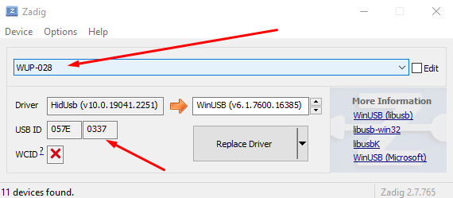
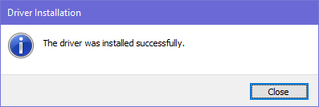

# Adapter Instructions

## GameCube Adapter: OEM or Mayflash (Wii U Mode)

### Installing WinUSB

WinUSB is a driver that allows applications to communicate with hardware. Delfinovin uses it to communicate with the GameCube adapter and read controller inputs. Use Zadig to install the WinUSB driver for the adapter.

1. Go to the [Zadig website](https://zadig.akeo.ie/) and download the latest version.
2. Open Zadig. In the **Options** menu, enable **List All Devices**.
   - This adds the USB devices connected to your computer to the device dropdown.
3. Select **WUP-028** from the dropdown. Its USB ID should be **0573 0337**.
   - If **WUP-028** does not appear and you are using a third-party adapter, look for a USB device with the ID above. The remaining steps are the same.

   

4. Select **WinUSB** in the driver box on the right, then click **Replace Driver**. Accept any system driver prompts that appear.
   - Driver installation may take a little while.
5. When Zadig confirms that installation is complete, close it and continue to the next step.

   