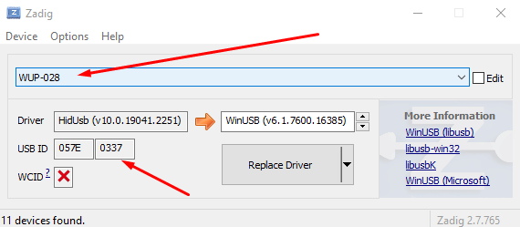
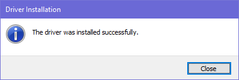

# Adapter Instructions

## GameCube Adapter: OEM or Mayflash (Wii U Mode)

### Installing WinUSB

WinUSB is a driver that allows applications to communicate with hardware. Delfinovin uses it to communicate with the GameCube adapter and read controller inputs. Use Zadig to install the WinUSB driver for the adapter.

1. Go to the [Zadig website](https://zadig.akeo.ie/) and download the latest version.
2. Open Zadig. In the **Options** menu, enable **List All Devices**.
   - This adds the USB devices connected to your computer to the device dropdown.
3. Select **WUP-028** from the dropdown. Its USB ID should be **0573 0337**.
   - If **WUP-028** does not appear and you are using a third-party adapter, look for a USB device with the ID above. The remaining steps are the same.

   

4. Select **WinUSB** in the driver box on the right, then click **Replace Driver**. Accept any system driver prompts that appear.
   - Driver installation may take a little while.
5. When Zadig confirms that installation is complete, close it and continue to the next step.

   

### Using it

- Keep the adapter's switch (if it has one) on the **Wii U** side: the game reads the adapter
  itself over WinUSB, with its own calibration. In **PC** mode the adapter is a generic joystick
  to the operating system, and sticks often reach only part of their travel there.
- Plug the controller in **without touching the sticks or triggers**. Their rest positions are
  measured the moment it connects (on a console, and in Dolphin, it works the same way), and a
  stick held off centre at that moment reads as off centre for the whole session.
- The adapter reports 125 times a second (every 8 ms) by hardware. If a port or a hub slows that
  down, every input takes a little longer.

### The Sticks page

In the game, **Esc > Controllers > Sticks...** shows the selected controller's numbers live:

- both sticks as the game gets them (after calibration), each axis with the least and most seen,
- **Adapter speed**: the measured reports per second. If it shows under **125 Hz** in red, the
  adapter is being read slower than it can go — plug it into a USB port on the machine itself
  (not a hub) and check the switch is on the Wii U side,
- the adapter's own numbers per axis (0-255), with the measured centre and how far each way the
  stick reaches,
- **Recalibrate sticks**: measures the centre and reach again (let go of everything, then
  confirm). Use it if the controller was plugged in with a stick held, or after an hour of play
  on a worn stick.

A dash needs a flick past about 80% of the stick's travel. If dashes feel hard: on the Sticks
page, push the stick all the way left and right and see whether the axis reaches its full scale
(±32767, 100%). If it stops short, use **Recalibrate sticks** with the stick let go, then push it
around its full circle once — the reach is relearned from what the stick can really do.

### PC mode

If you keep the adapter in PC mode instead, the sticks are scaled by the operating system's
driver, not by the game. Recent SDL expands a GameCube controller's range itself (unplug and
replug the adapter to have it measured again). If a stick still stops short — check on the
Sticks page how many percent it reaches — set `outer_zone` a little under that in
`controllers.ini`, e.g. `outer_zone = 88` under `[device gamecube]`.