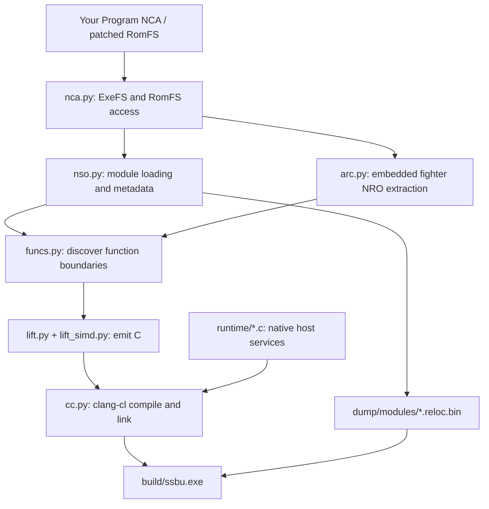
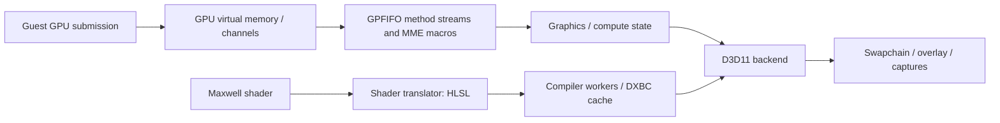

# How WindowSmash works

[← README](../README.md) · [Setup guide](BUILDING.md) · [Multiplayer](MULTIPLAYER.md) · [DLC and unlocks](DLC-AND-UNLOCKS.md) · [13.0.5 update](UPDATES.md)

WindowSmash is a static recompiler plus a Windows compatibility runtime, specialized for this game. CPU code is translated before launch. GPU programs are translated when encountered. Selected operating-system and SDK entry points are implemented natively, while the remaining game and SDK code executes as compiled guest functions.

This document describes the checked-in implementation. Implemented paths and developer test tools should not be read as a compatibility guarantee for every mode, fighter, stage, or machine.

## Contents

| Section | Covers |
| :--- | :--- |
| [1. From extracted modules to a Windows executable](#1-from-extracted-modules-to-a-windows-executable) | Inputs, function discovery, translation, module placement, incremental builds, the compile ladder, the instruction set, the game version, the imports check. |
| [2. Loading, symbols, and guest execution](#2-loading-symbols-and-guest-execution) | Mapping, binding, native replacements, exceptions. |
| [3. Native services](#3-native-services) | The runtime's service implementations, files and fonts, memory mappings, the rollback ring. |
| [4. The graphics path](#4-the-graphics-path) | GPU commands, the D3D11 back end, shader compilation, audio and video. |
| [5. Multiplayer transport](#5-multiplayer-transport) | The relay, the lobby and direct connections. |
| [6. DLC and fighter unlocks](#6-dlc-and-fighter-unlocks) | Installed-content reporting and save editing. |
| [7. Tool reference](#7-tool-reference) | Every tool in `tools/`. |
| [Verification and debugging](#verification-and-debugging) | Tests, the overlay, reports and diagnostic switches. |
| [Build boundaries](#build-boundaries) | What is source, and what stays local. |
| [Test runs](#test-runs) | Fast-forward, input counted in frames, movie skip, the fight hash, the deterministic mode, the fixed seed, the debug match and its end. |

## 1. From extracted modules to a Windows executable



### Inputs and discovery

[`nca.py`](../tools/nca.py) reads package headers, ExeFS containers, and RomFS tables using keys supplied locally. [`nso.py`](../tools/nso.py) handles module decompression and dynamic metadata, including imports, exports, relocations, and information useful for ELF conversion.

[`funcs.py`](../tools/funcs.py) finds function entries from exception-frame tables, exported function symbols, relocations into executable memory, initialization arrays, direct call targets, and recognizable import stubs. These sources provide more structure than a linear disassembly alone. Exception metadata also supplies extents used by the recompiler.

Fighter modules live inside `data.arc`. [`arc.py`](../tools/arc.py) resolves hashed archive paths and reads the compressed filesystem metadata. Its `nro` command extracts known modules from `prebuilt:/nro/release/`. The known-name list is 13.0.5's 98 modules.

### Translation

[`recomp.py`](../tools/recomp.py) orchestrates image preparation, C emission, incremental compilation, and linking. Each guest function becomes a C function accepting a `Cpu *` context. [`lift.py`](../tools/lift.py) emits integer/control-flow operations; [`lift_simd.py`](../tools/lift_simd.py) handles AdvSIMD/NEON operations with explicit vector lanes.

[`runtime/recomp.h`](../runtime/recomp.h) defines the shared contract:

- 31 general registers, the guest stack pointer, 32 vector registers, FP control/status, and thread-local register state.
- Guest memory operations expressed as host accesses to the mapped guest addresses.
- Function lookup for guest code pointers and cached indirect branch targets.
- Helpers for atomics, arithmetic, floating-point behavior, traps, and exception transitions.

Direct branches can target generated C labels/functions. Indirect calls resolve guest code addresses to native function pointers. Tail-call helpers keep supported guest tail transfers from accumulating unnecessary host stack frames. Unsupported instructions or unavailable targets can produce a trap; they do not establish complete instruction coverage.

Exclusive loads and stores, of one register or a pair (`ldxr`/`stxr`, `ldxp`/`stxp` and their acquire/release forms), keep the address and the value the load read in locals of the function. The store is a compare-and-swap against that value, and succeeds only at the same address. Its status register is 0 on success, 1 on failure. A pair of W registers is one 8-byte location. A pair of X registers is one 16-byte location, read whole and written with a 16-byte compare-and-swap (`ld128`, `lda128`, `cas128` in `recomp.h`: `ldp` and `casp` on arm64, `cmpxchg16b` on x86-64). The ARMv8.1 atomics (`cas`, `casp`, `ldadd` and the rest) and ARMv8.3's `ldapr` trap: the console's Cortex-A57 is ARMv8.0 and has none of them.

The build disables floating-point contraction and fast-math-style assumptions to preserve guest arithmetic behavior. `clang-cl` produces x64 object files, then links them with the native runtime and Windows libraries.

### Stable module placement

The primary modules have explicit guest bases in `recomp.py`: `main`, `subsdk0`, and `sdk`. Extracted NRO modules receive aligned address ranges, recorded locally in `dump/nro/bases.txt`. The generated registry binds build IDs to the matching compiled module.

That address manifest is a build input. Preserve it when incrementally rebuilding an existing installation; generated code and relocation images must agree on placement.

### Incremental builds

Each module's build folder has a `module.txt` stamp: build ID, address, name, and a fingerprint of the tools that generated it (the recompiler's sources and the runtime's list of native functions). With the same stamp, [`modcache.py`](../tools/modcache.py) leaves the generated C as it is, and the build only checks it for objects to compile. After a change to the recompiler, the C is generated again, but only changed files are compiled.

Whether an object is current goes by content, not by date ([`objcache.py`](../tools/objcache.py), in the Windows and Linux builds). Each build folder's `objcache.json` records each object's key: a SHA-256 of its C, the runtime headers it includes (`recomp.h` or `module.h` and the headers they include; a file with hook slots includes `hookable.h` too, and only those files are compiled again when it changes), the compiler (its path and what `--version` prints) and the whole compile command, with its optimisation level and instruction set. A change to any of them compiles the object again; a file saved again unchanged does not. The generated C is compiled without the runtime's own defines and include folders (SDL3, libopus, libvpx: `cc.GAME_CFLAGS`), which it cannot see, so their coming and going compiles only the runtime again. The key names a file and its object by their names in the build folder, so the folder spelled another way (`build\main`, `.\build\main`, a full path), or moved, compiles nothing again. A source with the same size and modification time as last time is not read again. A key is recorded only once its object has compiled, so a stopped build carries on where it stopped. A file the compiler crashed on and compiled at `/O1` instead keeps its own level's key, so it is not compiled again at every build. A file [the compile ladder](#the-compile-ladder) compiled with its longest functions unoptimised, or whole at `/Od`, is recorded with the command it was compiled with. The runtime's objects are kept the same way, with every runtime header. A game folder that an older version built has objects but no record. There, an object newer than its C and the runtime headers can be taken as current (what the old rule, by date, did) and recorded, so that updating does not compile the whole game again. The date cannot say what an object was compiled with, so that is only for a build whose flags are the ones the older versions compiled with, for the instruction set the folder was built for (`isa.adopts`: `isa.LEGACY_CLANG_CL`, `isa.LEGACY_CLANG`). None is today: avx2's flags have changed since the older versions ([the instruction set](#the-instruction-set)), and they never built for x86-64-v2, so a folder an older version built is compiled again whole, once. A record that another program holds open is waited for a moment; one that still cannot be opened stops the build before anything is compiled or removed, rather than compiling the folder again. The macOS build keeps its own record, `build-mac/obj/game_sources.tsv`.

### The compile ladder

No single file can hang or stop a build ([`ladder.py`](../tools/ladder.py), in the Windows, Linux and macOS builds). Every file is compiled as it always was: the same command, at the same level, with the same `--jobs` and priority. Only when that compile crashes, or runs past its time limit, is the file compiled again another way.

**A crash.** The compiler crashed when clang printed its crash report (`PLEASE submit a bug report`, `Stack dump:`, an LLVM fatal error), clang-cl exited with an exception code (0xC0000005 and up), a signal stopped it (Linux, macOS), or clang's driver says its compiler process crashed (`unable to execute command`, `frontend command failed due to signal`). The exit code alone does not tell: Apple clang 21 exits with 1 on a crash, as on an error in the code (254 with `-fno-crash-diagnostics`). A crash comes from a PC short of memory, or not quite stable, and rarely happens twice to the same file. Once the other files are done, the file is compiled again on its own at its level, then one level lower: `/O2` to `/O1`, `-O2` to `-O1`. It keeps its own level's key ([incremental builds](#incremental-builds)). The Linux and macOS builds now do this as the Windows one did. What a crashed compiler was writing is removed (a signal leaves clang's temporary file), and so are clang's bug-report files in the temporary folder. A compile stopped with the build (Ctrl+C) leaves nothing either, and is not taken for a crash.

**Too long.** A few of LLVM's passes are worse than linear in a function of tens of thousands of instructions with thousands of labels. A generated file's time limit is the larger of 10 minutes and 4 times its estimate, at this PC's pace. The estimate is the build's cost model ([`progress.py`](../tools/progress.py)) at the file's level, or what the file took last time if that is more. The pace is the seconds this build has taken for each estimated second, once 60 estimated seconds are compiled. Before that it is the last builds' pace, or 4 when there is none, and it is never taken as less than 1. The limit is worked out again every second as the pace is learned. Time the compiler does not run does not count. A compile is timed by a clock that leaves out the time the PC is asleep: `time.monotonic` on Linux and macOS, and `QueryUnbiasedInterruptTime` on Windows, whose `time.monotonic` counts sleep. A build stopped with Ctrl+Z stops its compilers too, since they stay in its process group. When one of those looks finds that its compiler was stopped and let go on since the last look (`waitid`), the time between the two does not count: the file's limit moves on by that much, and its time leaves it out. A look that comes late only because the PC was too busy counts in full. A PC paging hard, as a compile running away with the memory makes it, is too busy, so that compile is still stopped at its limit. Windows has no such report, and neither has a Python before 3.13 on macOS (no `os.waitid`). There a look more than 5 seconds late is taken for a pause, and the time does not count. On Windows that pause is most often Modern Standby, which suspends the build and its compilers while `QueryUnbiasedInterruptTime` runs on, since standby is the working state, S0. A PC too busy to look on time is not told from one in standby there, so a compile running away with the memory may run past its limit. `SSBU_COMPILE_LIMIT=<seconds>` gives every generated file that limit instead; `0` means none. The runtime's files have no time limit. A setting that is not a number stops the build before it does anything else.

A file over its limit is stopped with every process its compiler started: on Windows with `taskkill /T`; elsewhere each process is found under it with `ps` (or `/proc`), suspended, then killed. The object it was writing is removed, with clang's temporary file for it (`<name>-<random>.o.tmp`). Then the file is compiled again at its level, with its longest functions unoptimised:

1. `optnone` and `noinline` go on every function longer than 20,000 instructions. They are declared in a header beside the object, `<name>.optnone.h`, which is given to the compiler before the file (`-include`, or clang-cl's `/FI`). The definitions in the generated C take the attributes from those declarations, and the C is not changed.
2. Then the same for functions over 5,000 instructions, then over 1,250. A threshold that names no more functions than the one before is skipped. A header that cannot be written (a full disk, say) skips its step.
3. Then the whole file at `-O0` or `/Od`.

A function's size is its count of indented lines in the C: one an instruction, as [`lift.py`](../tools/lift.py) writes them. Each try has a time limit of its own, from its own estimate. A file still over its limit at the lowest level stops the build, and the message names `SSBU_COMPILE_LIMIT`.

Measured with Apple clang 21 on a made-up function in the lifter's layout (labels and gotos):

| Function | `-O2` | `-O2`, `optnone` from `-include` | `-O0` |
| :--- | ---: | ---: | ---: |
| 1,500 lines | 2.5 s | 0.1 s | 0.1 s |
| 3,000 lines | 11.7 s | 0.2 s | 0.1 s |

How much this saves on the game's own files, and how much slower those files then run, are not measured.

`TAIL`'s `musttail` calls stay tail calls with `optnone` and at `-O0`. `tests/test_compile_ladder.py` runs a chain of ten million guest tail calls built at `-O0` (as C, and as C++ like a file with landing sites) and with `optnone` at `-O2`. Without `musttail`, the same chain at `-O0` overflows the stack. With clang-cl at `/Od` the call is a `jmp`. A file with landing sites is compiled through its C++ wrapper. The header comes before the wrapper and declares the functions with C linkage.

**Records.** A file the ladder compiled another way is recorded with the command it was compiled with. Its level is in that command, and the header's SHA-256 is added to the command in its key. Its entry in `objcache.json` says how (`"ladder": {"level": "/O1", "above": 20000}`), with the `SSBU_OPTNONE_ABOVE` threshold the file's own compile had, when it had one (`"from"`). The next build makes the header again from the C and checks that key, if it starts the file the same way. So the file is not compiled again at every build, and it is compiled again once its C, the flags, the headers, the compiler or `SSBU_OPTNONE_ABOVE` change. With `SSBU_COMPILE_LIMIT=0`, it is compiled again the normal way. On macOS, the file's line in `game_sources.tsv` has a sixth field saying the same (`|ladder -O1 optnone>20000:<digest>`).

**Measured times.** Each generated file's compile seconds and level go into the build folder's `compile_times.json` (`build/`, `build-linux/`, `build-mac/obj/`), with its cost-model estimate and its C's SHA-256. On the next build, a file with the same C and level is estimated from its seconds over the last builds' pace, and the progress bar's time left goes by those estimates. Each build starts its files in the order it always has: the Windows build in the manifest's order, the Linux and macOS builds the biggest source first. With `SSBU_LONGEST_FIRST=1` (for benchmarking, below), once one of the files to compile has such a time, they are started longest first instead, a file without one by its cost-model estimate. A file the ladder compiled another way is kept in the file but not counted. When the ladder steps in, the bar takes what is left of the file to be the new try's estimate, from then on, and leaves the file out of the pace. A file the compiler crashed on goes back into the queue.

**The report.** Each time the ladder steps in, the build's log says so once, with the file, what happened, the level it ended at and the seconds. The build lists those files again at the end, and adds them to the build folder's `ladder_report.txt` under the date and the settings.

**For benchmarking.** `SSBU_OPTNONE_ABOVE=<instructions>` is off unless set. It compiles every generated file that has a function longer than that with those functions unoptimised from the start, and the rest of the file at the level it would have without them. A file still over its time limit then steps down to a quarter of the threshold, then a sixteenth. A file whose header cannot be written is compiled whole at that level instead, and recorded as the ladder's. ssbu-recomp's `build_opt.py` compiles this way. The default build compiles a file with a function over 20,000 instructions at `/O1`, whole, and stays so until a benchmark says otherwise. `SSBU_LONGEST_FIRST=1`, also off unless set, starts the files longest first by their measured times. The order is part of how long a build takes when nothing goes wrong, so it too stays as it was until a benchmark says otherwise.

### The instruction set

The Windows and Linux builds compile everything, the generated C, the runtime and libopus, for one x86-64 instruction set ([`isa.py`](../tools/isa.py)): `avx2` (the default, and what every build was before there was a choice, less F16C and MOVBE: clang-cl's `/arch:AVX2 -mfma -mno-movbe -mno-f16c`, clang's `-mavx2 -mfma -mbmi -mbmi2 -mlzcnt -mpopcnt`) or `x86-64-v2` (`-march=x86-64-v2`: SSE4.2 and POPCNT). The lifter's C asks for no extension by name. ARM's fused multiply-add is C's `fma()`, rounded once on either; `__builtin_roundeven` and the bit counts are plain C; half floats and TBL are done in software (`recomp.h`). So the two differ only in the code the compiler makes, and in speed: at `x86-64-v2`, `fma()` is a call into the C runtime and nothing is vectorised wider than 128 bits (by how much that is slower is not measured). Windows' C runtime, on a processor without FMA3, computes `fma(a, b, c)` with a zero `c` as `a * b + c`, which gives +0 for a product too small for a double plus +0, where the fused result is -0; so at `x86-64-v2` on Windows, `recomp.h` computes a zero `c` itself (the product rounded once) and hands the C runtime every other. `x86-64-v2` is the floor because below it the rounding functions become library calls too, and Windows' C runtime has no `roundeven`. `-mf16c` was dropped from both builds: nothing uses F16C. clang-cl's `/arch:AVX2` is Haswell's, with MOVBE and F16C, which the compiler uses unasked (a load and a byte swap become MOVBE); `-mno-movbe -mno-f16c` turn them off. So what this version compiles for `avx2` needs the same of the processor on Windows as on Linux, which is what the program checks for as it starts. What older versions compiled did not: their Windows objects could use MOVBE and F16C, their Linux ones F16C. So their objects are never kept as `avx2`'s ([incremental builds](#incremental-builds)), nor their vkd3d-shader.

Which one: `SSBU_ISA` when set; else `x86-64-v2` if the processor is known to lack something `avx2` needs (Windows' `IsProcessorFeaturePresent`, from Windows 10 version 2004, with `GetEnabledXStateFeatures` for whether the system saves the YMM registers; Linux's `/proc/cpuinfo`); else the build folder's last choice if `SSBU_ISA` made it; else `avx2` if the processor is known to have it; else the last choice, else `x86-64-v2`. A folder with no record but a program an older version linked has `avx2` for its last choice. Every older version built for `avx2`, and its installer stopped for a processor whose name said it had none, so an update on a processor that cannot be asked (Windows before version 2004, a name the installer does not know) keeps `avx2` rather than building again for `x86-64-v2`, slower. Where that is wrong, the program says so as it starts. The build writes what it compiled for into its folder (`build/isa.txt`, `build-linux/isa.txt`, `build-vkd3d/linux/isa.txt`) as it links, and `build_game.py` builds again when today's choice is another. The record is written at the link, not at the start, because it stands for the program beside it too: written by a build that then stopped, it would vouch for the program an earlier build made, for the other instruction set. So a choice `SSBU_ISA` made is kept once a build for it has linked, and one stopped before that is told again. Every object's compile command names the instruction set, so [`objcache.py`](../tools/objcache.py) then compiles every object again, and `codec_libs.py` rebuilds a codec library whose recorded command (`build/codecs/<library>.flags`) differs. A vkd3d-shader without a record, an older version's, is built again. `recomp.py link` and `build_linux.py --link-only` link only when every object is compiled for the build as it is today (else they stop and say so), so the record they write names what every object linked is compiled for.

The program checks the processor before any of its own code runs ([`cpu_check.c`](../runtime/cpu_check.c)). The extensions it needs come from the compiler's own macros where `host.c` is compiled (`cpu_check.h`'s `rt_cpu_needs`), so the check follows the flags, whatever they are. The check asks CPUID, and XGETBV for the YMM registers, and on a processor that lacks something it names what and how to build for it, in a message box and on stderr on Windows, on stderr on Linux, then exits with code 5. `cpu_check.c` alone is compiled for plain x86-64 (`cc.CHECK_CFLAGS`, `toolchain.CHECK_CFLAGS`), so that it runs on any x86-64 processor. It runs from the C runtime's start-up: on Windows as a C initialiser (`.CRT$XID`: after the static C runtime's own, in `.CRT$XIC`, which set up stdio among others, and before every C++ initialiser and `main`; it writes its message with `WriteFile`), on Linux from `.preinit_array` (before every constructor). The macOS build is arm64 and has none of this.

### The game version

WindowSmash builds one version of the game: 13.0.5, its last update. [`game_version.py`](../tools/game_version.py) holds what identifies it: the main module's build ID (`21450C647B8C5940ED5B68218EA128FD3C5D597D`), the update's title version (`0x1F0000`, v31) and data.arc's version field (`0xD0005`). Each step checks what it can see:

| Where | What it checks |
| :--- | :--- |
| A game folder's scan ([`gamefiles.py`](../tools/gamefiles.py), shown in the installers' windows) | The update's title version, else data.arc's version, else the version in the game's control data. Files that name another version get a message saying what to add; files that name none are left to step 4. |
| [`build_game.py`](../tools/build_game.py) step 4 | The build ID of the `main` it copied into `dump/exefs`. Another version's is removed again, and the build stops. |
| `build_game.py` step 6 | data.arc's version in the connected game data ([`arc.py`](../tools/arc.py)), which also catches a `romfs.bin` made by hand from another version. |
| The game, as it starts ([`host.c`](../runtime/host.c)) | Its own `main`'s build ID. A game built from another version shows a plain message and exits with code 4: no crash report. |
| The online lobby ([`ssbu_relay.py`](../tools/ssbu_relay.py)) | The build ID in each join. Another is refused, with a reason the game shows in its overlay: `Netplay: WindowSmash needs game 13.0.5: run the installer again`. |

The runtime and the lobby keep their own copy of the build ID (the lobby is deployed on its own); `tests/test_game_version.py` checks that the copies match.

A folder whose `dump/exefs/main` is another version's, set up before WindowSmash required 13.0.5, is set up again by `build_game.py` once the game folder has 13.0.5: it removes what the game files made (the program, the game data's configuration and the update's files, the DLC list, the fighter modules, `ssbu.exe`) and runs those steps again. The save, the settings, the fonts, a decrypted base and the shader cache stay, and module build folders are generated again where their build ID changed ([the 13.0.5 update](UPDATES.md#a-folder-built-from-another-version)).

### Code tied to the game version

- **Hooks in the runtime** (`HLE_WRAP(<address>)`, in `runtime/hle_fiber.c`, `hle_movie.c`, `hle_net.c`, `hle_online.c`, `hle_each_frame.c` and `hle_fight_test.c`) wrap a guest function that isn't exported, at its 13.0.5 address. Each has a code signature on the line above it (but for the test switches' two, in `hle_each_frame.c` and `hle_fight_test.c`, which wait for theirs: [Test runs](TESTING-RUNS.md#the-code)): a hash (SHA-256, first 16 hex digits) of its first instructions, with addresses masked out, and how many instructions that is. The instructions themselves never go in the source, since they are the game's code; the recompiler stops at a signature that spells them out. It checks that a function starts at that address and that its first instructions hash to the signature; if not, the build stops rather than leave the hook out. `tools/recomp.py wrap-sig <module> <address>` prints a new hook's signature.
- **Hooks by exported name** (`HLE_WRAP_EXPORT(<mangled name>)`) wrap an exported function by its name instead, for one whose address is each install's own (a fighter module's). Every lifted module that exports a function under that name has it wrapped as an `HLE_WRAP` is: the function stays, as `f_<address>_orig`, and every way of reaching it reaches the wrapper (a direct call or jump, an import stub in another module, a pointer, a lookup by address). The wrapper is handed the original it was reached through (`HLE_WRAP_EXPORT(name) { ...; orig(c); }`), so two modules that define the name each keep their own, and since it names no module's function, a build in which no module defines the name links as it is: the wrap does nothing there. A function exported under several wrapped names (an alias, or identical code the linker folded into one) has every one of their wrappers, one inside the other in the order of the runtime's sources: callers reach the first, whose `orig` is the next, and the last one's is the function. A name both replaced (`HLE`) and wrapped, one exported as something other than a function, or a function wrapped both by address and by name stops the build. So does either macro anywhere but at the start of a line in its form, outside comments (`static HLE_WRAP_EXPORT(...)`, `HLE_WRAP_EXPORT (...)`, indented), and any other name in the code that starts with `HLE_WRAP` (a macro standing for one, `HLE_WRAP_##k`, a name a line splice cuts in two): it would compile, and nothing would be wrapped. Comments and strings may mention them. The preprocessor's conditions are not followed: a form under `#if 0` is read as a wrap, and the build then fails to link where a module has the function. A signature goes on the line above as for `HLE_WRAP` (the four of the test switches, in `hle_each_frame.c` and `hle_fight_test.c`, wait for theirs); `tools/recomp.py wrap-sig <module> <exported name>` prints it. The names are part of the tools fingerprint, in the sources' order, as the addresses are.
- **Frame hooks** ([`frame_hooks.h`](../runtime/frame_hooks.h)): the game's two once-a-frame points, the graphics module's frame end (`FRAME_END`) and the fighters' frame line (`sys_line_system_control_fighter`), are each wrapped once, in [`hle_each_frame.c`](../runtime/hle_each_frame.c), since one function can have only one wrap and both the test switches and rollback need them. Code that needs them registers a handler to run before the game's function, after it, or both, with an order: handlers nest like wraps, the lowest order outermost (its before first, its after last), and one order nests in the order of registration. With nothing registered, a wrap only calls the game's function. `hle_each_frame.c` sorts before `hle_fight_test.c`, which had both wraps, so the exported names keep their order in the tools fingerprint.
- **The exact-register list** ([`tools/hooks.txt`](../tools/hooks.txt)) names functions, by their 13.0.5 address in `main`, `subsdk0` or `sdk`, where a hook needs the whole register state of the code that calls them. The register cache ([`regcache.py`](../tools/regcache.py)) keeps guest registers in C locals and, at a call, brings the context up to date only with what the ABI lets the callee read (x0-x18, x29, x30, SP), reading back x0-x18 and x30 afterwards; a hook would find stale x19-x28 there and lose what it writes to x19-x28, x29 or SP. Every direct call to an `exact-callee` stores every register the caller has changed and reads back every register it uses; every call an `exact-caller` makes (direct, through a pointer, svc) does the same. A hook's caller is the code it returns to, so in every module the recompiler also makes exact the calls to a function that reaches an exact-callee without a call of its own (by `b`, a conditional branch, or running on into it, directly or through others that do), and the calls through an import stub bound to the exported name of the exact-callee or of such a function (a wrapper ending in `b impl`), which is how other modules call them: the names main, subsdk0 and sdk export, bound as the loader binds them (the first of the three to export a name defines it), followed from module to module until no more are found. What a fighter module exports is followed only inside that module. A register the caller never writes holds what the context held when the caller was entered. A call through a pointer, or a jump through a register, cannot be known to reach an exact-callee, so the function that call returns to is listed as an exact-caller instead; what an exact-caller itself jumps to without a call sees registers only as exact as the call that reached the exact-caller. With the register cache off (`SSBU_REGCACHE=0`, or functions over 20,000 instructions) every call is exact already. An entry may carry a signature in the HLE_WRAP form, and the build stops at an address where no function starts, a signature that doesn't match, a line it can't read (or a file not saved as UTF-8), or anything that could be an instruction word: a run of 8 or more hex digits other than an address or a signature's hash (after `sha256 `), hex digits masked with a run of dots as the old signatures spelled them, or a row of 4 or more bytes; the message quotes what it found. The entries are part of the tools fingerprint, so a change generates the C again. The list is empty for now: the hooks that need it come with ssbu-recomp's modding port.
- **Hook slots** (`hookable <address> [<signature>] <name>` in the same list; [`hookable.h`](../runtime/hookable.h), [`hle_hooks.c`](../runtime/hle_hooks.c)) let a hook take over a listed function at run time. Its lifted code becomes `f_<address>_body`, compiled out of line (`noinline`) and never called by name, and a global `rt_hook_<address>` holds a pointer, the slot, that starts out at it. Every direct call and tail call to the function loads the slot and calls what it holds (a tail call stays one: `musttail` on the indirect call), and `f_<address>`, which the module's table gives `rt_lookup` (indirect calls, other modules' import stubs, `rt_call`), is a forwarder that does the same; so every way the guest reaches the function goes through the slot. An unlisted function is generated exactly as before and costs nothing; a listed one costs a load and an indirect call per call. A hookable function is an exact-callee too, with the same closure over tail calls and import stubs, so a hook in its slot sees x19-x28, x29 and SP as code that calls it directly, by a tail call or through an import stub left them, and what it writes comes back. A call through a pointer (a vtable, a function pointer) reaches the slot as well, but as for any exact-callee its caller is exact only if listed as an exact-caller: otherwise the hook sees x0-x18, x29, x30 and SP and can change x0-x18, but finds stale x19-x28 and loses what it writes to them, x29 or SP. A branch from the function back to its own first instruction stays a jump inside its code, which no hook sees. The function's own code stays a function of its own in the linked program: clang-cl's `/O2` puts every function in a COMDAT section, which lld-link's default `/OPT:ICF` may fold with an identical one, so on Windows it goes in a section that is not a COMDAT (`.text$rt_hook`); the macOS link passes `-no_deduplicate`, the Linux link no `--icf`, and no build uses LTO. Calls load the slot with acquire and a hook is stored with release, so one may go in while other threads call through the slot. For hooks: `rt_hook_slot(guest_addr)` is the slot of the hookable function starting there (NULL if none), `rt_hook_body(guest_addr)` the function itself, `rt_hook_list()` every slot; `rt_hook_install(slot, hook, &next)` puts a hook in, first setting `next` to what it replaces (the function, or a hook put in earlier), so the hook runs the original by calling `next(c)`; `rt_hook_remove(slot, hook, next)` takes it out again if it is still the last one put in. No machine code is patched, so a slot needs no instruction-length decoder, trampoline or writable code on any architecture (x86-64 or arm64). How Phase 7's hooks use slots (one hook or a chain per function, how a mod registers one) is left open. Crash reports name the function's own code by its guest address. `recomp.py build` runs [`hook_inline_check.py`](../tools/hook_inline_check.py) on every file it generates when the list has a hookable function, and stops if one is reached other than through its slot; the unit tests ([`test_hookable.py`](../tests/test_hookable.py)) also compile a made-up module at -O2 and read the object (clang-cl's COFF directly; ELF and Mach-O with `llvm-objdump` or `objdump`, skipped without one): the function's code is there, nothing calls it by name, and on Windows it is in no COMDAT. A function whose calls become the host's setjmp cannot be hookable.
- **Unlock All Fighters** writes at 13.0.5's save offsets. It reads main's build ID and changes nothing unless it is 13.0.5's (`LAYOUTS` in `tools/unlock_all.py`, `$knownLayouts` in `tools/Unlock-All-Fighters.ps1`).

### The imports check

Before compiling, `recomp.py all` lists each module's imported symbols that no module exports and the runtime doesn't implement, in `build/imports.unresolved.txt`. `recomp.py check <exefs>` runs that check on its own.

- A **strong** import on that list would trap if called: the runtime lacks a native function the game needs.
- **Weak** ones read as 0 and are normal. 13.0.5 has 0 strong and about 410 weak.

## 2. Loading, symbols, and guest execution

[`host.c`](../runtime/host.c) maps `*.reloc.bin` images at their expected guest addresses, registers module ranges, publishes exports, resolves imports, and applies symbol relocations. Function metadata associates guest addresses with compiled host functions.

Native replacements use `HLE(symbol)` declarations. The build detects those names and redirects applicable guest entry points to runtime implementations. Unresolved strong imports receive diagnostic handlers rather than silently acquiring arbitrary implementations.

Startup enters the guest SDK initialization path and eventually `nnMain`. Guest execution runs on a Windows thread with a large reserved stack. Modules loaded later through `nn::ro` are matched by build ID, mapped, bound, and initialized when requested.

[`hle_ro.c`](../runtime/hle_ro.c) can save an unrecognized module image into the local NRO dump directory. Harvesting a module does not compile it: a later rebuild must translate and link it. The runtime's missing-module behavior is a development aid, not a substitute for preparing the full module set.

### Exceptions and non-local control flow

The guest's own unwind implementation interprets guest exception metadata. [`hle_unwind.c`](../runtime/hle_unwind.c) bridges its final register/context transfer to the corresponding recompiled host frame using a structured host exception and landing-pad filters. [`hle_setjmp.c`](../runtime/hle_setjmp.c) and [`hle_fiber.c`](../runtime/hle_fiber.c) implement related control-flow bridges.

## 3. Native services

| Source | Responsibility |
| :--- | :--- |
| [`kernel.c`](../runtime/kernel.c) | Guest thread contexts, synchronization, handle/state tracking, memory operations, and supported supervisor calls. |
| [`clock.h`](../runtime/clock.h) | The one clock behind the guest's system tick, the kernel's timeouts, and the renderer's timing: Windows' `QueryPerformanceCounter`, or, where a read of it is slow (a PC timed by the HPET), the CPU's invariant time stamp counter scaled to the same nanoseconds. `SSBU_CLOCK=qpc` or `tsc` picks one; `build\play.log`'s `[clock]` line says which. |
| [`sleep.h`](../runtime/sleep.h) | The guest's `svcSleepThread`: a sleep of the nanoseconds asked, never shorter. On Windows it waits on a high-resolution waitable timer (one a thread, Windows 10 1803 and later; `Sleep` in whole milliseconds without one), on Linux with `clock_nanosleep`, on macOS on a critical kqueue timer. It used to round up to whole milliseconds; `SSBU_SLEEP=ms` brings that back (a guest loop that polls with short sleeps goes round far more often now: on an M5 Pro a sleep of 1 us took 3-32 us at the median, 200 us some 205-225 us, against some 1 ms for both before). The kernel's timed waits (`WaitSynchronization`, the address arbiter's and condition variables' timeouts) still round their time to milliseconds. |
| [`ipc.c`](../runtime/ipc.c), `ipc_*.c` | Service request handling and selected audio, display, Mii, and related interfaces. |
| [`hle_fs.c`](../runtime/hle_fs.c) | RomFS reads, save/cache mounts (the save journaled, as on the console), and host file operations. |
| [`hle_env.c`](../runtime/hle_env.c), [`hle_applet.c`](../runtime/hle_applet.c) | Account/environment behavior, applet-facing functions, and installed add-on reporting. |
| [`hle_hid.c`](../runtime/hle_hid.c), [`hle_pad.c`](../runtime/hle_pad.c) | Up to eight players' pads, keyboard input, rumble, and optional scripted input. An input thread owns SDL3 (loaded from `SDL3.dll` at run time; XInput pads 1-4 without it) and copies each pad's state for the game's threads; `controllers.ini` maps pads to players and buttons. GameCube controllers (Nintendo's adapter, through SDL3's own driver) report the console's GameCube style, with analog triggers and an on/off motor, so the game uses its GameCube controls. On Windows, [`hle_padusb.c`](../runtime/hle_padusb.c) reads Nintendo's GameCube adapter (WinUSB or Windows' HID driver) and the Switch 2's GameCube controller (started through its bulk interface) itself, through Windows' own libraries, because SDL3.dll has no libusb; SDL is told to ignore both (`SSBU_GC_USB=0` leaves them to SDL). |
| [`hle_pl.c`](../runtime/hle_pl.c) | Shared-font loading from locally supplied `.bfttf` files. |
| [`hle_nv.c`](../runtime/hle_nv.c) | Supported GPU-driver interfaces, address mapping, and channel operations. |
| [`hle_net.c`](../runtime/hle_net.c), [`net_relay.c`](../runtime/net_relay.c) | Virtual networking, Local Wireless, socket behavior, relay transport, and optional UPnP. |
| [`hle_online.c`](../runtime/hle_online.c) | The game's Online mode: NEX and Pia sent to the online lobby's game server, NEX's TCP streams carried to the lobby, and the SHA-1 its WebSocket needs. |
| [`hle_offline.c`](../runtime/hle_offline.c) | Selected offline service behavior needed by the target game. |

These are targeted service implementations, not a complete implementation of the console OS. Some functions return fixed or limited behavior appropriate to the supported paths.

### Threads and handles

Each guest thread runs on a host thread of its own (with a 256 MiB reserved stack, since guest call depth is host call depth), with its own register context and a 4 KiB thread-local region from `0x7780000000` up. A handle names a slot in the kernel's table of 4096 objects (threads, events, IPC sessions, transfer memory), and waits and mutex hand-overs look through a table of up to 1024 threads.

By default nothing of a thread is ever freed, as before: its slot, its handle and its thread-local region stay after it has exited and its handle is closed, so a session that has made 1024 threads (the main thread among them) stops at the next one with "too many threads", however few are running. `SSBU_THREAD_RECYCLING=1` gives threads the console's lifetime instead: a thread object lives while the thread runs or a handle to it is open. Once it has exited and its handle is closed, its slot and handle go to the next object and its thread-local region (zeroed) to the next thread; its context and its host thread's handle are freed once the host thread has ended. An exited thread stays signalled while its handle is open, and a wait holds the objects it waits on, so a thread whose handle another thread closes during the wait is still seen to end.

Handle values then take the console's layout, as Atmosphère's open-source kernel (mesosphère, `kern_k_handle_table.hpp`) has it: the slot in the low 15 bits and, above them, a linear id from 1 to `0x7FFF`, here a count of the slot's uses. Values stay nonzero and below `0x40000000`, the waiters bit of the userspace mutex words that hold owner handles. A handle used after its `CloseHandle` names nothing, not the slot's next object: `StartThread`, `GetThreadPriority` and `SetThreadPriority`, `GetThreadCoreMask` and `SetThreadCoreMask`, `SignalEvent`, `ClearEvent`, `CloseHandle`, `ResetSignal`, `WaitSynchronization`, `CancelSynchronization`, `SendSyncRequest` and `GetThreadId` refuse it with `0xE401` (invalid handle); `GetInfo` answers only the process's own values and does not look at its handle. `svcCreateEvent`'s two handles (one value here) and each IPC copy of a handle count as references of their own, each dropped by its own `CloseHandle`. That the SDK closes both of an event's handles is inferred, not seen in the game: libstratosphere, Atmosphère's open reimplementation of `nn::os`, does so in `DestroyInterProcessEvent`. A handle nothing closes keeps its slot for good: one of an event's two values left open, or one the game moves to a native service, which keeps none. The log says once when half the table's 4095 slots are in use (`[kernel] half the handle table in use`, with a count of each kind of object), since a slow leak would end at "out of handles". Also not freed with a thread, outside the kernel: the Linux and macOS platform layer's 256 KiB signal stack of each host thread (address space only, until a signal runs on it), and the fiber slot of a thread the game made a fiber ([`hle_fiber.c`](../runtime/hle_fiber.c), 16384 at most).

Without the switch, a handle is `0xA000` plus its slot, `CloseHandle` frees events, sessions and transfer memory at once and keeps threads, and `SetThreadCoreMask` takes any handle, as before. The switch stays off by default until a long play session has been run with it; [`kerneltest.c`](../tools/dev/kerneltest.c) checks both behaviours offline.

### Files and fonts

`dump/modules/romfs.cfg` contains two lines: a host file path, then the byte offset at which an unencrypted RomFS begins. Relative paths resolve against the game's working directory. The runtime reads RomFS metadata and game files in place rather than extracting all assets.

Save data and cache files are host directories: `save/<user>` and `cache`. `SSBU_DATA_ROOT` can redirect those per-run files for testing. A network identity is separate from save contents: copying `netplay_id.txt` to another PC can make two installs appear as the same player.

The save is journaled, as on the console: nothing the game writes is kept until it calls `nn::fs::Commit`, and a commit lands whole or not at all. `save/<user>` holds the last committed save, and only a commit writes there. Mounting the save makes a working folder beside it, `save/<user>.work.<process id>`. A file the game opens for writing is copied there first, new files and folders are made there, and deletions are remembered; the game sees the working folder over the committed one. A commit flushes the changed files, writes the list of changes to `save/<user>.journal.<process id>`, flushes it and renames it to `save/<user>.commit`. That rename decides the commit. The changes are then applied (each file moved over the committed one) and the marker deleted. A process stopped before the rename leaves the old save; one stopped after it has its commit finished by the next mount. A commit decided but not applied (a file the PC refuses to replace) keeps its marker and working folder: every later call on the save tries it again, and so does the next mount, which fails until it succeeds. Unmounting discards uncommitted changes, as the console does, and the next mount deletes the working folders of processes that no longer run. One process at a time commits: a named mutex on Windows, a lock file `save/<user>.lock` on Linux and macOS. A process mounts a save once. A file opened for reading before the same file is opened for writing keeps reading the committed copy. On Windows a committed file still open for reading is replaced with a POSIX-style rename (`FileRenameInfoEx`; `MoveFileEx` refuses), and a read-only mark is cleared first. On Linux and macOS the platform layer makes the protocol hold through a power cut: `MoveFileExA` with `MOVEFILE_WRITE_THROUGH` flushes the moved file and its folder, and `FlushFileBuffers` uses `F_FULLFSYNC` on macOS. On Windows, NTFS's log keeps the steps in order, but the last of them may reach the disk a few seconds after `Commit` returns. Saves made before the journal are simply the committed save: nothing is converted. The cache is written directly.

The font service loads six firmware font files, decodes their container format, and maps shared font memory. Fonts are user-supplied runtime inputs, not repository assets.

### Memory mappings

Thread stacks are mapped with `svcMapMemory`: the pages of memory the game allocated appear in the stack area, from `0x7700000000` up. On the console the source is then locked, with no access at all, until the unmap. The kernel copies instead: the destination gets a copy of the source, and the unmap writes it back over the source before the destination is decommitted (the renderer is told, as for any memory decommitted). A game that keeps to the console's rules cannot tell the difference; the cost is two copies and the destination's memory while the mapping lasts. On an M5 Pro (macOS), mapping and unmapping 1 MiB took some 60-70 and 20-30 µs (16 KiB: 2-3 µs each), and 64 mappings of 1 MiB with 16 KiB of each written added 64 MiB to the process's memory footprint. As aliases made with `mach_vm_remap` they added 1 MiB, and a 1 MiB alias made and removed took some 5 µs. Each status line (`--status`) gives the mappings made, how many are mapped and the most at once, and the time the copies took, so a session's log shows whether they matter.

An alias, the same pages at both addresses, needs the source in memory that can be mapped twice. On Windows that is a pagefile-backed section mapped into placeholders (`MapViewOfFile3`, Windows 10 1803 and later), whose committed pages `VirtualFree` cannot decommit and `GetWriteWatch` does not watch; on Linux a shared mapping (a memfd); on macOS anonymous memory will do (`mach_vm_remap`), but in 16 KiB pages, so only where source and destination sit at the same offset in one (and whatever shares a host page with the source then appears at the destination too). The heap and the alias area, where a stack's memory can come from, would have to be allocated that way. That has not been done.

`SSBU_MAP_GUARD=1` makes a mapping's source inaccessible while it is mapped, as on the console, so that a stray access faults, and the crash report names the guest function, instead of reading the stale copy or writing what the unmap then overwrites. It guards a source that the memory map has as read-write memory, outside the alias area (where the write watch sets the pages' protection itself, on macOS and on Linux before 6.7), and on macOS only the 16 KiB host pages wholly inside it. `svcQueryMemory` reports the source as it does without the switch, and `kernel_read64` (the kernel's read of memory that may be gone, which `hle_fiber.c` looks into dropped fibers with) treats the guarded pages as not mapped rather than fault on them. A system call that would write into them (a file read or a socket receive into the source) fails with an error instead of faulting, so the game sees a failed call there, not a crash. It is off by default until a play session has been run with it. The log says when it is on, and the status line how many sources it guarded. With `SSBU_ROLLBACK_RING` it is left off, and the log says so: the ring reads every mapped page, and the write watch then protects the heap's pages itself. [`maptest.c`](../tools/dev/maptest.c) checks both behaviours offline.

### Rollback ring

`SSBU_ROLLBACK_RING=1` (8 frames), or a number of frames from 2 to 64, keeps the guest's writable memory as it was at each of the last frame ends ([`hle_rollback_ring.c`](../runtime/hle_rollback_ring.c), [`rollback_ring.h`](../runtime/rollback_ring.h)): groundwork for rollback netplay. Any other value, or none, leaves it off, and then nothing of it runs: its frame end handler is not registered, and the renderer asks the system's write watch as it always has.

A frame holds every page of the memory map's read-write regions: the heap, alias memory, the stacks and thread-local regions, and the modules' data. The newest frame is a copy of each page (none for a page of zeros); each older one is an undo log, the copies of the pages that changed after it. A save compares the pages that may have changed with their copies and copies only those that differ; putting a frame back undoes the logs down to it and writes each page they name once. Which pages may have changed: those the write watch reports, every page of the modules' data (which `host.c` maps outside the watched areas, so it is compared in full at each save), and the pages mapped or unmapped since. The kernel's lock is held through a save, so every guest system call that uses the kernel's state (memory, waits, signals, locks; not service requests or sleeps) waits for it.

The write watch is shared ([`kernel_watch.h`](../runtime/kernel_watch.h)). The renderer resets the alias area's bits as it takes them, so a second user asking the system would lose the renderer's news or steal it. With the switch on, `kernel_init` reserves the heap, stack and thread-local areas with the write watch too (four watched areas, the Linux layer's limit), the kernel takes the system's bits in one place, and the renderer and the ring each keep a bit a page of their own: a write is news to each until that one takes it. A page that is decommitted is news to the ring. The renderer's bits are left as they are, so it may hear of a page it would not have heard of alone (an upload more), but never misses one. With the switch off, `kernel_write_watch` is `GetWriteWatch`. Sharing costs something only with the switch on: a renderer's first, cheap question now takes the system's bits whenever any are set, and the ring takes all four areas' bits at each frame end. On macOS, and on Linux before 6.7, where the watch is page protection, the first write to each page after a frame end therefore faults. On Windows and newer Linux the system notes writes itself.

In a run the ring only saves, at each frame end, after the fight test's handler ([frame hooks](#code-tied-to-the-game-version)), so it saves the frame end's report as `SSBU_DETERMINISTIC` leaves it. The log has a line for the first save (its pages, those not zeros, its time, the memory held) and one for each 300 saves after it: the pages written, changed and compared a frame, a save's time and the memory held. It never puts a frame back in a run. The game's other threads run on through a save, so a frame is not one moment of every thread, and memory changed under running threads would be read half old, half new. Putting a frame back needs the guest's threads stopped at known places first: later work, like the state below. [`ringtest.c`](../tools/dev/ringtest.c) puts frames back on made-up memory.

What a frame does not hold, all outside guest memory:

- **Threads**: `kernel.c`'s `threads[]` (each `KThread`'s wait, queue, priority and core) and each thread's registers, in a `Cpu` the kernel allocates on the host. A guest call's depth is the host's (`HOST_STACK`), so the return addresses of every guest thread's calls are on host stacks too. Fibers (`hle_fiber.c`'s `fibs[]`) have host stacks of their own.
- **Kernel objects**: `objects[]` (events' signalled state, sessions), the wait queues, the memory map itself (`regions[]`, `maps[]`, `heap_size`, the thread-local regions handed out). A frame put back leaves out the pages that are not mapped now, and leaves zeros in pages mapped since, as they were when new.
- **Services**: `ipc.c`'s sessions and domains; `hle_hid.c`'s controllers; `hle_fs.c`'s open files and the save journal; `hle_net.c`'s and `hle_online.c`'s sockets and streams; `hle_movie.c`, `hle_input_seq.c`, and `hle_fight_test.c`'s own state (the fighters' frame counts, the hash, the dropped-frame and step counters, the fixed seed's generator).
- **GPU**: `hle_nv.c`'s memory handles, GPU address space and sync points; `gpu.c`'s channels and engines (their register files, the sync points' values: `gpu_syncpt_min`, `gpu_syncpt_max`); the renderer's textures and buffers (`gpu_d3d11.c`, `gpu_metal.m`). Where the GPU wrote last (a GPU-resident region), guest memory under it is stale, and so is a frame's copy of those pages.
- **Audio**: `ipc_audio.c`'s queue of mixed sound and the device's place in it; `ipc_opus.c`'s decoders.
- **Time**: the clock and the system tick go on (`rt_clock_ns`, `rt_ticks`), and so do the timeouts of waits in progress; `ipc_vi.c`'s vsync thread and buffer queues.
- **Memory outside the map**: the guest addresses standing for native functions (`NATIVE_BASE`), and everything the runtime allocates on the host.

## 4. The graphics path



[`gpu.c`](../runtime/gpu.c) parses Tegra/Maxwell command streams, engine bindings, method writes, macros, transfers, synchronization, and dispatch/draw events. [`gpu_host1x.c`](../runtime/gpu_host1x.c) covers the Host1x/video-related job path. The backend interface separates command/state handling from rendering.

As on the console, the GPU runs alongside the CPU. A submission is copied into a queue and the driver gets its fence back at once; a GPU thread of its own ([`gpu_queue.c`](../runtime/gpu_queue.c)) runs the queue in order, and a submission's sync point reaches its fence when it has run, which is what the driver's fence waits wait for. A buffer queued for display is shown once everything submitted before it has run, and unmapping GPU addresses or decommitting memory that holds GPU allocations waits for the queue first. Rendering inside the submitting call instead put all of it on the game's main thread (in an 8-player match about 60% of that thread); `SSBU_GPU_THREAD=0` still does that, for comparison.

[`gpu_d3d11.c`](../runtime/gpu_d3d11.c) creates D3D resources, tracks render targets and pipeline state, uploads or retains guest buffers, handles graphics/compute work, and presents the result. [`gpu_display.c`](../runtime/gpu_display.c) owns the window (windowed, borderless, or full screen, from `display.ini`) and the pacing of presents: a 60 Hz high-resolution clock, the same clock presenting with tearing allowed for variable-refresh monitors, or the monitor's own refreshes. The game's 1920 x 1080 picture is drawn first, then scaled to the window at 16:9. With `display.ini`'s `render_scale`, every render target is created that many times the game's size: the game still works in its own pixels, and the renderer scales what is given in pixels (viewports, scissors, 2D-engine blits) to each target's size. Shaders sample with normalized coordinates, so almost none need to change; the few that read their pixel's position or step in texels (texel offsets, texel fetches) get the scale through spare words of the per-draw constants, and those few cache their compiled code under a salted hash so files from before scaling are not used for them. A picture bigger than the window is averaged down to it in linear light. [`gpu_texture.c`](../runtime/gpu_texture.c) contains texture-format/layout helpers. [`gpu_shader.c`](../runtime/gpu_shader.c) decodes guest shader instructions and emits HLSL.

### Shader compilation and the driver fix

CPU code is compiled ahead of time; GPU shaders remain demand-driven. A new shader is translated to HLSL, then queued for compilation. Persisted DXBC cache loads have priority over new HLSL compiles.

The current implementation uses up to 16 dedicated compiler workers with 64 MiB reserved stacks. The `SSBU_COMPILE_THREADS` environment variable controls the worker count within the implementation's limits. Shader cache entries include a translation-version marker and relevant shader/state hashes.

The shader fix addresses driver compilation on small internal worker stacks. A second D3D11 device, created with internal threading optimizations disabled, warms driver compilation on WindowSmash's own compiler threads. The rendering device retains its normal threading behavior. Compilation stages and current jobs are retained for crash reporting.

At start, the compiler threads create every cached DXBC program of the current cache version that the game has used, on both devices, on a queue below the game's own loads and compiles (`SSBU_SHADER_PREWARM=0` turns this off). When the game first uses such a program, it is still translated for its interface, but the prepared object is taken instead of a new compile, so its draws are not skipped. [`gpu_shader_cache.h`](../runtime/gpu_shader_cache.h) holds what the renderer and the ahead-of-time compiler must agree on: the cache version, the program hash, the file name, and the compiler flags. [`shader_aot.py`](../tools/shader_aot.py) finds the game's programs in `data.arc` and compiles them into the cache in advance; its files stay dated 2001 until the game first uses them, and the start-up preparation leaves them out until then.

AMD's Direct3D 11 driver makes a program's GPU code on threads of its own, not inside the call that creates the program or the draw that first uses it, and the GPU waits for that code. The driver keeps that code in a disk cache under the executable's name, so a program it has made before costs about a millisecond; one it has not made is a full compile, tens of milliseconds or more, the first time a move or its effect needs it. Programs the game has played are in that cache already. Programs that Prepare Shaders compiled but the game has not used yet are not. With AMD's driver, when the game closes it starts `ssbu --warm-shaders` in the background. That process draws every program in the shader cache once on Direct3D devices of its own, played programs first and then Prepare Shaders' programs, so the driver's cache has them before the game needs them. It runs in Windows' background mode, stops as soon as a game starts, and continues after the next one. It records what it has drawn in `warm.done` in the shader cache and draws everything again after a driver or executable change. Its result goes to `warm.log` in the shader cache, and the next start shows that result in the log. `SSBU_SHADER_WARM=0` turns this off, and `=1` turns it on with any driver. `=2` also draws each program that the start-up preparation makes once, into a 1x1 target with a partner shader matching its interface. That was the default before. On AMD, though, the driver already had nearly all of those programs cached, and its threads were still busy well into the first match. Every session's log also has two related `[status]` lines. `first draws with a shader` gives how many draws first used a shader and how many of those took the renderer over 4 ms. `graphics driver's own threads` gives how much processor time the driver's threads took since the previous status line.

This is a targeted mitigation, not a claim of driver-independent behavior. Rendering work with unavailable shaders can be skipped while compilation is pending. First-use hitches, incomplete visuals, or translation failures still need investigation on each supported path.

### Audio and video

`ipc_audio.c` supplies the audio-service path. The game appends short buffers (10.67 ms each, about five at a time) and mixes the next one when one is reported played; the runtime copies them into its own queue, the output device (WASAPI on Windows, waveOut if WASAPI cannot start; SDL on Linux and macOS) takes from that queue at its own pace, and a buffer is reported played once the device is within 20 ms of its end, so a late report never leaves the device without sound. `SSBU_AUDIO_LATENCY_MS` changes those 20 ms, `SSBU_AUDIO=waveout` picks waveOut, `SSBU_AUDIO_LOG=1` logs every buffer, and the log says when the game's sound ran out. `ipc_opus.c` uses a statically linked libopus. The video path reconstructs VP9 frame information and decodes with libvpx. [`gpu_vp9.c`](../runtime/gpu_vp9.c) contains frame/header logic; its default probability tables carry [libvpx attribution](../NOTICE.md).

Both codecs are built from the sources in [`third_party/`](../third_party/README.md) by [`codec_libs.py`](../tools/codec_libs.py) when the program is linked (`cc.py` adds `SSBU_HAVE_OPUS` and `SSBU_HAVE_VPX`); a developer's own builds take their place through `SSBU_OPUS_LIBS` and `SSBU_VPX_DIR`. Without either, the game builds and runs with that codec silent.

## 5. Multiplayer transport

The game continues to run its own Local Wireless session logic. WindowSmash presents a virtual LAN and carries UDP payloads through a relay. This does not replace the game's netcode with rollback networking.

[`net_relay.c`](../runtime/net_relay.c) implements both the game-side client and the integrated host relay of a private room. [`ssbu_relay.py`](../tools/ssbu_relay.py) is the online lobby: the same transport, plus room lists. The default UDP port is `39420`, and virtual addresses are allocated within `10.13.0.0/16`.

The protocol (version 2) uses a short magic/version/type header, big-endian fields, join/welcome/member messages, keepalive ping/pong, forwarded data, leave messages, and the lobby's list/listing/list-end messages. A join carries the main module's build id; the lobby lets in 13.0.5's only ([the game version](#the-game-version)). A private relay's rooms hold at most eight members; the game's selected mode can impose a smaller player limit. Peers silent for ten seconds are removed.

The lobby gives every player an address of its own and partitions players by build id and lobby code (`SSBU_NET_ROOM`; `smash`, the default, is the public lobby). `nn::ldn`'s scan asks the lobby for its room list and waits up to 500 ms for it. Room membership is derived from the Local Wireless messages the lobby relays, and a room's traffic passes only between that room's players. The client accepts join answers only from the host it asked, and adverts, departures and kicks only from the network's host. A lobby that has not answered for five seconds counts as offline: Local Wireless then reports itself unavailable, as without netplay.

Direct connections keep protocol version 2 and are negotiated: a lobby that introduces players sets a flag in its welcome, and a game that can connect directly sends a longer ping; older games and lobbies ignore both. The lobby sends each player a peer list of its room (type 12). A pair is introduced only when both allow it and their games have already exchanged game packets through the lobby; it then gets each other's public address as the lobby sees it (plus the LAN address when both share a public IP) and a 64-bit secret. Punch hellos and acks (type 14) carry nonces, and a path counts only once an ack echoes a recent hello from the address it went to. Game packets then travel as type 15 with the pair's secret, and the receiving game delivers one only from a lobby-given address, with the sender's own virtual address, on a game port, from a node of its Local Wireless network. Broadcasts go to the lobby as type 13, which forwards them to the room's players the sender does not reach directly. Local Wireless's own control messages always go through the lobby. A pair falls back to the lobby when punching gets no answer within 5 s, or when a direct path has had no ack for 1.2 s; hellos continue so a path can recover. `SSBU_NET_DIRECT=0` (or `off` in `online_direct.txt`) opts out, and the lobby then shares that player's address with nobody.

The game's Online mode logs in to a NEX game server of WindowSmash's own, [`tools/nex`](../tools/nex/) (standard-library Python), which [`ssbu_online_lobby.py`](../tools/ssbu_online_lobby.py) runs inside the lobby at the lobby's virtual address, `10.13.0.1`. With netplay configured, [`hle_env.c`](../runtime/hle_env.c) gives the user a network service account: an id derived from `netplay_id.txt`, and an id token with that id and the player name, which only this server reads. Hooks in [`hle_online.c`](../runtime/hle_online.c) give NEX a direct server address, with which it opens its WebSocket without TLS, and resolve Nintendo's server names (the game server, Pia's NAT check servers) to the lobby; nothing goes to Nintendo. NEX's stream socket travels over a TCP connection to the lobby's port, and the game server answers login, matchmaking (MatchmakeExtension, MatchMaking, NAT traversal), ranked ratings and the Online menu's other calls. Matched players' Pia traffic then crosses the virtual LAN as Local Wireless's does, relayed by the lobby only between players the game server put in one match. The server lets a connection act only for the player it logged in as and on gatherings that player belongs to, and bounds connections, buffers and stored state. `python -m nex.selftest`, run in `tools`, tests it without a game.

Lobby codes and room names are routing identifiers, not passwords. The protocol is not encrypted or an authenticated public service. Use it with trusted players and a reachable relay. A virtual LAN can simplify connectivity when the host cannot accept inbound UDP directly. Follow the [multiplayer setup guide](MULTIPLAYER.md).

## 6. DLC and fighter unlocks

13.0.5's content archive already contains the assets and code of every DLC fighter. `aoc.cfg` reports locally installed add-on indices to `nn::aoc`; it does not add game data. DLC fighter NROs must also be extracted and compiled.

The unlock tools edit 13.0.5's save layout; they check that the folder's program is 13.0.5's (its build ID), validate the fighter tables, and create a backup. Base-game selection flags and associated milestones are separate from installed DLC reporting. Mii Fighters may still need to be created in-game. See the [DLC and unlocks guide](DLC-AND-UNLOCKS.md) for usage and limitations.

## 7. Tool reference

Paths below are relative to the repository root. `tools/` holds what the installer, the build and the launchers run; `tools/dev/` holds the developers' analysis, verification and automation tools, which may require `tests/requirements-dev.txt` and locally prepared game inputs; `tools/linux/` is the Linux build ([Linux](LINUX.md)). Several modules are libraries imported by the driver rather than general user commands.

### Build and content preparation (`tools/`)

| Tool | Role |
| :--- | :--- |
| [`nca.py`](../tools/nca.py) | Inspect packages; extract ExeFS/RomFS files; generate `romfs.cfg` and installed-content `aoc.cfg`. |
| [`arc.py`](../tools/arc.py) | Inspect `data.arc`, extract named paths, and collect known embedded NRO modules. Uses Python 3.14's `compression.zstd`, or the `zstandard` package on older Pythons. |
| [`gamefiles.py`](../tools/gamefiles.py) | Say what a folder of game files holds (the guide's folder or an emulator's installed-content folder): the program to build from, base or update, DLC, versions, and whether it is 13.0.5. |
| [`game_version.py`](../tools/game_version.py) | The one game version, 13.0.5: its main build ID, update title version and data.arc version, and the messages for a game that isn't 13.0.5 ([the game version](#the-game-version)). |
| [`build_game.py`](../tools/build_game.py) | The one-command build behind `launchers\Build WindowSmash.bat`: tools check, packages, program (checked to be 13.0.5's), fonts, data (decrypting or applying the 13.0.5 update when needed; data.arc's version checked), DLC, fighters, build. A folder set up from another version is set up again. |
| [`codec_libs.py`](../tools/codec_libs.py) | Build libopus and libvpx's VP9 decoder from `third_party/` into static libraries, when they are missing, stale or compiled for another instruction set ([third-party sources](../third_party/README.md)). |
| [`install_windowsmash.ps1`](../tools/install_windowsmash.ps1) | What `Install WindowSmash.bat` runs: PC checks, Python, the compiler, SDL3, the folder wizard, then `build_game.py`. |
| [`update.py`](../tools/update.py) | Apply the 13.0.5 update over the game's data as a layered RomFS in `dump/`, checking every block against the update's hashes ([the 13.0.5 update](UPDATES.md)). |
| [`modcache.py`](../tools/modcache.py) | Keep fighter module addresses (`dump/nro/bases.txt`), the stamp that says a module's build folder is current, and the imports check. |
| [`objcache.py`](../tools/objcache.py) | Decide whether a compiled object is current, from the content of its C and headers, the compiler and the compile command (`objcache.json` in each build folder). |
| [`nso.py`](../tools/nso.py) | Read NSO/NRO images and dynamic metadata; inspect modules and export ELF representations. |
| [`funcs.py`](../tools/funcs.py) | Discover functions and optionally write a function inventory. |
| [`recomp.py`](../tools/recomp.py) | Run `coverage`, `emit`, `image`, `build`, `compile`, `link`, the end-to-end `all` driver, the `check` of unresolved imports, or `wrap-sig` for a hook's code signature (a hash). |
| [`lift.py`](../tools/lift.py) | AArch64 integer/control-flow lifting implementation. |
| [`lift_simd.py`](../tools/lift_simd.py) | NEON/AdvSIMD lifting implementation. |
| [`hook_inline_check.py`](../tools/hook_inline_check.py) | Check that each hookable function of `tools/hooks.txt` is reached only through its slot, in the generated C (`recomp.py build` runs it) and in compiled objects: `hook_inline_check.py build/main [--obj <objects>]` ([hook slots](#code-tied-to-the-game-version)). |
| [`a64.py`](../tools/a64.py) | Shared instruction-emission helpers, register expressions, types, and unsupported-operation handling. |
| [`cc.py`](../tools/cc.py) | Find `clang-cl`, construct compile options, compile incrementally, and link Windows executables. |
| [`isa.py`](../tools/isa.py) | Choose the instruction set the Windows and Linux builds compile for, `avx2` or `x86-64-v2`, from the processor, `SSBU_ISA` and the build folder's `isa.txt`, and give each one's flags ([the instruction set](#the-instruction-set)). |

### Analysis and diagnostics (`tools/dev/`)

| Tool | Role |
| :--- | :--- |
| [`disasm.py`](../tools/dev/disasm.py) | Disassemble an address range, optionally beside lifted C output. |
| [`calls.py`](../tools/dev/calls.py) | List a function's direct calls and name imported callees. |
| [`census.py`](../tools/dev/census.py) | Summarize imported/exported SDK boundaries and dynamically requested NVN entry points. |
| [`insn_census.py`](../tools/dev/insn_census.py) | Count decoded instruction forms in a module's text. |
| [`ipc_reach.py`](../tools/dev/ipc_reach.py) | Trace direct-call reachability to service IPC boundaries; indirect calls make its result a lower bound. |
| [`eh.py`](../tools/eh.py) | Inspect exception-frame information and C++ landing-pad tables. |
| [`find_crc.py`](../tools/dev/find_crc.py) | Find the CRC-32 table and code references to it. |
| [`strrefs.py`](../tools/dev/strrefs.py) | Report strings referenced by instructions in a range. |
| [`sym.py`](../tools/dev/sym.py) | Resolve module-relative offsets to nearby exported function symbols. |
| [`hostsym.py`](../tools/dev/hostsym.py) | Resolve host executable offsets using a locally generated linker map. |
| [`sass.py`](../tools/dev/sass.py) | List or count Maxwell shader instructions in dumped shader binaries. |
| [`hlslc.py`](../tools/dev/hlslc.py) | Compile an HLSL file through Windows D3DCompiler and report diagnostics. |
| [`shot.py`](../tools/dev/shot.py) | Convert captured BMP frames to PNG and summarize colors. |

### Verification and automation (`tools/dev/`)

| Tool | Role |
| :--- | :--- |
| [`difftest.py`](../tools/dev/difftest.py) | Compare lifted single-instruction behavior against Unicorn across random CPU states: instructions sampled from a module, or with `--synthetic` made from the A64 encoding classes without the game ([`difftest_words.py`](../tools/dev/difftest_words.py); CI runs it on Windows, Linux and macOS). |
| [`functest.py`](../tools/dev/functest.py) | Compare selected whole leaf functions against Unicorn, including registers and memory writes. |
| [`shadertest.c`](../tools/dev/shadertest.c) | Translate dumped guest shaders and compile their HLSL with D3DCompiler. |
| [`ringtest.c`](../tools/dev/ringtest.c) | Check the rollback ring and the shared write watch offline, on made-up memory: frames saved with only the pages that changed, the newest and older ones put back byte for byte, the ring's end passed with the copies held steady, the renderer and the ring each told of every write, memory unmapped and mapped again between saves, the frame end handler's log lines; without the switch, the renderer's questions the system's own (`tests/test_rollback_ring.py` builds and runs it on Windows, Linux and macOS). |
| [`maptest.c`](../tools/dev/maptest.c) | Check the kernel's memory mappings offline: a mapping's pages at its destination and written back to its source at the unmap, the destination freed and the renderer told, mappings side by side and from neighbouring sources, more mappings than slots, sources in the alias area and in a module, the status line's counts; with `SSBU_MAP_GUARD=1` the source inaccessible while mapped, where it should be, and `kernel_read64` refusing it (`tests/test_kernel_map_memory.py` builds and runs it on Windows, Linux and macOS). |
| [`padtest.c`](../tools/dev/padtest.c) | Check the controller layer offline: configuration, button mapping, GameCube controllers, sticks, player slots, and rumble pacing. |
| [`fighttest.c`](../tools/dev/fighttest.c) | Check the fight test switches' logic offline: the hash line, the generators' fixed state, the steps, the debug match and end, the fixed seed (`tests/test_fight_test.py` builds and runs it). |
| [`fightruntest.c`](../tools/dev/fightruntest.c) | Run the fight test switches' hooks on made-up guest memory, one switch at a time (`tests/test_fight_test.py`; macOS and Linux). |
| [`framehooktest.c`](../tools/dev/framehooktest.c) | Check the frame hooks with made-up handlers: nothing but the game's function with none registered, the order they nest in, what each is given, the limits, a registration during a call, and registrations from several threads while the wraps run (`tests/test_frame_hooks.py`). |
| [`fight_hash_diff.py`](../tools/dev/fight_hash_diff.py) | Compare two `SSBU_FIGHT_HASH` logs: the first line that differs, its frame, fighter and fields. |
| [`fstest.c`](../tools/dev/fstest.c) | Check the save journal offline on made-up saves: reads, listings and Commit, and a commit cut short at each of its steps, which must leave the old save or the new one, never a mix (`tests/test_fs_journal.py` builds and runs it). |
| [`clocktest.c`](../tools/dev/clocktest.c) | Check the clock offline: the timer it picks (also with a system timer slowed to a microsecond a read), that it never goes back across threads, and its rate and cost (`tests/test_clock.py` builds and runs it). |
| [`sleeptest.c`](../tools/dev/sleeptest.c) | Check the guest's sleep offline: never shorter than asked (from 1 us to 2.5 ms, and on four threads at once), a sleep of 200 us well under a millisecond, printed beside the old whole-millisecond sleep, and `SSBU_SLEEP=ms` bringing that back (`tests/test_sleep.py` builds and runs it on Windows, Linux and macOS). |
| [`vp9test.c`](../tools/dev/vp9test.c) | Replay recorded NVDEC jobs through the VP9 path and libvpx. |
| [`vp9rt.c`](../tools/dev/vp9rt.c) | Exercise VP9 header reconstruction with an independently parsed synthetic clip. |
| [`kerneltest.c`](../tools/dev/kerneltest.c) | Check the kernel's threads and handles offline, with made-up guest threads: with `SSBU_THREAD_RECYCLING=1`, 8000 threads made and ended one at a time and in batches with the tables staying small, stale handles refused by each call that takes one, one slot's handle values through a full turn of its use count, the log's line when half the handle table is in use, thread-local regions used again and zeroed, waits on handles closed meanwhile, and mutexes and condition variables among threads that come and go; without it, the old behaviour (`tests/test_kernel_threads.py` builds and runs it on Windows, Linux and macOS). |
| [`waittest.c`](../tools/dev/waittest.c) | Check the kernel's waits offline, with made-up guest threads: WaitSynchronization, mutexes, condition variables and the address arbiter, each with a signal before the wait, timeouts, cancels, many waiters and one signal (first come first served, only the waiters of what was signalled woken, each once), waits on several objects and waiters that exit, then a stress run of each for lost wake-ups, with `SSBU_THREAD_RECYCLING=1` and without (`tests/test_kernel_waits.py` builds and runs it on Windows, Linux and macOS). |
| [`menurun.sh`](../tools/dev/menurun.sh) | Script menu navigation, captures, and logging using a copied test save. |
| [`autobattle.sh`](../tools/dev/autobattle.sh) | Drive a timed menu-to-battle input sequence for local diagnostics. |
| [`netpair.sh`](../tools/dev/netpair.sh) | Run two local instances through loopback relay transport with separate copied test data. |
| [`smoke.ps1`](../tools/dev/smoke.ps1) | Compile and execute a small known game-function smoke harness against prepared local inputs. |

### Play, package and serve (`tools/`)

| Tool | Role |
| :--- | :--- |
| [`shader_aot.py`](../tools/shader_aot.py), [`shaderaot.c`](../tools/shaderaot.c) | Find the game's shader programs in `data.arc` and compile them ahead of time into the disk cache, as the renderer would (`launchers\Prepare Shaders.bat`). |
| [`ssbu_relay.py`](../tools/ssbu_relay.py) | Run a standalone UDP relay without the game, native runtime, or game files. |
| [`ssbu_online_lobby.py`](../tools/ssbu_online_lobby.py), [`nex/`](../tools/nex/) | Run the online lobby with the game server for Online mode (UDP and TCP on one port); `python -m nex.selftest` tests the server. |
| [`unlock_all.py`](../tools/unlock_all.py) | Validate, back up, and unlock the compatible local save using Python. |
| [`Unlock-All-Fighters.ps1`](../tools/Unlock-All-Fighters.ps1) | Equivalent Windows save-unlock helper, with a running-game guard and atomic backup/replacement. |
| [`Configure-Game-Data.ps1`](../tools/Configure-Game-Data.ps1) | Configure a runtime release using a separately supplied RomFS, fonts, and optional installed-content config. |

The `.sh` helpers expect a Unix-like shell/tool environment that can run the Windows executable. They recreate their named output/test directories; use disposable capture paths. They are developer scripts, not required player launchers.

## Verification and debugging

Source-only checks:

```powershell
python -m unittest discover -s tests -v
```

They include the lifter's differential test without the game ([`tests/test_difftest_synthetic.py`](../tests/test_difftest_synthetic.py)). `difftest.py --synthetic` assembles instruction words from the bit fields of the A64 encoding classes the lifter handles (random words inside each class, a few kept per C statement shape, plus edge cases and exclusive-monitor sequences), lifts them, compiles the C with the game build's compiler and flags for the OS (clang-cl on Windows, the Linux build's x86-64 flags, the macOS build's arm64 flags) at -O2 and -O0, and compares registers, flags, the next PC and memory writes with Unicorn from random states whose floating-point operands are often special values (signed zeros, infinities, quiet and signalling NaNs, denormals, conversion and rounding limits). In some states every operand is one of the NaN rules' (zeros, infinities, ones, NaNs of both kinds and signs). Floating-point results that differ only in NaN sign or payload (NaN on both sides, in the result register at its lane width) are reported but not counted as mismatches unless `--exact-nan`, which the test passes: NaN results must be Arm's to the bit, and the arm64 side is built with the x86 builds' NaN checks too (`RT_EXACT_NAN` in `runtime/recomp.h`, off by default on arm64, whose instructions make Arm's NaNs). It also lists, per class, the instructions the lifter does not lift. Mismatches the test knows of are listed, with the reason, in its `KNOWN`. A deeper run, and on an Apple silicon Mac the x86-64 code under Rosetta 2 with the Linux build's flags:

```sh
python tools/dev/difftest.py --synthetic --per-template 4 --states 32 --draws 8000 --seed 2 --exact-nan
python tools/dev/difftest.py --synthetic --toolchain rosetta --exact-nan
```

[`tests/test_recomp_helpers.py`](../tests/test_recomp_helpers.py) builds helpers of `runtime/recomp.h` the same ways (and on an Apple silicon Mac under Rosetta 2 too) and checks them against their definitions: frsqrte's estimate against the architecture's loop for every input, and the CRC-32 / CRC-32C helpers (the host's instruction where it has one, else for CRC-32 tables made on first use) against the bitwise CRC and the standard check values, and NaN results: the floating-point forms the lifter emits, with the x86 builds' NaN checks on every host, against Arm's NaN rules for made-up operands (on arm64 the instructions themselves too).

[`tests/test_exclusive_pairs.py`](../tests/test_exclusive_pairs.py) builds lifted `ldxp`/`stxp` sequences the same ways. It checks each sequence's registers, status and memory. Threads counting on one 16-byte and one 8-byte counter must lose no update, and a 16-byte read while other threads store must never return half of one store and half of another. On an arm64 Mac the same instruction words also run on the CPU, and the results must match.

Game-backed checks after preparing local modules:

```powershell
python tools/recomp.py coverage dump/exefs/main --jobs 8
python tools/dev/difftest.py dump/exefs/main --jobs 8
python tools/dev/functest.py dump/exefs/main --jobs 8
```

Differential results apply to the sampled encodings, states, and functions. Whole-function tests deliberately skip reference runs that cannot complete in isolation; neither test is proof that every game path works.

The overlay exposes frame/rendering counters. F1 toggles the overlay, F2 shows details (with the connected pads), F3 captures a frame, F4 requests draw diagnostics, F6 triggers a sampling profile, and F11 switches to full screen.

A diagnostic switch of the kernel: `SSBU_MAP_GUARD=1` makes a memory mapping's source inaccessible while it is mapped, as on the console, so that a stray access to it is a crash with a report ([Memory mappings](#memory-mappings)); off by default.

`SSBU_ROLLBACK_RING=1` (or a number of frames, 2 to 64) saves the guest's writable memory at each frame end and logs what that costs, without ever putting a frame back ([Rollback ring](#rollback-ring)); off by default.

A host exception writes `reports/crash_<time>.txt` with a minidump, and a runtime stop writes `reports/stopped_<time>.txt`. The minidump is written by a second process (the same executable started with `--write-dump`), because a process that dumps itself can deadlock on a lock held by one of its suspended threads. A watchdog ([`debug_watchdog.c`](../runtime/debug_watchdog.c)) writes `reports/freeze_<time>.txt` and a minidump when no frame has been presented for 5 s (again at 30 s and 120 s): the owners of the renderer's, present queue's, kernel's, and GPU channel's locks, the shader compiles in flight, the guest threads' states, and every thread's stack, with guest functions named by module offset. `SSBU_WATCHDOG=0` turns the watchdog off; `SSBU_MINIDUMP=0` writes no minidumps and `SSBU_MINIDUMP=full` writes all memory. `SSBU_HITCH=<ms>` logs every frame longer than that with what the main, vsync, and renderer threads spent it on: the program's functions by name once its map has been read (a few seconds after start), and for a wait inside a driver or library, the program's function that called into it (`... via <function>`). Locally generated linker maps are useful to `hostsym.py` and profiling tools, but are not required to run a release build.

Useful environment variables include `SSBU_DATA_ROOT`, `SSBU_SHADER_CACHE`, `SSBU_SHADER_PREWARM`, `SSBU_SHADER_WARM`, `SSBU_COMPILE_THREADS`, `SSBU_DUMP_SHADERS`, `SSBU_DUMP_HLSL`, `SSBU_INPUT`, `SSBU_CAPTURE`, `SSBU_CONTROLLERS` (another `controllers.ini`), `SSBU_PAD_BACKEND=xinput`, `SSBU_DISPLAY` (another `display.ini`), `SSBU_WINDOW`, `SSBU_WINDOW_SIZE`, `SSBU_PACING`, `SSBU_RENDER_SCALE` (`display.ini`'s `render_scale`), `SSBU_SCALE_SKIP` (render target sizes kept at 1x, e.g. `square,960x540`, to find which one a scaling artifact comes from), `SSBU_GPU` (`display.ini`'s `gpu`; `warp` for Windows' software renderer), `SSBU_D3D_DEBUG` (Direct3D's debug layer, its messages in the log; needs Windows' optional *Graphics Tools*), `SSBU_WATCHDOG`, `SSBU_MINIDUMP`, `SSBU_HITCH`, `SSBU_CLOCK`, `SSBU_SLEEP=ms` (the guest's sleeps in whole milliseconds, as before), and the [network variables](MULTIPLAYER.md#reference-environment-variables). Several other `SSBU_*` switches are implementation-level debugging controls; consult their use sites before enabling them.

The kernel's switch: `SSBU_THREAD_RECYCLING=1` frees exited guest threads, their handles and their thread-local regions for the next ones ([Threads and handles](#threads-and-handles)); off by default until a long play session has been run with it.

## Build boundaries

Checked-in code defines the recompiler and native runtime. Local game inputs supply the guest program and assets. A runtime release contains the compiled executable/module images but still requires separately supplied game data and fonts. Generated C, binaries, caches, captures, and personal data stay out of the Git source tree.

## Test runs

Switches for scripted runs. Each is off unless it is set, and the game then runs exactly as before. They have been tested offline on made-up input only, and not yet run with the game. [TESTING-RUNS.md](TESTING-RUNS.md) says what each one is built to do, what rests on ssbu-recomp's measurements, and what a run still has to check. It also gives an example.

- `SSBU_SPEED`: fast-forward. The game gets one refresh per frame shown, at n × 60 a second, or uncapped with 0, and none while no frame is ready. Audio is not touched.
- `SSBU_SEQ`: player 1's input as a sequence counted in the game's frames. It can wait for marks and for screens known by their draw count. `SSBU_SEQ_LOG` logs those counts, and `SSBU_SEQ_KEYBOARD` keeps the keyboard playing.
- `SSBU_SKIP_MOVIES`: each movie's stream ends after a few samples, and the game ends the movie itself.
- `SSBU_FIGHT_HASH`: one line per fighter per fight frame (status, motion, position, damage, the script random generators) with a running hash, in ssbu-recomp's format. `tools/dev/fight_hash_diff.py` finds the first line where two such logs differ.
- `SSBU_DETERMINISTIC`: the same input gives the same fight. The script random generators start from a fixed state, the game runs no extra logic frames for dropped refreshes, and `SSBU_SEQ` counts fight frames. `SSBU_DET_OFF` turns parts off.
- `SSBU_FIXED_SEED`: the clock reads and random bytes the game seeds its random numbers from come from a number.
- `SSBU_DEBUG_MATCH`: the fighters, stage and rules of the match, whatever the menus chose; `SSBU_DEBUG_MATCH_LIST` gives one line per match.
- `SSBU_DEBUG_END`: the run ends after a number of seconds or frames of fight.

[`game_addr.h`](../runtime/game_addr.h) holds the 13.0.5 game addresses that the test modes ported from ssbu-recomp use, each with 13.0.4's beside it. `tests/test_game_addr.py` checks them against ssbu-recomp's table. [`testruntest.c`](../tools/dev/testruntest.c) checks the sequence parser and step machine on made-up input. [`fighttest.c`](../tools/dev/fighttest.c) checks the fight switches' logic, and [`fightruntest.c`](../tools/dev/fightruntest.c) runs their hooks on made-up guest memory. The frame line and frame end hooks are registered on the [frame hooks](#code-tied-to-the-game-version) ([`frame_hooks.h`](../runtime/frame_hooks.h)), which rollback shares.
