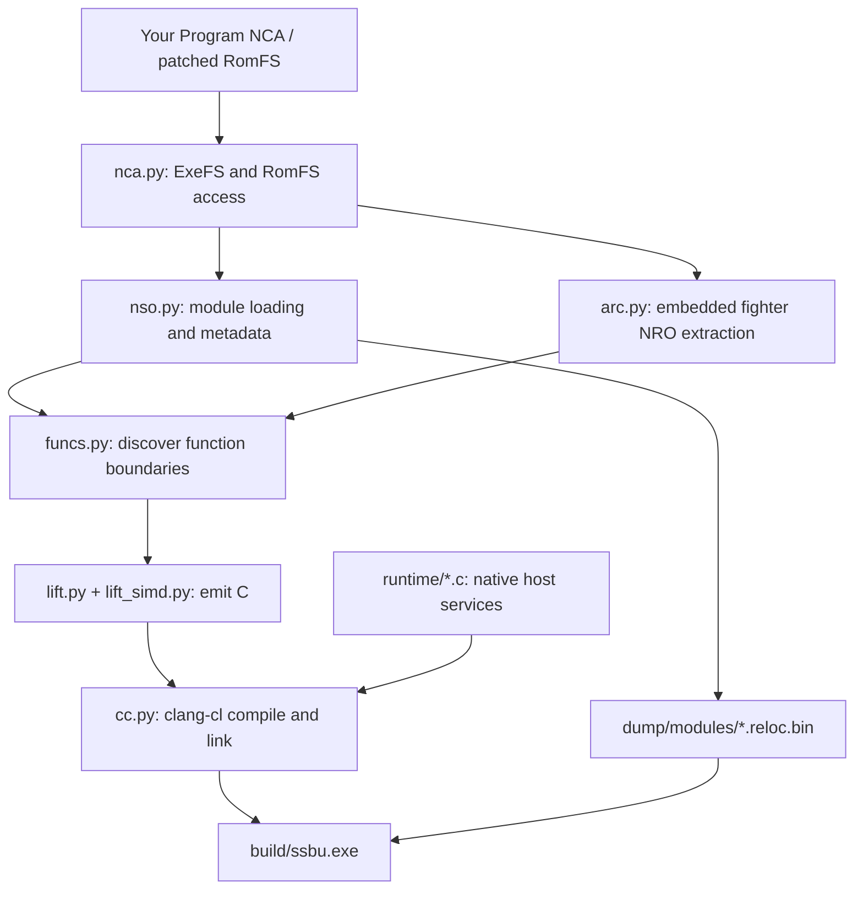
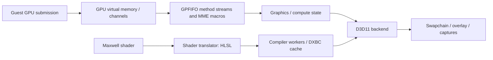

# How WindowSmash works

[← README](../README.md) · [Setup guide](BUILDING.md) · [Multiplayer](MULTIPLAYER.md) · [DLC and unlocks](DLC-AND-UNLOCKS.md) · [13.0.5 update](UPDATES.md)

WindowSmash is a static recompiler plus a Windows compatibility runtime, specialized for this game. CPU code is translated before launch. GPU programs are translated when encountered. Selected operating-system and SDK entry points are implemented natively, while the remaining game and SDK code executes as compiled guest functions.

This document describes the checked-in implementation. Implemented paths and developer test tools should not be read as a compatibility guarantee for every mode, fighter, stage, or machine.

## Contents

| Section | Covers |
| :--- | :--- |
| [1. From extracted modules to a Windows executable](#1-from-extracted-modules-to-a-windows-executable) | Inputs, function discovery, translation, module placement, incremental builds, the compile ladder, the instruction set, the game version, the imports check. |
| [2. Loading, symbols, and guest execution](#2-loading-symbols-and-guest-execution) | Mapping, binding, native replacements, exceptions. |
| [3. Native services](#3-native-services) | The runtime's service implementations, files and fonts, memory mappings, the rollback ring, rollback netplay, run-ahead. |
| [4. The graphics path](#4-the-graphics-path) | GPU commands, the D3D11 back end, shader compilation, the Vulkan back end in development, audio and video. |
| [5. Multiplayer transport](#5-multiplayer-transport) | The relay, the lobby and direct connections. |
| [6. DLC and fighter unlocks](#6-dlc-and-fighter-unlocks) | Installed-content reporting and save editing. |
| [7. Tool reference](#7-tool-reference) | Every tool in `tools/`. |
| [Verification and debugging](#verification-and-debugging) | Tests, the overlay, reports and diagnostic switches. |
| [Build boundaries](#build-boundaries) | What is source, and what stays local. |
| [Test runs](#test-runs) | Fast-forward, input counted in frames, movie skip, the fight hash, the deterministic mode, the fixed seed, the debug match and its end. |

## 1. From extracted modules to a Windows executable



### Inputs and discovery

[`nca.py`](../tools/nca.py) reads package headers, ExeFS containers, and RomFS tables using keys supplied locally. [`nso.py`](../tools/nso.py) handles module decompression and dynamic metadata, including imports, exports, relocations, and information useful for ELF conversion.

[`funcs.py`](../tools/funcs.py) finds function entries from exception-frame tables, exported function symbols, relocations into executable memory, initialization arrays, direct call targets, and recognizable import stubs. These sources provide more structure than a linear disassembly alone. Exception metadata also supplies extents used by the recompiler.

Fighter modules live inside `data.arc`. [`arc.py`](../tools/arc.py) resolves hashed archive paths and reads the compressed filesystem metadata. Its `nro` command extracts known modules from `prebuilt:/nro/release/`. The known-name list is 13.0.5's 98 modules.

### Translation

[`recomp.py`](../tools/recomp.py) orchestrates image preparation, C emission, incremental compilation, and linking. Each guest function becomes a C function accepting a `Cpu *` context. [`lift.py`](../tools/lift.py) emits integer/control-flow operations; [`lift_simd.py`](../tools/lift_simd.py) handles AdvSIMD/NEON operations with explicit vector lanes.

[`runtime/recomp.h`](../runtime/recomp.h) defines the shared contract:

- 31 general registers, the guest stack pointer, 32 vector registers, FP control/status, and thread-local register state.
- Guest memory operations expressed as host accesses to the mapped guest addresses.
- Function lookup for guest code pointers and cached indirect branch targets.
- Helpers for atomics, arithmetic, floating-point behavior, traps, and exception transitions.

Direct branches can target generated C labels/functions. Indirect calls resolve guest code addresses to native function pointers. Tail-call helpers keep supported guest tail transfers from accumulating unnecessary host stack frames. Unsupported instructions or unavailable targets can produce a trap; they do not establish complete instruction coverage.

Exclusive loads and stores, of one register or a pair (`ldxr`/`stxr`, `ldxp`/`stxp` and their acquire/release forms), keep the address and the value the load read in locals of the function. The store is a compare-and-swap against that value, and succeeds only at the same address. Its status register is 0 on success, 1 on failure. A pair of W registers is one 8-byte location. A pair of X registers is one 16-byte location, read whole and written with a 16-byte compare-and-swap (`ld128`, `lda128`, `cas128` in `recomp.h`: `ldp` and `casp` on arm64, `cmpxchg16b` on x86-64). The ARMv8.1 atomics (`cas`, `casp`, `ldadd` and the rest) and ARMv8.3's `ldapr` trap: the console's Cortex-A57 is ARMv8.0 and has none of them.

The build disables floating-point contraction and fast-math-style assumptions to preserve guest arithmetic behavior. `clang-cl` produces x64 object files, then links them with the native runtime and Windows libraries.

### Stable module placement

The primary modules have explicit guest bases in `recomp.py`: `main`, `subsdk0`, and `sdk`. Extracted NRO modules receive aligned address ranges, recorded locally in `dump/nro/bases.txt`. The generated registry binds build IDs to the matching compiled module.

That address manifest is a build input. Preserve it when incrementally rebuilding an existing installation; generated code and relocation images must agree on placement.

### Incremental builds

Each module's build folder has a `module.txt` stamp: build ID, address, name, and a fingerprint of the tools that generated it (the recompiler's sources and the runtime's list of native functions). With the same stamp, [`modcache.py`](../tools/modcache.py) leaves the generated C as it is, and the build only checks it for objects to compile. After a change to the recompiler, the C is generated again, but only changed files are compiled.

Whether an object is current goes by content, not by date ([`objcache.py`](../tools/objcache.py), in the Windows and Linux builds). Each build folder's `objcache.json` records each object's key: a SHA-256 of its C, the runtime headers it includes (`recomp.h` or `module.h` and the headers they include; a file with hook slots includes `hookable.h` too, and only those files are compiled again when it changes), the compiler (its path and what `--version` prints) and the whole compile command, with its optimisation level and instruction set. A change to any of them compiles the object again; a file saved again unchanged does not. The generated C is compiled without the runtime's own defines and include folders (SDL3, libopus, libvpx: `cc.GAME_CFLAGS`), which it cannot see, so their coming and going compiles only the runtime again. The key names a file and its object by their names in the build folder, so the folder spelled another way (`build\main`, `.\build\main`, a full path), or moved, compiles nothing again. A source with the same size and modification time as last time is not read again. A key is recorded only once its object has compiled, so a stopped build carries on where it stopped. A file the compiler crashed on and compiled at `/O1` instead keeps its own level's key, so it is not compiled again at every build. A file [the compile ladder](#the-compile-ladder) compiled with its longest functions unoptimised, or whole at `/Od`, is recorded with the command it was compiled with. The runtime's objects are kept the same way, with every runtime header. A game folder that an older version built has objects but no record. There, an object newer than its C and the runtime headers can be taken as current (what the old rule, by date, did) and recorded, so that updating does not compile the whole game again. The date cannot say what an object was compiled with, so that is only for a build whose flags are the ones the older versions compiled with, for the instruction set the folder was built for (`isa.adopts`: `isa.LEGACY_CLANG_CL`, `isa.LEGACY_CLANG`). None is today: avx2's flags have changed since the older versions ([the instruction set](#the-instruction-set)), and they never built for x86-64-v2, so a folder an older version built is compiled again whole, once. A record that another program holds open is waited for a moment; one that still cannot be opened stops the build before anything is compiled or removed, rather than compiling the folder again. The macOS build keeps its own record, `build-mac/obj/game_sources.tsv`.

### The compile ladder

No single file can hang or stop a build ([`ladder.py`](../tools/ladder.py), in the Windows, Linux and macOS builds). Every file is compiled as it always was: the same command, at the same level, with the same `--jobs` and priority. Only when that compile crashes, or runs past its time limit, is the file compiled again another way.

**A crash.** The compiler crashed when clang printed its crash report (`PLEASE submit a bug report`, `Stack dump:`, an LLVM fatal error), clang-cl exited with an exception code (0xC0000005 and up), a signal stopped it (Linux, macOS), or clang's driver says its compiler process crashed (`unable to execute command`, `frontend command failed due to signal`). The exit code alone does not tell: Apple clang 21 exits with 1 on a crash, as on an error in the code (254 with `-fno-crash-diagnostics`). A crash comes from a PC short of memory, or not quite stable, and rarely happens twice to the same file. Once the other files are done, the file is compiled again on its own at its level, then one level lower: `/O2` to `/O1`, `-O2` to `-O1`. It keeps its own level's key ([incremental builds](#incremental-builds)). The Linux and macOS builds now do this as the Windows one did. What a crashed compiler was writing is removed (a signal leaves clang's temporary file), and so are clang's bug-report files in the temporary folder. A compile stopped with the build (Ctrl+C) leaves nothing either, and is not taken for a crash.

**Too long.** A few of LLVM's passes are worse than linear in a function of tens of thousands of instructions with thousands of labels. A generated file's time limit is the larger of 10 minutes and 4 times its estimate, at this PC's pace. The estimate is the build's cost model ([`progress.py`](../tools/progress.py)) at the file's level, or what the file took last time if that is more. The pace is the seconds this build has taken for each estimated second, once 60 estimated seconds are compiled. Before that it is the last builds' pace, or 4 when there is none, and it is never taken as less than 1. The limit is worked out again every second as the pace is learned. Time the compiler does not run does not count. A compile is timed by a clock that leaves out the time the PC is asleep: `time.monotonic` on Linux and macOS, and `QueryUnbiasedInterruptTime` on Windows, whose `time.monotonic` counts sleep. A build stopped with Ctrl+Z stops its compilers too, since they stay in its process group. When one of those looks finds that its compiler was stopped and let go on since the last look (`waitid`), the time between the two does not count: the file's limit moves on by that much, and its time leaves it out. A look that comes late only because the PC was too busy counts in full. A PC paging hard, as a compile running away with the memory makes it, is too busy, so that compile is still stopped at its limit. Windows has no such report, and neither has a Python before 3.13 on macOS (no `os.waitid`). There a look more than 5 seconds late is taken for a pause, and the time does not count. On Windows that pause is most often Modern Standby, which suspends the build and its compilers while `QueryUnbiasedInterruptTime` runs on, since standby is the working state, S0. A PC too busy to look on time is not told from one in standby there, so a compile running away with the memory may run past its limit. `SSBU_COMPILE_LIMIT=<seconds>` gives every generated file that limit instead; `0` means none. The runtime's files have no time limit. A setting that is not a number stops the build before it does anything else.

A file over its limit is stopped with every process its compiler started: on Windows with `taskkill /T`; elsewhere each process is found under it with `ps` (or `/proc`), suspended, then killed. The object it was writing is removed, with clang's temporary file for it (`<name>-<random>.o.tmp`). Then the file is compiled again at its level, with its longest functions unoptimised:

1. `optnone` and `noinline` go on every function longer than 20,000 instructions. They are declared in a header beside the object, `<name>.optnone.h`, which is given to the compiler before the file (`-include`, or clang-cl's `/FI`). The definitions in the generated C take the attributes from those declarations, and the C is not changed.
2. Then the same for functions over 5,000 instructions, then over 1,250. A threshold that names no more functions than the one before is skipped. A header that cannot be written (a full disk, say) skips its step.
3. Then the whole file at `-O0` or `/Od`.

A function's size is its count of indented lines in the C: one an instruction, as [`lift.py`](../tools/lift.py) writes them. Each try has a time limit of its own, from its own estimate. A file still over its limit at the lowest level stops the build, and the message names `SSBU_COMPILE_LIMIT`.

Measured with Apple clang 21 on a made-up function in the lifter's layout (labels and gotos):

| Function | `-O2` | `-O2`, `optnone` from `-include` | `-O0` |
| :--- | ---: | ---: | ---: |
| 1,500 lines | 2.5 s | 0.1 s | 0.1 s |
| 3,000 lines | 11.7 s | 0.2 s | 0.1 s |

How much this saves on the game's own files, and how much slower those files then run, are not measured.

`TAIL`'s `musttail` calls stay tail calls with `optnone` and at `-O0`. `tests/test_compile_ladder.py` runs a chain of ten million guest tail calls built at `-O0` (as C, and as C++ like a file with landing sites) and with `optnone` at `-O2`. Without `musttail`, the same chain at `-O0` overflows the stack. With clang-cl at `/Od` the call is a `jmp`. A file with landing sites is compiled through its C++ wrapper. The header comes before the wrapper and declares the functions with C linkage.

**Records.** A file the ladder compiled another way is recorded with the command it was compiled with. Its level is in that command, and the header's SHA-256 is added to the command in its key. Its entry in `objcache.json` says how (`"ladder": {"level": "/O1", "above": 20000}`), with the `SSBU_OPTNONE_ABOVE` threshold the file's own compile had, when it had one (`"from"`). The next build makes the header again from the C and checks that key, if it starts the file the same way. So the file is not compiled again at every build, and it is compiled again once its C, the flags, the headers, the compiler or `SSBU_OPTNONE_ABOVE` change. With `SSBU_COMPILE_LIMIT=0`, it is compiled again the normal way. On macOS, the file's line in `game_sources.tsv` has a sixth field saying the same (`|ladder -O1 optnone>20000:<digest>`).

**Measured times.** Each generated file's compile seconds and level go into the build folder's `compile_times.json` (`build/`, `build-linux/`, `build-mac/obj/`), with its cost-model estimate and its C's SHA-256. On the next build, a file with the same C and level is estimated from its seconds over the last builds' pace, and the progress bar's time left goes by those estimates. Each build starts its files in the order it always has: the Windows build in the manifest's order, the Linux and macOS builds the biggest source first. With `SSBU_LONGEST_FIRST=1` (for benchmarking, below), once one of the files to compile has such a time, they are started longest first instead, a file without one by its cost-model estimate. A file the ladder compiled another way is kept in the file but not counted. When the ladder steps in, the bar takes what is left of the file to be the new try's estimate, from then on, and leaves the file out of the pace. A file the compiler crashed on goes back into the queue.

**The report.** Each time the ladder steps in, the build's log says so once, with the file, what happened, the level it ended at and the seconds. The build lists those files again at the end, and adds them to the build folder's `ladder_report.txt` under the date and the settings.

**For benchmarking.** `SSBU_OPTNONE_ABOVE=<instructions>` is off unless set. It compiles every generated file that has a function longer than that with those functions unoptimised from the start, and the rest of the file at the level it would have without them. A file still over its time limit then steps down to a quarter of the threshold, then a sixteenth. A file whose header cannot be written is compiled whole at that level instead, and recorded as the ladder's. ssbu-recomp's `build_opt.py` compiles this way. The default build compiles a file with a function over 20,000 instructions at `/O1`, whole, and stays so until a benchmark says otherwise. `SSBU_LONGEST_FIRST=1`, also off unless set, starts the files longest first by their measured times. The order is part of how long a build takes when nothing goes wrong, so it too stays as it was until a benchmark says otherwise.

### The instruction set

The Windows and Linux builds compile everything, the generated C, the runtime and libopus, for one x86-64 instruction set ([`isa.py`](../tools/isa.py)): `avx2` (the default, and what every build was before there was a choice, less F16C and MOVBE: clang-cl's `/arch:AVX2 -mfma -mno-movbe -mno-f16c`, clang's `-mavx2 -mfma -mbmi -mbmi2 -mlzcnt -mpopcnt`) or `x86-64-v2` (`-march=x86-64-v2`: SSE4.2 and POPCNT). The lifter's C asks for no extension by name. ARM's fused multiply-add is C's `fma()`, rounded once on either; `__builtin_roundeven` and the bit counts are plain C; half floats and TBL are done in software (`recomp.h`). So the two differ only in the code the compiler makes, and in speed: at `x86-64-v2`, `fma()` is a call into the C runtime and nothing is vectorised wider than 128 bits (by how much that is slower is not measured). Windows' C runtime, on a processor without FMA3, computes `fma(a, b, c)` with a zero `c` as `a * b + c`, which gives +0 for a product too small for a double plus +0, where the fused result is -0; so at `x86-64-v2` on Windows, `recomp.h` computes a zero `c` itself (the product rounded once) and hands the C runtime every other. `x86-64-v2` is the floor because below it the rounding functions become library calls too, and Windows' C runtime has no `roundeven`. `-mf16c` was dropped from both builds: nothing uses F16C. clang-cl's `/arch:AVX2` is Haswell's, with MOVBE and F16C, which the compiler uses unasked (a load and a byte swap become MOVBE); `-mno-movbe -mno-f16c` turn them off. So what this version compiles for `avx2` needs the same of the processor on Windows as on Linux, which is what the program checks for as it starts. What older versions compiled did not: their Windows objects could use MOVBE and F16C, their Linux ones F16C. So their objects are never kept as `avx2`'s ([incremental builds](#incremental-builds)), nor their vkd3d-shader.

Which one: `SSBU_ISA` when set; else `x86-64-v2` if the processor is known to lack something `avx2` needs (Windows' `IsProcessorFeaturePresent`, from Windows 10 version 2004, with `GetEnabledXStateFeatures` for whether the system saves the YMM registers; Linux's `/proc/cpuinfo`); else the build folder's last choice if `SSBU_ISA` made it; else `avx2` if the processor is known to have it; else the last choice, else `x86-64-v2`. A folder with no record but a program an older version linked has `avx2` for its last choice. Every older version built for `avx2`, and its installer stopped for a processor whose name said it had none, so an update on a processor that cannot be asked (Windows before version 2004, a name the installer does not know) keeps `avx2` rather than building again for `x86-64-v2`, slower. Where that is wrong, the program says so as it starts. The build writes what it compiled for into its folder (`build/isa.txt`, `build-linux/isa.txt`, `build-vkd3d/linux/isa.txt`) as it links, and `build_game.py` builds again when today's choice is another. The record is written at the link, not at the start, because it stands for the program beside it too: written by a build that then stopped, it would vouch for the program an earlier build made, for the other instruction set. So a choice `SSBU_ISA` made is kept once a build for it has linked, and one stopped before that is told again. Every object's compile command names the instruction set, so [`objcache.py`](../tools/objcache.py) then compiles every object again, and `codec_libs.py` rebuilds a codec library whose recorded command (`build/codecs/<library>.flags`) differs. A vkd3d-shader without a record, an older version's, is built again. `recomp.py link` and `build_linux.py --link-only` link only when every object is compiled for the build as it is today (else they stop and say so), so the record they write names what every object linked is compiled for.

The program checks the processor before any of its own code runs ([`cpu_check.c`](../runtime/cpu_check.c)). The extensions it needs come from the compiler's own macros where `host.c` is compiled (`cpu_check.h`'s `rt_cpu_needs`), so the check follows the flags, whatever they are. The check asks CPUID, and XGETBV for the YMM registers, and on a processor that lacks something it names what and how to build for it, in a message box and on stderr on Windows, on stderr on Linux, then exits with code 5. `cpu_check.c` alone is compiled for plain x86-64 (`cc.CHECK_CFLAGS`, `toolchain.CHECK_CFLAGS`), so that it runs on any x86-64 processor. It runs from the C runtime's start-up: on Windows as a C initialiser (`.CRT$XID`: after the static C runtime's own, in `.CRT$XIC`, which set up stdio among others, and before every C++ initialiser and `main`; it writes its message with `WriteFile`), on Linux from `.preinit_array` (before every constructor). The macOS build is arm64 and has none of this.

### The game version

WindowSmash builds one version of the game: 13.0.5, its last update. [`game_version.py`](../tools/game_version.py) holds what identifies it: the main module's build ID (`21450C647B8C5940ED5B68218EA128FD3C5D597D`), the update's title version (`0x1F0000`, v31) and data.arc's version field (`0xD0005`). Each step checks what it can see:

| Where | What it checks |
| :--- | :--- |
| A game folder's scan ([`gamefiles.py`](../tools/gamefiles.py), shown in the installers' windows) | The update's title version, else data.arc's version, else the version in the game's control data. Files that name another version get a message saying what to add; files that name none are left to step 4. |
| [`build_game.py`](../tools/build_game.py) step 4 | The build ID of the `main` it copied into `dump/exefs`. Another version's is removed again, and the build stops. |
| `build_game.py` step 6 | data.arc's version in the connected game data ([`arc.py`](../tools/arc.py)), which also catches a `romfs.bin` made by hand from another version. |
| The game, as it starts ([`host.c`](../runtime/host.c)) | Its own `main`'s build ID. A game built from another version shows a plain message and exits with code 4: no crash report. |
| The online lobby ([`ssbu_relay.py`](../tools/ssbu_relay.py)) | The build ID in each join. Another is refused, with a reason the game shows in its overlay: `Netplay: WindowSmash needs game 13.0.5: run the installer again`. |

The runtime and the lobby keep their own copy of the build ID (the lobby is deployed on its own); `tests/test_game_version.py` checks that the copies match.

A folder whose `dump/exefs/main` is another version's, set up before WindowSmash required 13.0.5, is set up again by `build_game.py` once the game folder has 13.0.5: it removes what the game files made (the program, the game data's configuration and the update's files, the DLC list, the fighter modules, `ssbu.exe`) and runs those steps again. The save, the settings, the fonts, a decrypted base and the shader cache stay, and module build folders are generated again where their build ID changed ([the 13.0.5 update](UPDATES.md#a-folder-built-from-another-version)).

### Code tied to the game version

- **Hooks in the runtime** (`HLE_WRAP(<address>)`, in `runtime/hle_fiber.c`, `hle_movie.c`, `hle_net.c`, `hle_online.c`, `hle_each_frame.c` and `hle_rb_wraps.c`) wrap a guest function that isn't exported, at its 13.0.5 address. Each has a code signature on the line above it (but for the frame hooks' two, the frame end and the record builder in `hle_each_frame.c`, which wait for theirs: [Test runs](TESTING-RUNS.md#the-code)): a hash (SHA-256, first 16 hex digits) of its first instructions, with addresses masked out, and how many instructions that is. The instructions themselves never go in the source, since they are the game's code; the recompiler stops at a signature that spells them out. It checks that a function starts at that address and that its first instructions hash to the signature; if not, the build stops rather than leave the hook out. `tools/recomp.py wrap-sig <module> <address>` prints a new hook's signature.
- **Hooks by exported name** (`HLE_WRAP_EXPORT(<mangled name>)`) wrap an exported function by its name instead, for one whose address is each install's own (a fighter module's). Every lifted module that exports a function under that name has it wrapped as an `HLE_WRAP` is: the function stays, as `f_<address>_orig`, and every way of reaching it reaches the wrapper (a direct call or jump, an import stub in another module, a pointer, a lookup by address). The wrapper is handed the original it was reached through (`HLE_WRAP_EXPORT(name) { ...; orig(c); }`), so two modules that define the name each keep their own, and since it names no module's function, a build in which no module defines the name links as it is: the wrap does nothing there. A function exported under several wrapped names (an alias, or identical code the linker folded into one) has every one of their wrappers, one inside the other in the order of the runtime's sources: callers reach the first, whose `orig` is the next, and the last one's is the function. A name both replaced (`HLE`) and wrapped, one exported as something other than a function, or a function wrapped both by address and by name stops the build. So does either macro anywhere but at the start of a line in its form, outside comments (`static HLE_WRAP_EXPORT(...)`, `HLE_WRAP_EXPORT (...)`, indented), and any other name in the code that starts with `HLE_WRAP` (a macro standing for one, `HLE_WRAP_##k`, a name a line splice cuts in two): it would compile, and nothing would be wrapped. Comments and strings may mention them. The preprocessor's conditions are not followed: a form under `#if 0` is read as a wrap, and the build then fails to link where a module has the function. A signature goes on the line above as for `HLE_WRAP` (the four of the test switches, in `hle_each_frame.c` and `hle_fight_test.c`, wait for theirs); `tools/recomp.py wrap-sig <module> <exported name>` prints it. The names are part of the tools fingerprint, in the sources' order, as the addresses are.
- **Frame hooks** ([`frame_hooks.h`](../runtime/frame_hooks.h)): the game's two once-a-frame points, the graphics module's frame end (`FRAME_END`) and the fighters' frame line (`sys_line_system_control_fighter`), are each wrapped once, in [`hle_each_frame.c`](../runtime/hle_each_frame.c), since one function can have only one wrap and both the test switches and rollback need them. The player record builder (`PLAYER_RECORD_BUILDER`, once per player as a match is set up) is held the same way, as a third point: the debug match and rollback netplay's handshake both need it. Code that needs them registers a handler to run before the game's function, after it, or both, with an order: handlers nest like wraps, the lowest order outermost (its before first, its after last), and one order nests in the order of registration. With nothing registered, a wrap only calls the game's function. `hle_each_frame.c` sorts before `hle_fight_test.c`, which had both wraps, so the exported names keep their order in the tools fingerprint.
- **The exact-register list** ([`tools/hooks.txt`](../tools/hooks.txt)) names functions, by their 13.0.5 address in `main`, `subsdk0` or `sdk`, where a hook needs the whole register state of the code that calls them. The register cache ([`regcache.py`](../tools/regcache.py)) keeps guest registers in C locals and, at a call, brings the context up to date only with what the ABI lets the callee read (x0-x18, x29, x30, SP), reading back x0-x18 and x30 afterwards; a hook would find stale x19-x28 there and lose what it writes to x19-x28, x29 or SP. Every direct call to an `exact-callee` stores every register the caller has changed and reads back every register it uses; every call an `exact-caller` makes (direct, through a pointer, svc) does the same. A hook's caller is the code it returns to, so in every module the recompiler also makes exact the calls to a function that reaches an exact-callee without a call of its own (by `b`, a conditional branch, or running on into it, directly or through others that do), and the calls through an import stub bound to the exported name of the exact-callee or of such a function (a wrapper ending in `b impl`), which is how other modules call them: the names main, subsdk0 and sdk export, bound as the loader binds them (the first of the three to export a name defines it), followed from module to module until no more are found. What a fighter module exports is followed only inside that module. A register the caller never writes holds what the context held when the caller was entered. A call through a pointer, or a jump through a register, cannot be known to reach an exact-callee, so the function that call returns to is listed as an exact-caller instead; what an exact-caller itself jumps to without a call sees registers only as exact as the call that reached the exact-caller. With the register cache off (`SSBU_REGCACHE=0`, or functions over 20,000 instructions) every call is exact already. An entry may carry a signature in the HLE_WRAP form, and the build stops at an address where no function starts, a signature that doesn't match, a line it can't read (or a file not saved as UTF-8), or anything that could be an instruction word: a run of 8 or more hex digits other than an address or a signature's hash (after `sha256 `), hex digits masked with a run of dots as the old signatures spelled them, or a row of 4 or more bytes; the message quotes what it found. The entries are part of the tools fingerprint, so a change generates the C again. The list is empty for now: the hooks that need it come with ssbu-recomp's modding port.
- **Hook slots** (`hookable <address> [<signature>] <name>` in the same list; [`hookable.h`](../runtime/hookable.h), [`hle_hooks.c`](../runtime/hle_hooks.c)) let a hook take over a listed function at run time. Its lifted code becomes `f_<address>_body`, compiled out of line (`noinline`) and never called by name, and a global `rt_hook_<address>` holds a pointer, the slot, that starts out at it. Every direct call and tail call to the function loads the slot and calls what it holds (a tail call stays one: `musttail` on the indirect call), and `f_<address>`, which the module's table gives `rt_lookup` (indirect calls, other modules' import stubs, `rt_call`), is a forwarder that does the same; so every way the guest reaches the function goes through the slot. An unlisted function is generated exactly as before and costs nothing; a listed one costs a load and an indirect call per call. A hookable function is an exact-callee too, with the same closure over tail calls and import stubs, so a hook in its slot sees x19-x28, x29 and SP as code that calls it directly, by a tail call or through an import stub left them, and what it writes comes back. A call through a pointer (a vtable, a function pointer) reaches the slot as well, but as for any exact-callee its caller is exact only if listed as an exact-caller: otherwise the hook sees x0-x18, x29, x30 and SP and can change x0-x18, but finds stale x19-x28 and loses what it writes to them, x29 or SP. A branch from the function back to its own first instruction stays a jump inside its code, which no hook sees. The function's own code stays a function of its own in the linked program: clang-cl's `/O2` puts every function in a COMDAT section, which lld-link's default `/OPT:ICF` may fold with an identical one, so on Windows it goes in a section that is not a COMDAT (`.text$rt_hook`); the macOS link passes `-no_deduplicate`, the Linux link no `--icf`, and no build uses LTO. Calls load the slot with acquire and a hook is stored with release, so one may go in while other threads call through the slot. For hooks: `rt_hook_slot(guest_addr)` is the slot of the hookable function starting there (NULL if none), `rt_hook_body(guest_addr)` the function itself, `rt_hook_list()` every slot; `rt_hook_install(slot, hook, &next)` puts a hook in, first setting `next` to what it replaces (the function, or a hook put in earlier), so the hook runs the original by calling `next(c)`; `rt_hook_remove(slot, hook, next)` takes it out again if it is still the last one put in. No machine code is patched, so a slot needs no instruction-length decoder, trampoline or writable code on any architecture (x86-64 or arm64). How Phase 7's hooks use slots (one hook or a chain per function, how a mod registers one) is left open. Crash reports name the function's own code by its guest address. `recomp.py build` runs [`hook_inline_check.py`](../tools/hook_inline_check.py) on every file it generates when the list has a hookable function, and stops if one is reached other than through its slot; the unit tests ([`test_hookable.py`](../tests/test_hookable.py)) also compile a made-up module at -O2 and read the object (clang-cl's COFF directly; ELF and Mach-O with `llvm-objdump` or `objdump`, skipped without one): the function's code is there, nothing calls it by name, and on Windows it is in no COMDAT. A function whose calls become the host's setjmp cannot be hookable.
- **Unlock All Fighters** writes at 13.0.5's save offsets. It reads main's build ID and changes nothing unless it is 13.0.5's (`LAYOUTS` in `tools/unlock_all.py`, `$knownLayouts` in `tools/Unlock-All-Fighters.ps1`).

### The imports check

Before compiling, `recomp.py all` lists each module's imported symbols that no module exports and the runtime doesn't implement, in `build/imports.unresolved.txt`. `recomp.py check <exefs>` runs that check on its own.

- A **strong** import on that list would trap if called: the runtime lacks a native function the game needs.
- **Weak** ones read as 0 and are normal. 13.0.5 has 0 strong and about 410 weak.

## 2. Loading, symbols, and guest execution

[`host.c`](../runtime/host.c) maps `*.reloc.bin` images at their expected guest addresses, registers module ranges, publishes exports, resolves imports, and applies symbol relocations. Function metadata associates guest addresses with compiled host functions.

Native replacements use `HLE(symbol)` declarations. The build detects those names and redirects applicable guest entry points to runtime implementations. Unresolved strong imports receive diagnostic handlers rather than silently acquiring arbitrary implementations.

Startup enters the guest SDK initialization path and eventually `nnMain`. Guest execution runs on a Windows thread with a large reserved stack. Modules loaded later through `nn::ro` are matched by build ID, mapped, bound, and initialized when requested.

[`hle_ro.c`](../runtime/hle_ro.c) can save an unrecognized module image into the local NRO dump directory. Harvesting a module does not compile it: a later rebuild must translate and link it. The runtime's missing-module behavior is a development aid, not a substitute for preparing the full module set.

### Exceptions and non-local control flow

The guest's own unwind implementation interprets guest exception metadata. [`hle_unwind.c`](../runtime/hle_unwind.c) bridges its final register/context transfer to the corresponding recompiled host frame using a structured host exception and landing-pad filters. [`hle_setjmp.c`](../runtime/hle_setjmp.c) and [`hle_fiber.c`](../runtime/hle_fiber.c) implement related control-flow bridges.

## 3. Native services

| Source | Responsibility |
| :--- | :--- |
| [`kernel.c`](../runtime/kernel.c) | Guest thread contexts, synchronization, handle/state tracking, memory operations, and supported supervisor calls. |
| [`clock.h`](../runtime/clock.h) | The one clock behind the guest's system tick, the kernel's timeouts, and the renderer's timing: Windows' `QueryPerformanceCounter`, or, where a read of it is slow (a PC timed by the HPET), the CPU's invariant time stamp counter scaled to the same nanoseconds. `SSBU_CLOCK=qpc` or `tsc` picks one; `build\play.log`'s `[clock]` line says which. |
| [`sleep.h`](../runtime/sleep.h) | The guest's `svcSleepThread`: a sleep of the nanoseconds asked, never shorter. On Windows it waits on a high-resolution waitable timer (one a thread, Windows 10 1803 and later; `Sleep` in whole milliseconds without one), on Linux with `clock_nanosleep`, on macOS on a critical kqueue timer. It used to round up to whole milliseconds; `SSBU_SLEEP=ms` brings that back (a guest loop that polls with short sleeps goes round far more often now: on an M5 Pro a sleep of 1 us took 3-32 us at the median, 200 us some 205-225 us, against some 1 ms for both before). The kernel's timed waits (`WaitSynchronization`, the address arbiter's and condition variables' timeouts) still round their time to milliseconds. |
| [`ipc.c`](../runtime/ipc.c), `ipc_*.c` | Service request handling and selected audio, display, Mii, and related interfaces. |
| [`hle_fs.c`](../runtime/hle_fs.c) | RomFS reads, save/cache mounts (the save journaled, as on the console), and host file operations. |
| [`hle_env.c`](../runtime/hle_env.c), [`hle_applet.c`](../runtime/hle_applet.c) | Account/environment behavior, applet-facing functions, and installed add-on reporting. |
| [`hle_hid.c`](../runtime/hle_hid.c), [`hle_pad.c`](../runtime/hle_pad.c) | Up to eight players' pads, keyboard input, rumble, and optional scripted input. An input thread owns SDL3 (loaded from `SDL3.dll` at run time; XInput pads 1-4 without it) and copies each pad's state for the game's threads; `controllers.ini` maps pads to players and buttons. GameCube controllers (Nintendo's adapter, through SDL3's own driver) report the console's GameCube style, with analog triggers and an on/off motor, so the game uses its GameCube controls. On Windows, [`hle_padusb.c`](../runtime/hle_padusb.c) reads Nintendo's GameCube adapter (WinUSB or Windows' HID driver) and the Switch 2's GameCube controller (started through its bulk interface) itself, through Windows' own libraries, because SDL3.dll has no libusb; SDL is told to ignore both (`SSBU_GC_USB=0` leaves them to SDL). |
| [`hle_pl.c`](../runtime/hle_pl.c) | Shared-font loading from locally supplied `.bfttf` files. |
| [`hle_nv.c`](../runtime/hle_nv.c) | Supported GPU-driver interfaces, address mapping, and channel operations. |
| [`hle_net.c`](../runtime/hle_net.c), [`net_relay.c`](../runtime/net_relay.c) | Virtual networking, Local Wireless, socket behavior, relay transport, and optional UPnP. |
| [`hle_online.c`](../runtime/hle_online.c) | The game's Online mode: NEX and Pia sent to the online lobby's game server, NEX's TCP streams carried to the lobby, and the SHA-1 its WebSocket needs. |
| [`hle_offline.c`](../runtime/hle_offline.c) | Selected offline service behavior needed by the target game. |

These are targeted service implementations, not a complete implementation of the console OS. Some functions return fixed or limited behavior appropriate to the supported paths.

### Threads and handles

Each guest thread runs on a host thread of its own (with a 256 MiB reserved stack, since guest call depth is host call depth), with its own register context and a 4 KiB thread-local region from `0x7780000000` up. A handle names a slot in the kernel's table of 4096 objects (threads, events, IPC sessions, transfer memory), and waits and mutex hand-overs look through a table of up to 1024 threads.

By default nothing of a thread is ever freed, as before: its slot, its handle and its thread-local region stay after it has exited and its handle is closed, so a session that has made 1024 threads (the main thread among them) stops at the next one with "too many threads", however few are running. `SSBU_THREAD_RECYCLING=1` gives threads the console's lifetime instead: a thread object lives while the thread runs or a handle to it is open. Once it has exited and its handle is closed, its slot and handle go to the next object and its thread-local region (zeroed) to the next thread; its context and its host thread's handle are freed once the host thread has ended. An exited thread stays signalled while its handle is open, and a wait holds the objects it waits on, so a thread whose handle another thread closes during the wait is still seen to end.

Handle values then take the console's layout, as Atmosphère's open-source kernel (mesosphère, `kern_k_handle_table.hpp`) has it: the slot in the low 15 bits and, above them, a linear id from 1 to `0x7FFF`, here a count of the slot's uses. Values stay nonzero and below `0x40000000`, the waiters bit of the userspace mutex words that hold owner handles. A handle used after its `CloseHandle` names nothing, not the slot's next object: `StartThread`, `GetThreadPriority` and `SetThreadPriority`, `GetThreadCoreMask` and `SetThreadCoreMask`, `SignalEvent`, `ClearEvent`, `CloseHandle`, `ResetSignal`, `WaitSynchronization`, `CancelSynchronization`, `SendSyncRequest` and `GetThreadId` refuse it with `0xE401` (invalid handle); `GetInfo` answers only the process's own values and does not look at its handle. `svcCreateEvent`'s two handles (one value here) and each IPC copy of a handle count as references of their own, each dropped by its own `CloseHandle`. That the SDK closes both of an event's handles is inferred, not seen in the game: libstratosphere, Atmosphère's open reimplementation of `nn::os`, does so in `DestroyInterProcessEvent`. A handle nothing closes keeps its slot for good: one of an event's two values left open, or one the game moves to a native service, which keeps none. The log says once when half the table's 4095 slots are in use (`[kernel] half the handle table in use`, with a count of each kind of object), since a slow leak would end at "out of handles". Also not freed with a thread, outside the kernel: the Linux and macOS platform layer's 256 KiB signal stack of each host thread (address space only, until a signal runs on it), and the fiber slot of a thread the game made a fiber ([`hle_fiber.c`](../runtime/hle_fiber.c), 16384 at most).

Without the switch, a handle is `0xA000` plus its slot, `CloseHandle` frees events, sessions and transfer memory at once and keeps threads, and `SetThreadCoreMask` takes any handle, as before. The switch stays off by default until a long play session has been run with it; [`kerneltest.c`](../tools/dev/kerneltest.c) checks both behaviours offline.

### Files and fonts

`dump/modules/romfs.cfg` contains two lines: a host file path, then the byte offset at which an unencrypted RomFS begins. Relative paths resolve against the game's working directory. The runtime reads RomFS metadata and game files in place rather than extracting all assets.

Save data and cache files are host directories: `save/<user>` and `cache`. `SSBU_DATA_ROOT` can redirect those per-run files for testing. A network identity is separate from save contents: copying `netplay_id.txt` to another PC can make two installs appear as the same player.

The save is journaled, as on the console: nothing the game writes is kept until it calls `nn::fs::Commit`, and a commit lands whole or not at all. `save/<user>` holds the last committed save, and only a commit writes there. Mounting the save makes a working folder beside it, `save/<user>.work.<process id>`. A file the game opens for writing is copied there first, new files and folders are made there, and deletions are remembered; the game sees the working folder over the committed one. A commit flushes the changed files, writes the list of changes to `save/<user>.journal.<process id>`, flushes it and renames it to `save/<user>.commit`. That rename decides the commit. The changes are then applied (each file moved over the committed one) and the marker deleted. A process stopped before the rename leaves the old save; one stopped after it has its commit finished by the next mount. A commit decided but not applied (a file the PC refuses to replace) keeps its marker and working folder: every later call on the save tries it again, and so does the next mount, which fails until it succeeds. Unmounting discards uncommitted changes, as the console does, and the next mount deletes the working folders of processes that no longer run. One process at a time commits: a named mutex on Windows, a lock file `save/<user>.lock` on Linux and macOS. A process mounts a save once. A file opened for reading before the same file is opened for writing keeps reading the committed copy. On Windows a committed file still open for reading is replaced with a POSIX-style rename (`FileRenameInfoEx`; `MoveFileEx` refuses), and a read-only mark is cleared first. On Linux and macOS the platform layer makes the protocol hold through a power cut: `MoveFileExA` with `MOVEFILE_WRITE_THROUGH` flushes the moved file and its folder, and `FlushFileBuffers` uses `F_FULLFSYNC` on macOS. On Windows, NTFS's log keeps the steps in order, but the last of them may reach the disk a few seconds after `Commit` returns. Saves made before the journal are simply the committed save: nothing is converted. The cache is written directly.

The font service loads six firmware font files, decodes their container format, and maps shared font memory. Fonts are user-supplied runtime inputs, not repository assets.

### Memory mappings

Thread stacks are mapped with `svcMapMemory`: the pages of memory the game allocated appear in the stack area, from `0x7700000000` up. On the console the source is then locked, with no access at all, until the unmap. The kernel copies instead: the destination gets a copy of the source, and the unmap writes it back over the source before the destination is decommitted (the renderer is told, as for any memory decommitted). A game that keeps to the console's rules cannot tell the difference; the cost is two copies and the destination's memory while the mapping lasts. On an M5 Pro (macOS), mapping and unmapping 1 MiB took some 60-70 and 20-30 µs (16 KiB: 2-3 µs each), and 64 mappings of 1 MiB with 16 KiB of each written added 64 MiB to the process's memory footprint. As aliases made with `mach_vm_remap` they added 1 MiB, and a 1 MiB alias made and removed took some 5 µs. Each status line (`--status`) gives the mappings made, how many are mapped and the most at once, and the time the copies took, so a session's log shows whether they matter.

An alias, the same pages at both addresses, needs the source in memory that can be mapped twice. On Windows that is a pagefile-backed section mapped into placeholders (`MapViewOfFile3`, Windows 10 1803 and later), whose committed pages `VirtualFree` cannot decommit and `GetWriteWatch` does not watch; on Linux a shared mapping (a memfd); on macOS anonymous memory will do (`mach_vm_remap`), but in 16 KiB pages, so only where source and destination sit at the same offset in one (and whatever shares a host page with the source then appears at the destination too). The heap and the alias area, where a stack's memory can come from, would have to be allocated that way. That has not been done.

`SSBU_MAP_GUARD=1` makes a mapping's source inaccessible while it is mapped, as on the console, so that a stray access faults, and the crash report names the guest function, instead of reading the stale copy or writing what the unmap then overwrites. It guards a source that the memory map has as read-write memory, outside the alias area (where the write watch sets the pages' protection itself, on macOS and on Linux before 6.7), and on macOS only the 16 KiB host pages wholly inside it. `svcQueryMemory` reports the source as it does without the switch, and `kernel_read64` (the kernel's read of memory that may be gone, which `hle_fiber.c` looks into dropped fibers with) treats the guarded pages as not mapped rather than fault on them. A system call that would write into them (a file read or a socket receive into the source) fails with an error instead of faulting, so the game sees a failed call there, not a crash. It is off by default until a play session has been run with it. The log says when it is on, and the status line how many sources it guarded. With `SSBU_ROLLBACK_RING` it is left off, and the log says so: the ring reads every mapped page, and the write watch then protects the heap's pages itself. [`maptest.c`](../tools/dev/maptest.c) checks both behaviours offline.

### Rollback ring

`SSBU_ROLLBACK_RING=1` (8 frames), or a number of frames from 2 to 64, keeps the guest's writable memory as it was at each of the last frame ends ([`hle_rollback_ring.c`](../runtime/hle_rollback_ring.c), [`rollback_ring.h`](../runtime/rollback_ring.h)): groundwork for rollback netplay. Any other value, or none, leaves it off, and then nothing of it runs: its frame end handler is not registered, and the renderer asks the system's write watch as it always has.

A frame holds every page of the memory map's read-write regions: the heap, alias memory, the stacks and thread-local regions, and the modules' data. The newest frame is a copy of each page (none for a page of zeros); each older one is an undo log, the copies of the pages that changed after it. A save compares the pages that may have changed with their copies and copies only those that differ; putting a frame back undoes the logs down to it and writes each page they name once. Which pages may have changed: those the write watch reports, every page of the modules' data (which `host.c` maps outside the watched areas, so it is compared in full at each save), and the pages mapped or unmapped since. The kernel's lock is held through a save, so every guest system call that uses the kernel's state (memory, waits, signals, locks; not service requests or sleeps) waits for it.

The write watch is shared ([`kernel_watch.h`](../runtime/kernel_watch.h)). The renderer resets the alias area's bits as it takes them, so a second user asking the system would lose the renderer's news or steal it. With the switch on, `kernel_init` reserves the heap, stack and thread-local areas with the write watch too (four watched areas, the Linux layer's limit), the kernel takes the system's bits in one place, and the renderer and the ring each keep a bit a page of their own: a write is news to each until that one takes it. A page that is decommitted is news to the ring. The renderer's bits are left as they are, so it may hear of a page it would not have heard of alone (an upload more), but never misses one. With the switch off, `kernel_write_watch` is `GetWriteWatch`. Sharing costs something only with the switch on: a renderer's first, cheap question now takes the system's bits whenever any are set, and the ring takes all four areas' bits at each frame end. On macOS, and on Linux before 6.7, where the watch is page protection, the first write to each page after a frame end therefore faults. On Windows and newer Linux the system notes writes itself.

In a run the ring only saves, at each frame end, after the fight test's handler ([frame hooks](#code-tied-to-the-game-version)), so it saves the frame end's report as `SSBU_DETERMINISTIC` leaves it. The log has a line for the first save (its pages, those not zeros, its time, the memory held) and one for each 300 saves after it: the pages written, changed and compared a frame, a save's time and the memory held. It never puts a frame back in a run. The game's other threads run on through a save, so a frame is not one moment of every thread, and memory changed under running threads would be read half old, half new. Putting a frame back needs the guest's threads stopped at known places first: later work, like the state below. [`ringtest.c`](../tools/dev/ringtest.c) puts frames back on made-up memory.

What a frame does not hold, all outside guest memory:

- **Threads**: `kernel.c`'s `threads[]` (each `KThread`'s wait, queue, priority and core) and each thread's registers, in a `Cpu` the kernel allocates on the host. A guest call's depth is the host's (`HOST_STACK`), so the return addresses of every guest thread's calls are on host stacks too. Fibers (`hle_fiber.c`'s `fibs[]`) have host stacks of their own.
- **Kernel objects**: `objects[]` (events' signalled state, sessions), the wait queues, the memory map itself (`regions[]`, `maps[]`, `heap_size`, the thread-local regions handed out). A frame put back leaves out the pages that are not mapped now, and leaves zeros in pages mapped since, as they were when new.
- **Services**: `ipc.c`'s sessions and domains; `hle_hid.c`'s controllers; `hle_fs.c`'s open files and the save journal; `hle_net.c`'s and `hle_online.c`'s sockets and streams; `hle_movie.c`, `hle_input_seq.c`, and `hle_fight_test.c`'s own state (the fighters' frame counts, the hash, the dropped-frame and step counters, the fixed seed's generator).
- **GPU**: `hle_nv.c`'s memory handles, GPU address space and sync points; `gpu.c`'s channels and engines (their register files, the sync points' values: `gpu_syncpt_min`, `gpu_syncpt_max`); the renderer's textures and buffers (`gpu_d3d11.c`, `gpu_metal.m`). Where the GPU wrote last (a GPU-resident region), guest memory under it is stale, and so is a frame's copy of those pages.
- **Audio**: `ipc_audio.c`'s queue of mixed sound and the device's place in it; `ipc_opus.c`'s decoders.
- **Time**: the clock and the system tick go on (`rt_clock_ns`, `rt_ticks`), and so do the timeouts of waits in progress; `ipc_vi.c`'s vsync thread and buffer queues.
- **Memory outside the map**: the guest addresses standing for native functions (`NATIVE_BASE`), and everything the runtime allocates on the host.

### Rollback netplay (SSBU_RB)

`SSBU_RB=1` turns on rollback netplay for 2 to 4 players, each on their own PC, for 13.0.5 (Windows only). It is a port of Piaka11's WindowSmash PR #103 ("Rollback netplay preview", GPL-3.0), whose design follows ssbu-recomp PR #116 by Rsoto95, reimplemented on this runtime's kernel. Unset, it is on when the game is started with `--online` (`Play SSBU.bat`, the launcher) and has a lobby or a room to play in, unless `online_rollback.txt` (the settings menu's *Online > Rollback netcode*) says `off` (`net_rollback_default`, asked by `hle_rb_core.c`'s constructor before `main`, so it reads the command line itself); its net mode is then `SSBU_RB_NET=online`'s, below. `SSBU_RB=0`, or unset and started offline, nothing of it runs: no frame hook is registered, its wraps only call the game's functions, the kernel sleeps and reserves memory as before, and the log has no line of it. Its files: [`hle_rb_core.c`](../runtime/hle_rb_core.c) (the switch, the safe point, the input tape, the net mode), [`hle_rb_state.c`](../runtime/hle_rb_state.c) (savestates), [`hle_rb_net.c`](../runtime/hle_rb_net.c) / [`hle_rb_net.h`](../runtime/hle_rb_net.h) (messages and sync, no I/O), [`hle_rb_link.c`](../runtime/hle_rb_link.c) (UDP), [`hle_rb_relay.c`](../runtime/hle_rb_relay.c) (the same messages through the netplay relay), [`hle_rb_wraps.c`](../runtime/hle_rb_wraps.c) (its wraps), and small parts of `kernel.c`, `hle_fiber.c`, `hle_setjmp.c`, `hle_hid.c`, `ipc_vi.c`, `ipc_audio.c`, `gpu.c`, `hle_nv.c`, `host.c` and `gpu_d3d11.c`, each gated on the switch. Elsewhere than Windows the switch is never on, and stand-ins keep the wraps as they are.

**Savestates.** A guest call is a host call, so the game's state is guest memory plus the host stacks of every guest thread and fiber. A state is taken at a fixed safe point: right after the main loop's call to the task workers' kick (FUN 0x7103549720, returning to 0x710374a0d4), reached through the same calls every frame. There every other guest thread is held in `kwait` (`rb_hold`: each one parks at its next wait, its host stack frozen), and every switched-away fiber is frozen at its switch. A save copies the pages written since the last one (the write watch: with the switch on, `kernel_init` reserves the heap, stack and thread-local areas with it, and `host.c` the modules; the alias area's pages through the renderer's stamps, `watch_rb_take`), every parked thread's registers and host stack, every fiber's stack and Windows fiber block, the setjmp records, the kernel's tables (threads, objects, wait queues, the memory map) and the host state the game reads (the vsync queue, the audio output's buffers). A load does the reverse, each parked thread first moving onto a scratch stack of its own. Saves are lazy: taken only while a guess about a remote player's input is outstanding. The pads that came are read before that is decided, and while guesses are outstanding a state is kept every other logic frame (`SSBU_RB_NET_SAVE_EVERY=<n>`, default 2; 1: every one): a wrong guess loads the newest state before it, so a rollback runs at most n - 1 frames more, while every guessed frame paid for a save. A save is made all the same when a guest thread came or went since the newest state (a load is refused across that). A save no longer drains the GPU's queue before its copies: the GPU thread logs the guest pages it writes (semaphores, uploads, copies: `gpu_rb_wrote`), the copies run beside the frame before's drawing, then the save waits for the work queued before it and copies the pages logged meanwhile again, which gives the state the drain gave (`SSBU_RB_SAVE_DRAIN=1`: the drain first, as before; also the fight's first save and the one that turns the state map on). If the log runs over, every present page is compared with the shadow instead. A save's write-watch questions about the state map's hot runs are asked on the copy threads too, under the renderer's lock taken once (`SSBU_RB_SM_PAR=0`: one after the other). **Leaving the GPU's memory out** (`SSBU_RB_SKIP_GPU=1`, experimental, off): every nvmap allocation (command buffers, constant and vertex data, textures; ~4,000 of a fight save's ~11,000 hot pages) is left out of a fight's saves and loads, except the pages of the semaphores the GPU released. The fight hashes stayed equal over whole fights (mario-donkey on end, link-pikachu on battle_field, samus-fox on Peach's Castle 64 with hazards), but 3 fights of 7 hung after a rollback, the main thread spinning in NVN (sdk+0x427010): the CPU's own data in the GPU's memory is game state too. `SSBU_RB_SKIP_GPU=2` leaves out only the GPU's pure data: every allocation is kept in once a thread other than the GPU's wrote to it (its pages are made read-only at the fight's first save and again every `SSBU_RB_GPU_REPROTECT` saves, default 60, so a CPU write faults; the GPU's writes only open them), and nothing is left out before `SSBU_RB_GPU_WARMUP` saves (120). About 60 of ~2,080 allocations were found written by the CPU. Over 12 fights (the three matchups, 1,400 rollbacks) none hung and 11 kept equal hashes; one desynced at logic frame 11, before anything was left out (loads refused, a thread on a job's fiber, until no state was old enough). It is not faster yet: in a back-to-back mario-donkey pair a save cost 7.4 ms against 5.7 with it off and a load 4.3-5.1 against 3.7, the GPU thread faulting on the pages made read-only again. `SSBU_RB_SKIP=<lo>-<hi>,...` leaves further guest ranges out, for such experiments. `SSBU_RB_SM_CMP=1` (experimental, off) stops asking the write watch in a fight: every hot page is compared with the shadow at each save and load, and a hot page unchanged at `SSBU_RB_SM_COLD` saves in a row (default 30) is made read-only again. A load the threads cannot take now (one in the middle of a job) waits briefly, then falls back to an older state. A save waits the same way (up to `SSBU_RB_SAVE_RETRY_MS`, 4, each hold bounded by what is left of it) while a thread is in a job, and is not made if it stays there (`SSBU_RB_SAVE_HOME=0`: made all the same): a state saved with a thread in a job could not be loaded once the job was over, and a link-pikachu fight's first states were all such ones, so a wrong guess at logic frame 11 found no state to load and the games desynced. A load is refused when a game file open at its save was closed since (`SSBU_RB_FS_LOAD=1`: loaded anyway, as before). While a wrong guess waits for its rollback (a load refused), no state is saved (at most `SSBU_RB_PENDING_MAX`, 8, in a row): one would be built on the guess and push out the older states the rollback needs. **Resync.** A DESYNC (a final frame's hash differs from the other game's) rolls the game back to a state within the last run of frames both games hashed alike (none kept there: RESYNC IMPOSSIBLE, said) and runs the frames again with the pads both have, in both games (at most one each 30 logic frames by the frame found different, 30 a fight; `SSBU_RB_RESYNC=0`: off): what a wrong guess left uncorrected is corrected so. A wrong guess with no state before it is said as ROLLBACK IMPOSSIBLE; the games then go on apart unless the states kept reach back (no state is sent between the games). Forced cases for tests: `SSBU_RB_TEST_IGNORE=<frame>[,<n>]` (the first n wrong guesses from that frame on left as they are; a resync's own rollback never), `SSBU_RB_TEST_REFUSE=<frame>,<n>` (n rollbacks refused), `SSBU_RB_TEST_DROP=<frame>` (every state dropped before a rollback). The fight's end has a `resyncs:` line.

**The fight's state map.** A save or a load asks the write watch which pages changed, and on Windows that costs by the call (some 15 µs in a fight, whatever the range), by the written page it resets (some 0.6 µs, the page tables and the TLB) and by the page of the range (some 4.5 ns): asking about the whole alias area (game heap and GPU memory, ~1.9 GB) took ~7 ms a save and as much a load. In a fight ([`hle_rb_state.c`](../runtime/hle_rb_state.c), "the fight's state map"; `rb_state_map_fight` from the safe point) the fight's first save makes every present page of the alias area read-only except the pages written since the save before (hot); a write to a read-only (cold) page faults into a vectored handler that makes its 64 KB group writable and hot for the rest of the fight (`SSBU_RB_SM_GROUP` pages). A cold page has not been written since that save, so the shadow has it: saves and loads ask about the hot pages only (a fight's ~20-50 MB, in runs merged where a merge costs less than a call). A hot page written at each of two saves in a row is steady: never asked about (its bit never reset), compared with the shadow at each save and load and copied only if it differs; a steady page unchanged for 600 saves is asked about again. A load only asks (no reset): the next save's reset takes those pages' news, and the load writes them again anyway. Pages committed since (read-write, as the kernel commits them) become hot when a save or a load settles them, and a decommitted page loses its bits. The system cannot fault for the game, so the file reads (`hle_fs.c`'s `pread_all`) and socket receives (`hle_net.c`) open their pages first (`rb_guest_writing`), and the fighter registry counts a cold page as writable. At the fight's end every cold page is writable again. `SSBU_RB_SM=0`: off (the whole alias area asked as before). `SSBU_RB_CHECKLOAD=1` (every present page against the shadow after each save and load) finds nothing amiss with it.

**Lessons of the other rollbacks.** Checked against ssbu-recomp PR #116 (Rsoto95) and OpenSmash-Ultimate PR #53 (FrankyFromEarthBound). Most of what they added is already covered here by design: the pages the game commits during a fight, the fibers' guest stacks, the thread-local slots and the SDK's events and semaphores are all guest memory or kernel tables, which every state holds whole; fibers made after a state are dropped with its fiber table; every state is taken with every thread parked at a wait, and a load puts each one back at its saved wait whatever wait it is at; a parked thread never holds the kernel's lock; only the kernel's own memory map is read, never a foreign host mapping; the lighting and the last re-run frame always run (`SSBU_RB_LITE`); and a refused load falls back to up to 3 older states. Three things were added. A load is refused before anything changes when a fiber it needs cannot be put back whole: one whose host stack could not be saved, or whose saved host stack is in use now (it used to go on and log "not copied back", leaving that fiber's host stack in a later state than its memory). Each state keeps the IPC sessions' domain tables (`ipc.c`, shared between states while no table changes), so an object closed after a save is there again after its load. And `SSBU_RB_STRICT=1` (off by default) refuses a load when a thread is at another kernel wait than at the save (PR #53's rule) or when a game file open at the save was closed since (`hle_fs.c`: its handle is gone after the load); without it that file case is logged. Not taken: PR #116's fault safety net (it hides bugs), and the lazy first copy (PR #53, ssbu-recomp #80): it needs the pages write-protected, and Windows' own writes into guest buffers (file reads, sockets) fail on such pages instead of faulting; here the first copy is taken during loading anyway (the GO! freeze) and kept across fights.

**Re-running frames.** In a fight the game runs on logic frames with a fixed clock (`rt_ticks` and the GPU's timer, `rb_gpu_ns`, move by exactly one 60 Hz frame at each safe point; the frame end's dropped refreshes are cleared through its frame hook), so a frame run again with the same inputs gives the same result. Inputs come from an input tape keyed by logic frame (`rb_pad`, asked by `hle_hid.c`). When a remote input arrives that differs from the guess, the state of that frame is loaded and the frames up to now are run again, unpaced and unseen: the vsync thread neither waits nor presents (`rb_fast`), and the main loop's presentation callees are left out (`SSBU_RB_LITE`, by group). The audio output drops what was queued since the save and skips what was already heard, so a rollback neither repeats nor misses sound. Both games hash the fight state and compare; on the first desync each logs every player's last inputs.

**Netcode.** Star topology through the host (player 1): every message goes to the host, which relays it, so with the direct link (`net`) only the host needs an open port. The relay link (`relay`) needs none: the messages travel through the netplay client ([`net_relay.c`](../runtime/net_relay.c)) as datagrams between the virtual port 7701 of two room members, addressed by their virtual addresses (10.13.x.y), straight to the other game where the lobby introduced the two and hole punching worked, through the relay otherwise: a private room's relay carries them between its members, the lobby within a Local Wireless room, and, to a player of the same lobby code who shares no room (no direct path then), a lobby of protocol 3 carries them as its RB messages (`tools/ssbu_relay.py`; on the public code only between a rollback match's two players). A game that does not know the host's address yet sends to every player of the room and takes as the host the first game whose valid message says it is player 1; the star is the same. Messages: inputs (run-length coded, with acks), hello and round trip, each player's fighter choice, the host's rules, ready, the results screen's presses, a player gone, and the frames before the fight. The match set-up is agreed at the player record builder (its frame hook): every game builds the same players, fighters, stage and rules, and seeds the generators alike. A player whose game says nothing for 8 s, or says it left, stands still from a frame every game agrees on.

**Switches.** `SSBU_RB_NET=net,<player 0-3, -1 to join>,<my port>,<peer port>[,<delay>,<frames>,<host>]` (the direct link: the host waits with `*`; a joiner gives the host's address), or `SSBU_RB_NET=relay[,<player>[,<delay>,<frames>]]` (the relay link, with netplay set up as for Local Wireless: `SSBU_NET_RELAY`, or `SSBU_NET_HOST=1` for the private room's host). The relay link's `<player>` is `auto` (the default), `0`-`3`, or `-1` (the host gives one, in the order the joiners' hellos come). `auto` numbers the room's members by virtual address, lowest first, once the room has `SSBU_RB_NET_PLAYERS` of them (every game must say the same; 2 by default), and keeps the number for the session: a private room's relay hands out the lowest free address from 10.13.0.2 in joining order, so the hosting game, which joins its own relay first, is player 1; in the lobby the room is the Local Wireless room both are in, and its order the lobby's (addresses handed out in turn). Players of one lobby code in no shared room give numbers by hand (protocol 3, a lobby code other than `smash`). Two games on one PC through a local lobby (`python tools/ssbu_relay.py --bind 127.0.0.1`): both `SSBU_RB=1 SSBU_NET_RELAY=127.0.0.1:39420 SSBU_NET_PROTOCOL=3 SSBU_NET_ROOM=rbtest`, the host `SSBU_RB_NET=relay,0`, the joiner `SSBU_RB_NET=relay,1`. `SSBU_RB_NET_PLAYERS=2..4` (the host's; with `relay,auto` every game's), each game's player plays with its own controllers (`SSBU_RB_NET_LIVE=0`, or `SSBU_RB_NET_BOT=<kind>`, a test's: a bot plays instead; before #145 the bot was the default), `SSBU_RB_LOG=1` (more lines). `SSBU_RB_UPNP=1` asks the host's router to open its UDP port (Windows' UPnP NAT API); it is off by default, and the port is then forwarded by hand. `SSBU_RB_BIND=<address>` listens on one address of this PC only (the link test's 127.0.0.1). On the direct link, `SSBU_RB_LINK_DELAY_MS=<n>` holds every message n ms, and `SSBU_NET_SIM=<ms>[,<loss %>[,<jitter ms>]]` (ssbu-recomp's switch) also loses that share of them and adds up to that much jitter: two games on one PC then play as over the internet. F7 and F8 save and load a state by hand. The rest (`SSBU_RB_RING`, `SSBU_RB_AUTO`, `SSBU_RB_VERIFY`, `SSBU_RB_BENCH`, `SSBU_RB_SKIP`, `SSBU_RB_LITE`, `SSBU_RB_TREE` and others) are the PR's research switches, described where `hle_rb_core.c` and `hle_rb_state.c` read them. With `SSBU_RB` on, `SSBU_ROLLBACK_RING` and `SSBU_MAP_GUARD` are left off, and the log says so: the savestates ask the write watch themselves and copy every mapped page. `SSBU_RB_STRICT=1`: the stricter loads above. `SSBU_RB_HOLD_REPORT=<n>`: when the guest threads don't stop for a save or a load, name the ones still running with their host stacks (Windows), up to n times, also after the short waits; without it only the long waits report, 3 times.

**The game's Online mode and Local Wireless rooms** (`SSBU_RB_NET=online`, the default online; [`hle_rb_core.c`](../runtime/hle_rb_core.c) "the game's Online mode"). A Quickplay match is set up by both games at once from the match the NEX game server made: the same players in the same order (player 1 the gathering's owner), the same rules, stage and seed, melee mode 14 in the match block, the other game's player a network player (its panel's + 0x451, controller slot -1) whose pads the game's own netcode (Pia) would bring. At player 1's record (the match set-up's caller) each game finds its number (the panel that is not a network player's), the other game's virtual address (the one its sockets talk to: `net_recent_peers`, which `hle_net.c` notes at each datagram sent) and opens the relay link to it numbered (`rbl_relay_online`); the handshake (seed, delay from the round trip measured over 1.5 s) must end within 15 s, or the match is left to the game's own netcode on both. Then every panel becomes a local player on the controller slot of its number, and the rest is the net mode's as in a room. The melee mode stays 14: the scene stays the Online one, and with a local melee (mode 0) the fight plays alike but ends on a local results screen the Online scene never leaves. The game's own records, built a second time from the panels as the game left them (`record_after`), go back into the match block as the fight ends, for its results, the GSP report and the next search. The game's Online rules stay on (a player standing still or self-destructing too often is sent back to the menu, by its own game: the other learns it from rollback's LEFT, which the lobby still carries for 30 s after one of a match's players left it). What lives on through rollbacks: the NEX thread waits in `poll` nearly always, so `hle_net.c`'s waits park during a hold as `kwait` does (`kernel_rb_park_guest`; a hold that waited for its poll's timeout took ~95 ms a save); and a load gives the game's sockets again what they took since its save, the datagrams (Pia's) and the stream bytes (NEX's), and leaves out what the game sends again on a stream while it is what it had sent (`net_rb_save` / `net_rb_load`, `online_rb_save` / `online_rb_load`). A Local Wireless room's match (another melee mode, the room's other member a node of the game's local wireless network: `lw_room_others`) is taken the same way, the peer being that member's virtual address; a room of three or four players is left to the game's own netcode. Every `[rb]` line is also kept in memory (the last 3000), and a lost player or a desync writes them to `reports\rollback_<date>_<time>.txt`.

**What it changes in the build.** Its wraps (the task workers' kick, 19 presentation callees, the task tree's walk and the two script random generators, each with its signature) are in every build's generated C, so adding them generates the game's C again; with the switch off each only calls the game's function. The frame end and the record builder are frame hook registrations, not wraps of their own. Left out of the port: the PR's launchers, its self-updater and friend installer, its overlay build (`build_rollback.*`), and its fixes unrelated to rollback (the NVIDIA shader eviction, the graphics caches' memory budgets and flight recorder, the GameCube trigger offsets, the right-stick inversion, the adapter stick reach, keeping the screen awake, nvmap handle reuse), which are for PRs of their own. [`rbnettest.c`](../tools/dev/rbnettest.c) and [`rblinktest.c`](../tools/dev/rblinktest.c) check the netcode and the link without the game, and [`rbrelaytest.c`](../tools/dev/rbrelaytest.c) the relay link: two netplay clients trading real hellos and pads on loopback in a private room, in a lobby room straight and with direct packets blocked (`SSBU_NET_TEST_BLOCK`), and in a lobby code with no room (`tests/test_rb_net.py`).

### Run-ahead (SSBU_RUNAHEAD)

Run-ahead takes frames of input delay out of local fights with rollback's savestates, as RetroArch's run-ahead does ([`runahead.h`](../runtime/runahead.h) the schedule, [`hle_rb_core.c`](../runtime/hle_rb_core.c) "Run-ahead" the rest; Windows only). `SSBU_RUNAHEAD=<n>` (0-3), or display.ini's `runahead`, which the settings menu's Display page sets (*Run-ahead (experimental)*: off, 1, 2). Either switches the savestates on from the start (`kernel_rb_switch`, as `SSBU_RB` does, without rollback netplay), so a change from off takes a restart; between 1 and 2 it changes at the next fight frame.

The game's main loop, cut at the safe point, runs a segment: the render preparation of the last logic frame, the pad poll, one logic frame, the frame end and the submission. A segment draws the logic frame of the segment before it, so a press read in one frame shown is drawn in the next: one frame of the game's own pipeline. With run-ahead of n frames, each frame shown in a fight runs a real segment hidden (its poll live, its logic frame the real one), saves, runs n - 1 segments hidden on the same controls (predicted), runs the segment shown, which draws the last logic frame, and loads back to the save. With n = 1 nothing is predicted: the picture is the real logic frame's, one frame sooner. With n = 2 the picture is one logic frame ahead on the controls held, wrong only in the frame a press or release begins. Hidden segments run as a catch-up's (`rb_fast` 1: not shown, not paced, and nothing of the game's drawing work left out, so the camera and the HUD move on in the real frames); their GPU submissions run without their draws and clears (`gpu.c`, `gpu_job_hidden`: everything else, the semaphores, the uploads, the copies and the compute work, as always), since their pictures are never shown: the GPU thread spends ~1 ms on a hidden frame instead of ~4, and the save waits for it no longer (`SSBU_RA_DRAW_HIDDEN=1` draws them). A run-ahead save is taken only with every guest thread on its own fiber: a state saved with one in the middle of a job could not be loaded once the job was over, and the predicted frames then stayed as real ones, the game a logic frame off; the threads are let go and held again until the job is done (`SSBU_RB_SAVE_RETRY_MS`, default 4), else that frame is a normal one. Every pad read is live in a fight with run-ahead (no input tape: a tape would give the real frame the predicted one's read). Predicted segments do not move `SSBU_SEQ` on and are not fight frames for the fight hash log (`rb_ra_predicting`). The sound mixed in the frames thrown away goes at the load (`SSBU_RB_AUDIO_SPLICE`). It runs only in fights (the fighter manager's ready-go flag), never with the net mode, the ring test, the replay check, the save benchmark or the auto test; a paused fight runs normal frames. The first save's whole copy of memory is taken at the match set-up, in the loading screen, and kept current every 4 frames until GO! (as the net mode does). A refused save makes that frame a normal one; a refused load (a thread on another fiber than at the save: 2 in 1700 frames with n = 2) keeps the predicted frames as real ones; both are counted in the log's `[rb] run-ahead` lines, every 10 s, with the time of each part. At normal speed, frames shown more than 18.5 ms apart on average over 2 s turn it off for the rest of the fight (`SSBU_RA_KEEP=1` keeps it).

Measured (2026-11-04, Mario against a level 1 Ganondorf, `SSBU_DETERMINISTIC`, 24 presses of A and Y by `SSBU_SEQ`, `SSBU_RA_TRACE` read by [`runahead_trace.py`](../tools/runahead_trace.py)): from the frame shown whose poll read a press to the first frame shown that draws its answer, 1 frame without run-ahead and 0 with 1 and with 2 (the game answers in the logic frame that reads the press; with 2 the picture is one animation frame further on). The real logic frames of runs with 1 and 2 are those of the run without it (1699 of 1699), and so is the `SSBU_FIGHT_HASH` log (3830 lines); with 1 every frame shown is the real logic frame's, with 2, 40 of 1697 were predicted differently (the presses' and releases' frames). The cost, on the test PC (RTX 5000 Ada laptop GPU, other work running): a save of 11-20 ms and a load of 12-22 ms a frame (holding the threads about 1 ms each, draining the GPU 5-8 ms each, guest memory 8-12 ms each, most of it the renderer's write-watch walk over the 2 GB alias area) plus a game frame (4-5 ms): a frame shown every 34-55 ms instead of 16.7, so it cannot hold 60 frames a second there yet. A savestate of the fight state alone (the GGPO-style state map) is what would make it cheap. `SSBU_RA_STATS=1` times the frames shown without run-ahead too.

## 4. The graphics path



[`gpu.c`](../runtime/gpu.c) parses Tegra/Maxwell command streams, engine bindings, method writes, macros, transfers, synchronization, and dispatch/draw events. [`gpu_host1x.c`](../runtime/gpu_host1x.c) covers the Host1x/video-related job path. The backend interface separates command/state handling from rendering.

As on the console, the GPU runs alongside the CPU. A submission is copied into a queue and the driver gets its fence back at once; a GPU thread of its own ([`gpu_queue.c`](../runtime/gpu_queue.c)) runs the queue in order, and a submission's sync point reaches its fence when it has run, which is what the driver's fence waits wait for. A buffer queued for display is shown once everything submitted before it has run, and unmapping GPU addresses or decommitting memory that holds GPU allocations waits for the queue first. Rendering inside the submitting call instead put all of it on the game's main thread (in an 8-player match about 60% of that thread); `SSBU_GPU_THREAD=0` still does that, for comparison.

[`gpu_d3d11.c`](../runtime/gpu_d3d11.c) creates D3D resources, tracks render targets and pipeline state, uploads or retains guest buffers, handles graphics/compute work, and presents the result. [`gpu_display.c`](../runtime/gpu_display.c) owns the window (windowed, borderless, or full screen, from `display.ini`) and the pacing of presents: a 60 Hz high-resolution clock, the same clock presenting with tearing allowed for variable-refresh monitors, or the monitor's own refreshes. The game's 1920 x 1080 picture is drawn first, then scaled to the window at 16:9. With `display.ini`'s `render_scale`, every render target is created that many times the game's size: the game still works in its own pixels, and the renderer scales what is given in pixels (viewports, scissors, 2D-engine blits) to each target's size. Shaders sample with normalized coordinates, so almost none need to change; the few that read their pixel's position or step in texels (texel offsets, texel fetches) get the scale through spare words of the per-draw constants, and those few cache their compiled code under a salted hash so files from before scaling are not used for them. A picture bigger than the window is averaged down to it in linear light. [`gpu_texture.c`](../runtime/gpu_texture.c) contains texture-format/layout helpers. [`gpu_shader.c`](../runtime/gpu_shader.c) decodes guest shader instructions and emits HLSL.

### Shader compilation and the driver fix

CPU code is compiled ahead of time; GPU shaders remain demand-driven. A new shader is translated to HLSL, then queued for compilation. Persisted DXBC cache loads have priority over new HLSL compiles.

The current implementation uses up to 16 dedicated compiler workers with 64 MiB reserved stacks. The `SSBU_COMPILE_THREADS` environment variable controls the worker count within the implementation's limits. Shader cache entries include a translation-version marker and relevant shader/state hashes.

The shader fix addresses driver compilation on small internal worker stacks. A second D3D11 device, created with internal threading optimizations disabled, warms driver compilation on WindowSmash's own compiler threads. The rendering device retains its normal threading behavior. Compilation stages and current jobs are retained for crash reporting.

At start, the compiler threads create every cached DXBC program of the current cache version that the game has used, on both devices, on a queue below the game's own loads and compiles (`SSBU_SHADER_PREWARM=0` turns this off). Every prewarm thread works for the first 30 seconds and whenever no fight is on (menus, fighter select, loads, results); during a fight one does (`SSBU_SHADER_PREWARM_THREADS` sets how many, 0 pauses it there), so a fight's frames keep the processor and the driver. The shipped list (`shader_prewarm.txt`, the programs of normal play) fills the queue up to 6,000 programs, played ones first (`SSBU_SHADER_PREWARM_LIST` sets that total, 0 leaves the list out), within the memory budget (`SSBU_SHADER_PREWARM_MB`; an eighth of the PC's memory, 1 to 1.5 GB): all 12,000 made took the game from 3.7 to 5.5 GB, and players found it slower. The game's first frame waits until the whole queue is made, with "Shaders N%" beside the loading animation, on every processor but one: no program of normal play is then made at its first draw, which skipped its draws that once (an effect missing the first time) and hitched (`SSBU_SHADER_PREWARM_WAIT=0` does not wait, a number waits that many seconds at most). When the game first uses such a program, it is still translated for its interface, but the prepared object is taken instead of a new compile, so its draws are not skipped. [`gpu_shader_cache.h`](../runtime/gpu_shader_cache.h) holds what the renderer and the ahead-of-time compiler must agree on: the cache version, the program hash, the file name, and the compiler flags. [`shader_aot.py`](../tools/shader_aot.py) finds the game's programs in `data.arc` and compiles them into the cache in advance: one pass of `shaderaot --dry` lists every program's key once, and worker processes (`shaderaot --serve`) pull the keys not cached yet from one queue, so none sits idle while another finishes a long compile. The queue is ordered longest compile first, by the times recorded in `dump/aot/compile_times.txt` on earlier runs (kept apart from the cache, so that clearing the cache keeps them); keys never timed go first, vertex programs before pixel programs; each worker is given one key at a time, so that the two longest do not queue behind each other. The bar and its time left go by work, not by count (a key's recorded time, or its size at the timed keys' rate), since the longest compiles come first. Measured on a 16-thread Linux desktop with 14 processes and a cold cache: 46 min with the keys split by hash between the processes (the last 2 % took 16 min, on two of them), 34 min queued on a first run, 33 min with an earlier run's times, which is the floor (450 CPU-minutes over 14 processes); the two longest compiles, 29 and 20 min, are single vertex programs that no order shortens. Its files stay dated 2001 until the game first uses them, and the start-up preparation leaves them out until then.

Under DXVK (Linux) the prewarm is on as well, but goes its own way: the first frame does not wait (no "Shaders N%"); a third of the PC's memory is its budget. Later starts make the played programs and, by default, the unplayed ones the PC's memory allows: every program on 12 GB or more, the vertex programs from 8 GB, and only the played ones below that. The first start after Prepare Shaders' warm pass makes every program in the cache once regardless, not only the played ones, and then writes `prewarm-all.done`. The marker is keyed by `warm.done`, this executable, DXVK's libraries and the budget, so a rebuild, a rewarm or a larger budget makes the whole cache again. Measured on the earlier 65,283-key version-10 cache here: 65,257 objects in 22.2 s, 4.2 GB private memory (the prewarm makes the rendering device's object only; the compile device is for full compiles). A match started after the preparation finished made 269 first draws with none over 4 ms and no shader wait; the 10 waits of 5–13 ms in that run were menu first uses while the prewarm was still running (it had not reached those programs yet). A shader object is not a Vulkan pipeline state: DXVK makes the state, and RADV its code, on the game's first draw of a program with the match's blend, depth, target and partner state. The warm pass's 1×1 draws use a partner shader and Direct3D's defaults, so they do not cover every game state; the title screen's demo match draws the game's own states and is what makes the first real match smooth. The whole-cache start therefore has a measured settle after the objects are ready: the renderer hashes each draw's full pipeline state (both shaders, targets, blend, raster, depth, topology; `pipeline_key`), counts distinct states, notes a new state whose first draw took over 2 ms (the actual pipeline compile/hitch), and waits until the title screen's demo match has drawn and no new or slow state has appeared for 3 s. The middle of the picture shows `Settling title screen... N states` and then `Ready to play` for five seconds; `SSBU_SHADER_SETTLE` is only the longest wait (seconds, default 60; 0 off). The game's own input is held while the prewarm and settle run (scripted `SSBU_BENCH`/`SSBU_SEQ`/`SSBU_INPUT` runs bypass it), so a match cannot start early. Later starts skip the settle (their prewarm follows the memory-based default above). `[status] pipeline states` logs the distinct count, the slow ones and how long ago the last one appeared. While the prewarm runs, the middle of the picture shows `Preparing shaders... N%` and a bar (`gpu_overlay.c`'s `overlay_message`, set from the renderer's present). `SSBU_SHADER_PREWARM_UNPLAYED` overrides the memory-based default: `=vs` makes the unplayed vertex programs, `=all` every unplayed program on every start, and `=0` only the played ones. `SSBU_SHADER_PREWARM_MB` limits it (a third of the PC's memory by default; 0: no limit).


AMD's Direct3D 11 driver makes a program's GPU code on threads of its own, not inside the call that creates the program or the draw that first uses it, and the GPU waits for that code. The driver keeps that code in a disk cache under the executable's name, so a program it has made before costs about a millisecond; one it has not made is a full compile, tens of milliseconds or more, the first time a move or its effect needs it. Programs the game has played are in that cache already. Programs that Prepare Shaders compiled but the game has not used yet are not. With AMD's driver, when the game closes it starts `ssbu --warm-shaders` in the background. That process draws every program in the shader cache once on Direct3D devices of its own, played programs first and then Prepare Shaders' programs, so the driver's cache has them before the game needs them. It runs in Windows' background mode, stops as soon as a game starts, and continues after the next one. Prepare Shaders starts the same pass when it finishes (`ssbu --warm-shaders <cache> auto`: the first AMD card, nothing without one), so a new player's first match already finds them. Played programs go first, then the ones in the shipped list (`media/shader_prewarm.txt`: the programs the game draws), then the rest of Prepare Shaders' files. It records what it has drawn in `warm.done` in the shader cache and draws everything again after a driver or executable change. Its result goes to `warm.log` in the shader cache, and the next start shows that result in the log. `SSBU_SHADER_WARM=0` turns this off, and `=1` turns it on with any driver. `=2` also draws each program that the start-up preparation makes once, into a 1x1 target with a partner shader matching its interface. That was the default before. On AMD, though, the driver already had nearly all of those programs cached, and its threads were still busy well into the first match. Every session's log also has two related `[status]` lines. `first draws with a shader` gives how many draws first used a shader and how many of those took the renderer over 4 ms. `graphics driver's own threads` gives how much processor time the driver's threads took since the previous status line.

On Linux the same drawing is part of Prepare Shaders: `shader_aot.py` runs `ssbu --warm-shaders <cache dir>` after a successful compile (skipped by `--no-warm`). There is no window or swap chain: the pass starts SDL's video system without making a window (DXVK's native build presents through SDL) and draws into 1x1 targets, once per device. It takes up to `SSBU_WARM_THREADS` threads (1–6), runs below normal priority, and streams `[warm]` progress to stderr rather than a line per shader; each line reports programs drawn and whose batch has finished, and the last one says when the shader caches are being written. Each thread draws up to 512 programs before it waits for the GPU (the pipeline is made during its draw, so a wait per program was a round trip for nothing), and sets the target and pipeline state once rather than per program; that lets DXVK's compiler threads work while the drawings go on. A full pass without a matching `warm.done` uses one thread by default: DXVK's shader-cache writer and the driver's cache writes are then the bottleneck, and extra workers only build a backlog that the pass waits out after its last draw (16-thread desktop, the earlier 65,282-program cache: 416 s with 6 threads, 178 s of it writing the caches, against 377–402 s with 1). A matching `warm.done` (or `--rewarm` after one) uses half the processors (up to 6), where pipeline creation dominates (65 s with 6 against 79 s with 1 for a full cache). `SSBU_WARM_THREADS` overrides the count. On the same desktop the full pass takes about 6.5 min from empty caches, where a wait per program took 797 s, and about 65 s when they already hold the programs (514 s before). A `flock` on `warm.lock` keeps two passes apart. `warm.done` is keyed by the executable (`/proc/self/exe` size, date and inode), by DXVK's `libdxvk_d3d11.so.0` and `libdxvk_dxgi.so.0` (size and date, found with `dladdr`), and by the Vulkan ICD manifests (`VK_DRIVER_FILES`/`VK_ICD_FILENAMES`, else the loader's folders; their content, which has Mesa's `api_version`, and the library each names), so a rebuild or a DXVK or Mesa/RADV update draws everything again; `SSBU_WARM_DRIVER` overrides the driver part. It draws only the files `warm.done` does not have; `--rewarm` or `SSBU_SHADER_WARM_ALL=1` ignores it. A failed warm pass returns non-zero: Prepare Shaders reports it but keeps the compiled cache, as the game can still make the missing GPU code at first use.

This is a targeted mitigation, not a claim of driver-independent behavior. Rendering work with unavailable shaders can be skipped while compilation is pending. First-use hitches, incomplete visuals, or translation failures still need investigation on each supported path.

### A second back end: Vulkan

Status: on Windows the default on AMD cards. `display.ini`'s `renderer` (`auto` on Windows, `dxvk` on Linux, the defaults; `direct3d11`; or `vulkan`), `SSBU_RENDERER`, and the settings menu's Display > Renderer row choose a renderer for the next start. `auto` ([`gpu_backend.c`](../runtime/gpu_backend.c)'s choice, at the first GPU work) starts the Vulkan back end when the card it picks is AMD's (PCI vendor 0x1002), where Direct3D 11's driver compiles each shader at its first draw and the first matches stutter (#224, #186); on any other card (asked of DXGI, the card Direct3D 11 would take: on those Vulkan is not even loaded), when Vulkan cannot start, and after two auto starts in a row that stopped before the Vulkan back end showed its 600th frame (a crash, a driver or layer crashing in its start included, or the game closed early: `vulkan_auto_trial.txt` in the shader cache's folder counts them; written before anything of Vulkan's is made, put back when the start declines or fails, taken away at the 600th frame and by `renderer = vulkan`), Direct3D 11 draws and the log says why. `d3d11`, the value every default `display.ini` was written with before `auto`, counts as `auto`; `direct3d11` (or `dx11`, `direct3d`) is Direct3D 11 on any card. `SSBU_VK_AUTO_VENDOR=<hex>` makes `auto` take another vendor's card for AMD's, to test the choice and the trial on another PC. Linux and macOS are unchanged: DXVK and Metal. With `vulkan` asked for, the renderer's start ([`gpu_renderer.c`](../runtime/gpu_renderer.c), called once from `gpu_d3d11.c` when the window exists) checks Vulkan on this PC ([`gpu_vulkan.c`](../runtime/gpu_vulkan.c): the loader, an instance, the card `gpu` names, presenting to the game's window, a device with a graphics queue and swap chains), writes what it found in the log, and Direct3D 11 draws, until the Vulkan back end can draw the game. With the default asked for, that call returns at once and logs nothing.

**Two ways to it, and the one taken.** ssbu-recomp's Vulkan renderer works at the level of the game's graphics API, NVN: [`nvn_front.c`](../ssbu-recomp/runtime/nvn_front.c) answers the game's NVN calls and `nvn_vk*.c` draw them, with shaders from [`mx_translate.c`](../ssbu-recomp/runtime/mx_translate.c) (Maxwell to GLSL, then SPIR-V through glslang). Here the game's own NVN driver runs as compiled guest code, and the runtime emulates the GPU underneath it (`gpu.c`, `hle_nv.c`). The two routes:

- *NVN level*: take ssbu-recomp's renderer. The game reaches NVN through `nvnBootstrapLoader`, exported by the `sdk` module (13.0.5: `0x7109454d90`, imported by `main`), and every NVN function after that through the pointers `nvnDeviceGetProcAddress` returns. Answering it natively is an `HLE` of an exported name, so the game's generated C changes and is compiled again, and choosing at start means both the guest driver and the native one in one program, the choice made when the game asks for the loader. The game's `nv` and `vi` services would then be answered for that renderer, not by `hle_nv.c`, `gpu.c` and `ipc_vi.c`. Its dependencies on ssbu-recomp's runtime (its threads, host runtime, platform layer, SDL window and options, RomFS access, the zstd workers' guest context, native slots and SDK base address: about 1.2 MB of C with `nvn_front.c`) would all be rebased onto this runtime. And rollback's savestates hold the GPU's state as `gpu.c`, `hle_nv.c` and the renderer's resident regions and write watch keep it ([rollback netplay](#rollback-netplay-ssbu_rb)); at the NVN level that state is `nvn_front.c`'s objects, a second savestate design to make and keep. XXL, and at its end two GPU paths of different correctness to maintain.
- *Maxwell level*: a second implementation of [`gpu_backend.h`](../runtime/gpu_backend.h), as [`macos/gpu_metal.m`](../runtime/macos/gpu_metal.m) is for Metal ("gpu_d3d11.c's renderer, told again for Metal"). Everything above the back end stays: the game's C, `gpu.c`'s channels and engines, `hle_nv.c`'s address space and sync points, the GPU thread, rollback's GPU state, render scale, the overlay and the settings menu. L-XL, about the size of the Metal back end.

The Maxwell level is the one taken: the game's C stays as it is; everything that already works above the back end (rollback's savestates first) keeps working the same for both renderers; the seam exists and has a second implementation already; and the choice is one switch at the renderer's start, with Direct3D 11 to fall back on. What it reuses of ssbu-recomp is its Vulkan experience (pipelines built on worker threads with a pipeline cache, the swap chain and present modes, `nvn_vk_m4.c`'s split of stages and workers) and [`tex_decode.c`](../ssbu-recomp/runtime/tex_decode.c), which the Direct3D 11 back end already uses; not its NVN front.

**Shaders.** `gpu_shader.c` translates Maxwell programs to HLSL, compiled to DXBC (fxc on Windows, vkd3d-shader on Linux) and cached on disk; `tools/shader_aot.py` fills that cache ahead of time. The Vulkan back end takes the same DXBC and turns it into SPIR-V with vkd3d-shader (Wine's, as vkd3d does for Direct3D 12 games), mapping the HLSL registers (`b#` constant buffers, `t#` textures and raw buffers, `s#` samplers, `u#` storage) to descriptor set bindings through `vkd3d_shader_interface_info` ([`gpu_spirv.h`](../runtime/gpu_spirv.h): one binding a register, the vertex program's set 0 and the pixel program's set 1). vkd3d-shader makes a raw buffer only read (`ByteAddressBuffer`: the constant buffers, vertex streams and storage buffers of `gpu_shader.c`'s HLSL) a uniform texel buffer, read through an `R32_UINT` view, and a written one (`RWByteAddressBuffer`) a storage buffer. So the translator, the cache, the ahead-of-time compile and the prewarm serve both back ends, and no translator target is added at first. vkd3d 2.1 is what the Linux build already compiles HLSL with, downloaded and checked by its SHA-256 (`tools/linux/install_linux.py`); `tools/linux/build_vkd3d.py` already builds it for Windows too. A SPIR-V target of the translator's own stays possible if DXBC to SPIR-V shows limits.

**Shaders without vkd3d-shader: glslang.** No player's build had vkd3d-shader (it needs bison and flex, and `tools/vkd3d_lib.py` is run by hand), so `vulkan` always fell back to Direct3D 11 (#238). The Vulkan back end's usual translator is now glslang (Khronos'), as ssbu-recomp's renderer had it: `gpu_shader.c` writes a fourth dialect, `SHADER_HLSL_GLSLANG` (vkd3d-shader's HLSL with the buffers only read - constant buffers, vertex streams, a draw's storage buffers - declared `Buffer<uint>` and read a word at a time), which glslang's HLSL front end turns straight into SPIR-V 1.3: no fxc, no DXBC. `Buffer<uint>` becomes a uniform texel buffer, so the SPIR-V has the same descriptor kinds and the same binding map ([`gpu_spirv.h`](../runtime/gpu_spirv.h)) as vkd3d-shader's, and `gpu_vk.c`'s layouts, views and writes are the same for both. glslang is C++, and its Windows release is built against the DLL C runtime, so it lives in a library of its own, `ssbu_glslang.dll` beside the program ([`tools/glslang_shim.c`](../tools/glslang_shim.c): two C functions), which [`tools/glslang_lib.py`](../tools/glslang_lib.py) makes with clang-cl from Khronos' glslang 16.6.0 release (downloaded once into `deps/glslang`, checked by its SHA-256); `build_game.py` runs it after the program is built and `recomp.py`'s link makes it again when it is stale. [`gpu_spirv.c`](../runtime/gpu_spirv.c)'s `spirv_from_hlsl` loads it at the first shader; without it (or without the Visual C++ runtime it needs) Vulkan says it has no translator and Direct3D 11 draws. The SPIR-V is kept in the shader cache's folder (`g<version>.<library>_<stage>_<key>.spv`, the DXBC files' key; `<library>` is the shim's revision and glslang's version as `ssbu_glslang.dll` reports them, so the files of another DLL are never read), and since a program's SPIR-V takes milliseconds rather than fxc's seconds, a draw waits for its new program (up to 250 ms) instead of being skipped. `SSBU_VK_SPIRV=vkd3d` takes vkd3d-shader instead when the build has both. [`tools/dev/glslangtest.c`](../tools/dev/glslangtest.c) runs every program of Prepare Shaders' pack (`dump/aot/programs.pack`) through it, without the game.

**No stall at a first use.** Two things take the work out of play. Prepare Shaders ([`tools/shader_aot.py`](../tools/shader_aot.py), `shaderaot --spirv`) writes each key's SPIR-V beside its DXBC when `ssbu_glslang.dll` is beside its tool, under the name the game looks for, so the game translates only what the pack does not hold (programs with jump tables, compute programs). And the back end lists every pipeline and compute program it used in `vulkan_<vendor>_<device>.warm` (the programs' keys and the pipeline's whole state); at the next start, up to three threads below the game's priority load those programs' SPIR-V and make the pipelines again from the driver's pipeline cache (`vulkan_<vendor>_<device>.pipelines`), within Direct3D 11's prewarm memory budget (`SSBU_SHADER_PREWARM_MB`), while the game starts. A draw that comes first takes the program over and hands it to the warm threads when it is made; a draw that finds the pipeline made uses it. The game's first frame waits for the warm start, as a PC game compiles its pipelines behind a loading screen, with "Shaders N%" beside the loading animation and more threads while it waits (`SSBU_SHADER_PREWARM_WAIT=0` does not wait, a number waits that many seconds at most); the pipelines then sit in our own pipeline cache, so the next start has them in about a second, however small the driver's own cache. A card with no list yet starts from the shipped one, `vulkan_pipelines.warm` beside the exe or in `media/` (the pipelines of normal play, from runs over every stage and fighter; its header names the SPIR-V translator, and a list for another one is not used). A pipeline no list holds is still made at its first draw. A warm start that did not finish (a `.warm.warming` file left beside the list) starts the list again instead of handing the driver the same records once more. A Vulkan start that fails after the device was made (no swap chain, no memory) now frees what the device held, the device, the window's surface and the instance before Direct3D 11 takes over (its threads are started only once the start is sure). The switches are in [Test runs](TESTING-RUNS.md#the-vulkan-renderers-switches).

**Build.** The Vulkan headers are in [`third_party/vulkan-headers`](../third_party/README.md) (Khronos' 1.4.365), so the build needs no Vulkan SDK; `tools/cc.py` compiles the runtime with `SSBU_HAVE_VULKAN` when they are there. The program links no Vulkan library: it loads the system's loader at run time (`vulkan-1.dll`, which graphics drivers install), and without one Vulkan is simply not available. The Linux and macOS builds compile `gpu_vulkan.c` without `SSBU_HAVE_VULKAN`: asked for Vulkan, they say they have none.

**The seam, and what is left** (the plan, in order):

1. Selection and a check of Vulkan at start (done: `renderer.h`, `gpu_display.c`, `gpu_menu.c`, `gpu_renderer.c`, `gpu_vulkan.c`).
2. Dispatch (done): [`gpu_backend.h`](../runtime/gpu_backend.h)'s entry points go through a table, `gfx_backend` ([`gpu_backend.c`](../runtime/gpu_backend.c)), filled with Direct3D 11's functions (`d3d11_*`, [`gpu_d3d11.h`](../runtime/gpu_d3d11.h)) from the start; Until the game's first GPU work the table holds starters: the first entry point that draws makes the choice (display.ini's renderer) and the table is filled with the chosen back end's functions; the questions (unmapped memory, the watchdog's, `[status]`) answer as a back end not yet started, without making the choice. gpu.c and hle_nv.c call inline functions over the table: one indirect call each, nothing else. The back end's other answers (the watchdog's lock owner and last thread in, the compiler threads in a crash report, `[status]`, the swap chain's output for display pacing, the game's close) go through the same table. The window and its debug and menu keys are [`gpu_window.c`](../runtime/gpu_window.c)'s, the write watch's stamps (`watch_rb_*`, rollback's) [`gpu_watch.c`](../runtime/gpu_watch.c)'s, so either back end has them. macOS keeps one back end, `gpu_metal.m`, which defines the entry points itself (these three files are left out of its program). Checked: the fight hash of a scripted match the same with and without the change (42,290 lines).
3. vkd3d-shader in the Windows build (done): [`tools/vkd3d_lib.py`](../tools/vkd3d_lib.py) fetches the Linux build's vkd3d 2.1 and SPIRV-Headers (the same SHA-256 pins, `install_linux.py`), makes vkd3d's parsers with bison and flex (`SSBU_BISON`/`SSBU_FLEX`, else WSL's), and builds `deps/vkd3d/vkd3d-shader.lib` with clang-cl for the program's instruction set; `tools/cc.py` links it into the runtime with `SSBU_HAVE_VKD3D` when it is there (about 1.2 MB; nothing changes without it, and the game's C is not compiled again). [`gpu_spirv.c`](../runtime/gpu_spirv.c) turns a program's DXBC into SPIR-V 1.3 with the binding map of [`gpu_spirv.h`](../runtime/gpu_spirv.h): one descriptor set a stage (vertex 0, pixel 1, compute 0), one binding a register (`b#` 0-31, `t#` 32-159, `s#` 160-191, `u#` 192-223), buffers as storage buffers, `SPV_KHR_float_controls` for Shader Model 5's denormals. [`tools/dev/spirvtest.c`](../tools/dev/spirvtest.c) checks the map (`tests/test_spirv.py`) and translates a whole shader cache: this PC's 8,755 programs (6,733 vertex, 2,007 pixel, 15 compute) all translated, in 59 s on one thread (6.7 ms each, the longest 160 ms), 643 MB of DXBC giving 2.7 GB of SPIR-V; `-val` runs SPIRV-Tools' `spirv-val` on each when one is given (none is pinned here, so not run yet). vkd3d 2.1 frees a failed compile's code itself without clearing the pointer: `gpu_spirv.c` does not free it again.
4. Present (done): [`gpu_vk.c`](../runtime/gpu_vk.c) is the Vulkan back end, chosen at the first GPU work when display.ini asks for `vulkan` ([`gpu_backend.c`](../runtime/gpu_backend.c)); if it cannot start, Direct3D 11 draws and the log says why. It makes the render targets the clears and the 2D engine's blits name (images keyed by guest address, the render scale's size, 8-bit colour stored plain and mutable), clears them (masked clears are not drawn yet), blits between them, and shows the presented one: swap chain on the game's window, the picture 16:9 and centred (bilinear), pacing as Direct3D 11's (clock: mailbox; vrr and `SSBU_SPEED`: immediate; display: the monitor's refreshes through DXGI's output, which needs no Direct3D device), the window's new size and F11 (the swap chain made again), display.ini's latency as frames in flight, `SSBU_CAPTURE` and F3 pictures. Draws and compute launches are counted, not drawn; the overlay and the menu are not drawn. Checked: with the default renderer the fight hash is the same as the unchanged build's (31,487 and 36,018 lines); with `vulkan` too (37,170 lines), in runs whose menus land on the same select-screen choice (the CPU slot's random fighter is timing-dependent, and a different one changes the fight in either renderer); a capture shows the frame the clears make (black: nothing is drawn yet).
5. Draws (done, first form): [`gpu_vk.c`](../runtime/gpu_vk.c)'s draw makes the same decisions as `gpu_d3d11.c`'s: the same shaders (the DXBC of the disk cache, else fxc's, then SPIR-V), the same per-draw parameters (`DrawParams`: vertex pulling, the clip-space fix-up, the render scale, the alpha test), the same constant buffers, vertex streams and storage buffers, textures and samplers, and the same fixed-function state, as Vulkan pipelines (Direct3D's y: the viewport upside down). Draws go into dynamic renderings (`VK_KHR_dynamic_rendering`, which the device must have) on the render targets' images, kept open while the next draws have the same attachments. Buffers and indices are copied into each frame's upload memory as few times as it can: the same range once a submission (unless the GPU's own commands wrote it since: writes counted by 64 KB block), a constant buffer slot's bytes compared with what it had last (as `gpu_d3d11.c`'s), the 64 KB constant buffers the game binds at a new place for each draw read from shared 128 KB windows, and constant buffers of the write-watched area kept in buffers of their own (`gpu_d3d11.c`'s kept ones; vertex streams kept the same way drew stale vertices, so they are copied once a submission); textures are made from guest memory once and again when the write watch (or a sample of their bytes, outside the watched area) says they changed; images share 64 MB chunks of device memory (drivers allow 4,096 allocations). Shaders and pipelines are made by threads of their own ("makers"), the draw skipped meanwhile as Direct3D 11's are while their shaders compile (`SSBU_VK_WAIT=1`: draws wait); the pipeline cache is kept in the shader cache's folder (`vulkan_<vendor>_<device>.pipelines`). Where Vulkan has the thing itself it is used: two-sided stencil with references and masks of its own (no second pass), block-compressed textures of any size (no padded copy). Masked clears are drawn (a full-target triangle through the channel mask; `SSBU_VK_DRAWN_CLEARS=1` draws every colour clear so, to test it), and small sRGB block-compressed textures are decoded on the CPU with their clear texels mended (`tex_decode.c`), as `gpu_d3d11.c` does. A program declaring a 1D texture gets a 1D image of its own (Vulkan cannot view a 2D image as 1D), and 24-bit depth in guest memory a 32-bit float depth image read as Direct3D 11's `R24_UNORM_X8` (depth, 0, 0, 1). Per draw the back end does as little as it can: upload views are kept for the life of the device (the frame's upload blocks hand out the same places frame after frame), the per-draw parameters are a dynamic uniform buffer so that a draw binding what an earlier one bound in the frame takes that descriptor set, pipeline and dynamic state are set only when they change, and the same indices in one submission are copied once. The `[status]` lines (`--status N`) give the back end's counts and where a draw's time goes (its parts timed in one draw of 32); the GPU waits are negligible. Speed (2026-11-03, gate runs one at a time at `SSBU_SPEED=8`): a fight frame has about 3,000 draws; Vulkan's drawing thread spends about 2.5 µs on each (it was 4-8 µs), Direct3D 11's less because NVIDIA's driver does part of its work on a thread of its own - so in fights Vulkan runs about 120-155 frames a second where Direct3D 11 runs 170-200 at the fight's start, 77-98 against 119 KB/s of fight hash later on (R8's notes have the runs and the method).
6. Compute (done): launches run with the compute program's SPIR-V; storage buffers in the write-watched alias area are resident regions (device buffers, overlapping regions merged), and draws read vertex streams and storage buffers from a region that covers them (the fighters' skinned vertices). As `gpu_d3d11.c`, a program that stores is learned over its first 8 launches (results read back and written to guest memory, the buffers that changed noted); then what it writes is a region the launches own (not taken again from guest memory while they keep writing it, given up after 60 frames unwritten) and what it only reads an input buffer the write watch refreshes. `gfx_copy_resident` copies between regions on the GPU, `gfx_resident_flush` brings a region's data back to guest memory, `gfx_resident_written` refreshes it.
7. Overlay and settings menu (done): the window's picture is composed in an image of the swap chain's format - the game's picture fitted in (shrunk through `gpu_d3d11.c`'s `psdown` filter, in linear light, when it is bigger than its place: render scale above 1, or a window smaller than 1920x1080; else bilinear), then the overlay and the menu from [`gpu_overlay.c`](../runtime/gpu_overlay.c)'s quads (`overlay_quads`, `overlay_coverage`: the same quads Direct3D 11 draws, its path unchanged) - and copied into the swap chain image. F1, F2, F3 (with the menu open: the window, menu and all), F5, F6 (the profiler) and `SSBU_CAPTURE_WINDOW` (the window's picture too, `vk_windw_N.bmp`) as on Direct3D 11.
8. Parity checks (L): the same frames drawn by both back ends compared (captures), the fight hash unchanged (it does not depend on the renderer), rollback's savestates with Vulkan; then the `[status]` lines and the watchdog's lock owners.

9. Speed (2026-11-04): measured in the same scene, headless and uncapped (`SSBU_SPEED=0`), the Vulkan back end is as fast as Direct3D 11 in the fight (Final Destination, Mario against Ganondorf: about 114 frames a second against 100, some 1,200 draws a frame) and some 15% slower in the character select screen (3,236 draws a frame), where both are bound by the GPU thread's work per draw. (An earlier measurement of 250 against 23-96 compared a Direct3D 11 run whose menu inputs had landed elsewhere - it never reached the fight, 628 draws a frame - with a Vulkan run in the fight; runs of `gate2.seq` uncapped reach the fight or not depending on timing, so compare runs by their `[seq] ... fight seen` line and draws a frame.) A submission's draws ask for the same things thousands of times; within one submission nothing but the GPU's own commands writes what they read (`upload()` already relied on that), so what a draw found once is taken again unlooked at while no command wrote it (`writes_over`): constant buffers no longer compared byte by byte, shaders no longer fingerprinted, textures no longer looked up (`texture_of`, while no texture or render target was made or let go: `tex_gen`). Also: the last draw's pipeline and parameters taken again when they are the same, descriptor sets written through a per-program update template, the per-draw bindings no longer cleared (2.6 KB a draw), the pipeline cache (100 MB and more) written at most once a minute instead of every 20 seconds. Some 8% less of the GPU thread's time a draw, measured with two instances run side by side (`[status] vulkan drawing thread: N cycles a draw`: the thread's own run time, steadier than wall time on a busy computer). `SSBU_VK_MEMO=0` looks at everything again each time, as before; `SSBU_VK_MEMO=check` does both and counts the answers that differ (0 of 243 million in a fight, 0 of 134 million in the menus). `SSBU_HITCH` and the profiler (`SSBU_PROFILE_AT`, F6) now work with Vulkan too, and the profiler names a file's static functions (the map lists them apart). Tried and left out: a thread of its own recording the draws' commands (as Direct3D 11's driver does): 4% of the GPU thread's time, not worth a second thread's ordering rules. What remains is the GPU thread's own work per draw (shared with Direct3D 11: the command stream, the macro interpreter) and the select screen's gap.

With `vulkan` asked for, the game is drawn by Vulkan (menus, the select screen, fights with animated fighters, the overlay and the settings menu, as the captures in R8's notes show); if Vulkan cannot start (no dynamic rendering, no shader translator: neither `ssbu_glslang.dll` nor vkd3d-shader), Direct3D 11 draws and the log says why.

### Audio and video

`ipc_audio.c` supplies the audio-service path. The game appends short buffers (10.67 ms each, about five at a time) and mixes the next one when one is reported played; the runtime copies them into its own queue, the output device (WASAPI on Windows, waveOut if WASAPI cannot start; SDL on Linux and macOS) takes from that queue at its own pace, and a buffer is reported played once the device is within 20 ms of its end, so a late report never leaves the device without sound. `SSBU_AUDIO_LATENCY_MS` changes those 20 ms, `SSBU_AUDIO=waveout` picks waveOut, `SSBU_AUDIO_LOG=1` logs every buffer, and the log says when the game's sound ran out. `ipc_opus.c` uses a statically linked libopus. The video path reconstructs VP9 frame information and decodes with libvpx. [`gpu_vp9.c`](../runtime/gpu_vp9.c) contains frame/header logic; its default probability tables carry [libvpx attribution](../NOTICE.md).

Both codecs are built from the sources in [`third_party/`](../third_party/README.md) by [`codec_libs.py`](../tools/codec_libs.py) when the program is linked (`cc.py` adds `SSBU_HAVE_OPUS` and `SSBU_HAVE_VPX`); a developer's own builds take their place through `SSBU_OPUS_LIBS` and `SSBU_VPX_DIR`. Without either, the game builds and runs with that codec silent.

## 5. Multiplayer transport

The game continues to run its own Local Wireless session logic. WindowSmash presents a virtual LAN and carries UDP payloads through a relay. This does not replace the game's netcode with rollback networking.

[`net_relay.c`](../runtime/net_relay.c) implements both the game-side client and the integrated host relay of a private room. [`ssbu_relay.py`](../tools/ssbu_relay.py) is the online lobby: the same transport, plus room lists. The default UDP port is `39420`, and virtual addresses are allocated within `10.13.0.0/16`.

The protocol (version 2) uses a short magic/version/type header, big-endian fields, join/welcome/member messages, keepalive ping/pong, forwarded data, leave messages, and the lobby's list/listing/list-end messages. A join carries the main module's build id; the lobby lets in 13.0.5's only ([the game version](#the-game-version)). A private relay's rooms hold at most eight members; the game's selected mode can impose a smaller player limit. Peers silent for ten seconds are removed.

The lobby gives every player an address of its own and partitions players by build id and lobby code (`SSBU_NET_ROOM`; `smash`, the default, is the public lobby). `nn::ldn`'s scan asks the lobby for its room list and waits up to 500 ms for it. Room membership is derived from the Local Wireless messages the lobby relays, and a room's traffic passes only between that room's players. The client accepts join answers only from the host it asked, and adverts, departures and kicks only from the network's host. A lobby that has not answered for five seconds counts as offline: Local Wireless then reports itself unavailable, as without netplay.

Direct connections keep protocol version 2 and are negotiated: a lobby that introduces players sets a flag in its welcome, and a game that can connect directly sends a longer ping; older games and lobbies ignore both. The lobby sends each player a peer list of its room (type 12). A pair is introduced only when both allow it and their games have already exchanged game packets through the lobby; it then gets each other's public address as the lobby sees it (plus the LAN address when both share a public IP) and a 64-bit secret. Punch hellos and acks (type 14) carry nonces, and a path counts only once an ack echoes a recent hello from the address it went to. Game packets then travel as type 15 with the pair's secret, and the receiving game delivers one only from a lobby-given address, with the sender's own virtual address, on a game port, from a node of its Local Wireless network. Broadcasts go to the lobby as type 13, which forwards them to the room's players the sender does not reach directly. Local Wireless's own control messages always go through the lobby. A pair falls back to the lobby when punching gets no answer within 5 s, or when a direct path has had no ack for 1.2 s; hellos continue so a path can recover. `SSBU_NET_DIRECT=0` (or `off` in `online_direct.txt`) opts out, and the lobby then shares that player's address with nobody.

The game's Online mode logs in to a NEX game server of WindowSmash's own, [`tools/nex`](../tools/nex/) (standard-library Python), which [`ssbu_online_lobby.py`](../tools/ssbu_online_lobby.py) runs inside the lobby at the lobby's virtual address, `10.13.0.1`. With netplay configured, [`hle_env.c`](../runtime/hle_env.c) gives the user a network service account: an id derived from `netplay_id.txt`, and an id token with that id and the player name, which only this server reads. Hooks in [`hle_online.c`](../runtime/hle_online.c) give NEX a direct server address, with which it opens its WebSocket without TLS, and resolve Nintendo's server names (the game server, Pia's NAT check servers) to the lobby; nothing goes to Nintendo. NEX's stream socket travels over a TCP connection to the lobby's port, and the game server answers login, matchmaking (MatchmakeExtension, MatchMaking, NAT traversal), ranked ratings and the Online menu's other calls. Matched players' Pia traffic then crosses the virtual LAN as Local Wireless's does, relayed by the lobby only between players the game server put in one match. The server lets a connection act only for the player it logged in as and on gatherings that player belongs to, and bounds connections, buffers and stored state. `python -m nex.selftest`, run in `tools`, tests it without a game.

Lobby codes and room names are routing identifiers, not passwords. The protocol is not encrypted or an authenticated public service. Use it with trusted players and a reachable relay. A virtual LAN can simplify connectivity when the host cannot accept inbound UDP directly. Follow the [multiplayer setup guide](MULTIPLAYER.md).

## 6. DLC and fighter unlocks

13.0.5's content archive already contains the assets and code of every DLC fighter. `aoc.cfg` reports locally installed add-on indices to `nn::aoc`; it does not add game data. DLC fighter NROs must also be extracted and compiled.

The unlock tools edit 13.0.5's save layout; they check that the folder's program is 13.0.5's (its build ID), validate the fighter tables, and create a backup. Base-game selection flags and associated milestones are separate from installed DLC reporting. Mii Fighters may still need to be created in-game. See the [DLC and unlocks guide](DLC-AND-UNLOCKS.md) for usage and limitations.

## 7. Tool reference

Paths below are relative to the repository root. `tools/` holds what the installer, the build and the launchers run; `tools/dev/` holds the developers' analysis, verification and automation tools, which may require `tests/requirements-dev.txt` and locally prepared game inputs; `tools/linux/` is the Linux build ([Linux](LINUX.md)). Several modules are libraries imported by the driver rather than general user commands.

### Build and content preparation (`tools/`)

| Tool | Role |
| :--- | :--- |
| [`nca.py`](../tools/nca.py) | Inspect packages; extract ExeFS/RomFS files; generate `romfs.cfg` and installed-content `aoc.cfg`. |
| [`arc.py`](../tools/arc.py) | Inspect `data.arc`, extract named paths, and collect known embedded NRO modules. Uses Python 3.14's `compression.zstd`, or the `zstandard` package on older Pythons. |
| [`gamefiles.py`](../tools/gamefiles.py) | Say what a folder of game files holds (the guide's folder or an emulator's installed-content folder): the program to build from, base or update, DLC, versions, and whether it is 13.0.5. |
| [`game_version.py`](../tools/game_version.py) | The one game version, 13.0.5: its main build ID, update title version and data.arc version, and the messages for a game that isn't 13.0.5 ([the game version](#the-game-version)). |
| [`build_game.py`](../tools/build_game.py) | The one-command build behind `launchers\Build WindowSmash.bat`: tools check, packages, program (checked to be 13.0.5's), fonts, data (decrypting or applying the 13.0.5 update when needed; data.arc's version checked), DLC, fighters, build. A folder set up from another version is set up again. |
| [`codec_libs.py`](../tools/codec_libs.py) | Build libopus and libvpx's VP9 decoder from `third_party/` into static libraries, when they are missing, stale or compiled for another instruction set ([third-party sources](../third_party/README.md)). |
| [`vkd3d_lib.py`](../tools/vkd3d_lib.py) | For the Vulkan back end in development: fetch vkd3d 2.1 and SPIRV-Headers (pinned by SHA-256), make vkd3d's parsers, build `deps/vkd3d/vkd3d-shader.lib`; `cc.py` links it when it is there ([a second back end](#a-second-back-end-vulkan)). Optional. |
| [`glslang_lib.py`](../tools/glslang_lib.py), [`glslang_shim.c`](../tools/glslang_shim.c) | The Vulkan back end's shader translator: fetch Khronos' glslang 16.6.0 Windows release (pinned by SHA-256) into `deps/glslang` and make `ssbu_glslang.dll` beside the program (HLSL to SPIR-V); `build_game.py` runs it ([a second back end](#a-second-back-end-vulkan)). |
| [`install_windowsmash.ps1`](../tools/install_windowsmash.ps1) | What `Install WindowSmash.bat` runs: PC checks, Python, the compiler, SDL3, the folder wizard, then `build_game.py`. |
| [`update.py`](../tools/update.py) | Apply the 13.0.5 update over the game's data as a layered RomFS in `dump/`, checking every block against the update's hashes ([the 13.0.5 update](UPDATES.md)). |
| [`modcache.py`](../tools/modcache.py) | Keep fighter module addresses (`dump/nro/bases.txt`), the stamp that says a module's build folder is current, and the imports check. |
| [`objcache.py`](../tools/objcache.py) | Decide whether a compiled object is current, from the content of its C and headers, the compiler and the compile command (`objcache.json` in each build folder). |
| [`nso.py`](../tools/nso.py) | Read NSO/NRO images and dynamic metadata; inspect modules and export ELF representations. |
| [`funcs.py`](../tools/funcs.py) | Discover functions and optionally write a function inventory. |
| [`recomp.py`](../tools/recomp.py) | Run `coverage`, `emit`, `image`, `build`, `compile`, `link`, the end-to-end `all` driver, the `check` of unresolved imports, or `wrap-sig` for a hook's code signature (a hash). |
| [`lift.py`](../tools/lift.py) | AArch64 integer/control-flow lifting implementation. |
| [`lift_simd.py`](../tools/lift_simd.py) | NEON/AdvSIMD lifting implementation. |
| [`hook_inline_check.py`](../tools/hook_inline_check.py) | Check that each hookable function of `tools/hooks.txt` is reached only through its slot, in the generated C (`recomp.py build` runs it) and in compiled objects: `hook_inline_check.py build/main [--obj <objects>]` ([hook slots](#code-tied-to-the-game-version)). |
| [`a64.py`](../tools/a64.py) | Shared instruction-emission helpers, register expressions, types, and unsupported-operation handling. |
| [`cc.py`](../tools/cc.py) | Find `clang-cl`, construct compile options, compile incrementally, and link Windows executables. |
| [`isa.py`](../tools/isa.py) | Choose the instruction set the Windows and Linux builds compile for, `avx2` or `x86-64-v2`, from the processor, `SSBU_ISA` and the build folder's `isa.txt`, and give each one's flags ([the instruction set](#the-instruction-set)). |

### Analysis and diagnostics (`tools/dev/`)

| Tool | Role |
| :--- | :--- |
| [`disasm.py`](../tools/dev/disasm.py) | Disassemble an address range, optionally beside lifted C output. |
| [`calls.py`](../tools/dev/calls.py) | List a function's direct calls and name imported callees. |
| [`census.py`](../tools/dev/census.py) | Summarize imported/exported SDK boundaries and dynamically requested NVN entry points. |
| [`insn_census.py`](../tools/dev/insn_census.py) | Count decoded instruction forms in a module's text. |
| [`ipc_reach.py`](../tools/dev/ipc_reach.py) | Trace direct-call reachability to service IPC boundaries; indirect calls make its result a lower bound. |
| [`eh.py`](../tools/eh.py) | Inspect exception-frame information and C++ landing-pad tables. |
| [`find_crc.py`](../tools/dev/find_crc.py) | Find the CRC-32 table and code references to it. |
| [`strrefs.py`](../tools/dev/strrefs.py) | Report strings referenced by instructions in a range. |
| [`sym.py`](../tools/dev/sym.py) | Resolve module-relative offsets to nearby exported function symbols. |
| [`hostsym.py`](../tools/dev/hostsym.py) | Resolve host executable offsets using a locally generated linker map. |
| [`sass.py`](../tools/dev/sass.py) | List or count Maxwell shader instructions in dumped shader binaries. |
| [`hlslc.py`](../tools/dev/hlslc.py) | Compile an HLSL file through Windows D3DCompiler and report diagnostics. |
| [`shot.py`](../tools/dev/shot.py) | Convert captured BMP frames to PNG and summarize colors. |

### Verification and automation (`tools/dev/`)

| Tool | Role |
| :--- | :--- |
| [`difftest.py`](../tools/dev/difftest.py) | Compare lifted single-instruction behavior against Unicorn across random CPU states: instructions sampled from a module, or with `--synthetic` made from the A64 encoding classes without the game ([`difftest_words.py`](../tools/dev/difftest_words.py); CI runs it on Windows, Linux and macOS). |
| [`functest.py`](../tools/dev/functest.py) | Compare selected whole leaf functions against Unicorn, including registers and memory writes. |
| [`shadertest.c`](../tools/dev/shadertest.c) | Translate dumped guest shaders and compile their HLSL with D3DCompiler. |
| [`renderertest.c`](../tools/dev/renderertest.c) | Check `display.ini`'s `renderer` offline: the names, the key and `SSBU_RENDERER`, the default file, and what the renderer's start does with the choice (`tests/test_renderer_option.py`, Windows). |
| [`vkprobetest.c`](../tools/dev/vkprobetest.c) | Run the Vulkan back end's start-up check (`gpu_vulkan.c`'s `vk_probe`) on this PC, with a hidden window of its own: the cards Vulkan lists, the one `gpu` picks, a device made (`tests/test_renderer_option.py`). |
| [`ringtest.c`](../tools/dev/ringtest.c) | Check the rollback ring and the shared write watch offline, on made-up memory: frames saved with only the pages that changed, the newest and older ones put back byte for byte, the ring's end passed with the copies held steady, the renderer and the ring each told of every write, memory unmapped and mapped again between saves, the frame end handler's log lines; without the switch, the renderer's questions the system's own (`tests/test_rollback_ring.py` builds and runs it on Windows, Linux and macOS). |
| [`maptest.c`](../tools/dev/maptest.c) | Check the kernel's memory mappings offline: a mapping's pages at its destination and written back to its source at the unmap, the destination freed and the renderer told, mappings side by side and from neighbouring sources, more mappings than slots, sources in the alias area and in a module, the status line's counts; with `SSBU_MAP_GUARD=1` the source inaccessible while mapped, where it should be, and `kernel_read64` refusing it (`tests/test_kernel_map_memory.py` builds and runs it on Windows, Linux and macOS). |
| [`padtest.c`](../tools/dev/padtest.c) | Check the controller layer offline: configuration, button mapping, GameCube controllers, sticks, player slots, and rumble pacing. |
| [`fighttest.c`](../tools/dev/fighttest.c) | Check the fight test switches' logic offline: the hash line, the generators' fixed state, the steps, the debug match and end, the fixed seed (`tests/test_fight_test.py` builds and runs it). |
| [`fightruntest.c`](../tools/dev/fightruntest.c) | Run the fight test switches' hooks on made-up guest memory, one switch at a time (`tests/test_fight_test.py`; macOS and Linux). |
| [`framehooktest.c`](../tools/dev/framehooktest.c) | Check the frame hooks with made-up handlers: nothing but the game's function with none registered, the order they nest in, what each is given, the limits, a registration during a call, registrations from several threads while the wraps run, and the record builder's point apart from the frame points (`tests/test_frame_hooks.py`). |
| [`rbnettest.c`](../tools/dev/rbnettest.c) | Check rollback netplay's netcode (`hle_rb_net.c`) offline: two to four made-up peers over a link that drops, delays and reorders messages, each rolling back on its wrong guesses, against a run with every pad known; input delays 0, 2 and 4, a slow peer, a player leaving, and failing as it must with rollbacks off (`tests/test_rb_net.py`). |
| [`rblinktest.c`](../tools/dev/rblinktest.c) | Check rollback netplay's link (`hle_rb_link.c`) on this PC's loopback: a waiting game found, a game following the other to another port, strangers dropped, the host with several players (`tests/test_rb_net.py`, Windows). |
| [`fight_hash_diff.py`](../tools/dev/fight_hash_diff.py) | Compare two `SSBU_FIGHT_HASH` logs: the first line that differs, its frame, fighter and fields. |
| [`fstest.c`](../tools/dev/fstest.c) | Check the save journal offline on made-up saves: reads, listings and Commit, and a commit cut short at each of its steps, which must leave the old save or the new one, never a mix (`tests/test_fs_journal.py` builds and runs it). |
| [`clocktest.c`](../tools/dev/clocktest.c) | Check the clock offline: the timer it picks (also with a system timer slowed to a microsecond a read), that it never goes back across threads, and its rate and cost (`tests/test_clock.py` builds and runs it). |
| [`sleeptest.c`](../tools/dev/sleeptest.c) | Check the guest's sleep offline: never shorter than asked (from 1 us to 2.5 ms, and on four threads at once), a sleep of 200 us well under a millisecond, printed beside the old whole-millisecond sleep, and `SSBU_SLEEP=ms` bringing that back (`tests/test_sleep.py` builds and runs it on Windows, Linux and macOS). |
| [`vp9test.c`](../tools/dev/vp9test.c) | Replay recorded NVDEC jobs through the VP9 path and libvpx. |
| [`vp9rt.c`](../tools/dev/vp9rt.c) | Exercise VP9 header reconstruction with an independently parsed synthetic clip. |
| [`kerneltest.c`](../tools/dev/kerneltest.c) | Check the kernel's threads and handles offline, with made-up guest threads: with `SSBU_THREAD_RECYCLING=1`, 8000 threads made and ended one at a time and in batches with the tables staying small, stale handles refused by each call that takes one, one slot's handle values through a full turn of its use count, the log's line when half the handle table is in use, thread-local regions used again and zeroed, waits on handles closed meanwhile, and mutexes and condition variables among threads that come and go; without it, the old behaviour (`tests/test_kernel_threads.py` builds and runs it on Windows, Linux and macOS). |
| [`waittest.c`](../tools/dev/waittest.c) | Check the kernel's waits offline, with made-up guest threads: WaitSynchronization, mutexes, condition variables and the address arbiter, each with a signal before the wait, timeouts, cancels, many waiters and one signal (first come first served, only the waiters of what was signalled woken, each once), waits on several objects and waiters that exit, then a stress run of each for lost wake-ups, with `SSBU_THREAD_RECYCLING=1` and without (`tests/test_kernel_waits.py` builds and runs it on Windows, Linux and macOS). |
| [`menurun.sh`](../tools/dev/menurun.sh) | Script menu navigation, captures, and logging using a copied test save. |
| [`autobattle.sh`](../tools/dev/autobattle.sh) | Drive a timed menu-to-battle input sequence for local diagnostics. |
| [`netpair.sh`](../tools/dev/netpair.sh) | Run two local instances through loopback relay transport with separate copied test data. |
| [`smoke.ps1`](../tools/dev/smoke.ps1) | Compile and execute a small known game-function smoke harness against prepared local inputs. |

### Play, package and serve (`tools/`)

| Tool | Role |
| :--- | :--- |
| [`shader_aot.py`](../tools/shader_aot.py), [`shaderaot.c`](../tools/shaderaot.c) | Find the game's shader programs in `data.arc` and compile them ahead of time into the disk cache, as the renderer would (`launchers\Prepare Shaders.bat`); on Linux, then draw the cache once through DXVK so its pipelines and the driver's GPU code are made too (`launchers/prepare-shaders.sh`). |
| [`ssbu_relay.py`](../tools/ssbu_relay.py) | Run a standalone UDP relay without the game, native runtime, or game files. |
| [`ssbu_online_lobby.py`](../tools/ssbu_online_lobby.py), [`nex/`](../tools/nex/) | Run the online lobby with the game server for Online mode (UDP and TCP on one port); `python -m nex.selftest` tests the server. |
| [`unlock_all.py`](../tools/unlock_all.py) | Validate, back up, and unlock the compatible local save using Python. |
| [`Unlock-All-Fighters.ps1`](../tools/Unlock-All-Fighters.ps1) | Equivalent Windows save-unlock helper, with a running-game guard and atomic backup/replacement. |
| [`Configure-Game-Data.ps1`](../tools/Configure-Game-Data.ps1) | Configure a runtime release using a separately supplied RomFS, fonts, and optional installed-content config. |

The `.sh` helpers expect a Unix-like shell/tool environment that can run the Windows executable. They recreate their named output/test directories; use disposable capture paths. They are developer scripts, not required player launchers.

## Verification and debugging

Source-only checks:

```powershell
python -m unittest discover -s tests -v
```

They include the lifter's differential test without the game ([`tests/test_difftest_synthetic.py`](../tests/test_difftest_synthetic.py)). `difftest.py --synthetic` assembles instruction words from the bit fields of the A64 encoding classes the lifter handles (random words inside each class, a few kept per C statement shape, plus edge cases and exclusive-monitor sequences), lifts them, compiles the C with the game build's compiler and flags for the OS (clang-cl on Windows, the Linux build's x86-64 flags, the macOS build's arm64 flags) at -O2 and -O0, and compares registers, flags, the next PC and memory writes with Unicorn from random states whose floating-point operands are often special values (signed zeros, infinities, quiet and signalling NaNs, denormals, conversion and rounding limits). In some states every operand is one of the NaN rules' (zeros, infinities, ones, NaNs of both kinds and signs). Floating-point results that differ only in NaN sign or payload (NaN on both sides, in the result register at its lane width) are reported but not counted as mismatches unless `--exact-nan`, which the test passes: NaN results must be Arm's to the bit, and the arm64 side is built with the x86 builds' NaN checks too (`RT_EXACT_NAN` in `runtime/recomp.h`, off by default on arm64, whose instructions make Arm's NaNs). It also lists, per class, the instructions the lifter does not lift. Mismatches the test knows of are listed, with the reason, in its `KNOWN`. A deeper run, and on an Apple silicon Mac the x86-64 code under Rosetta 2 with the Linux build's flags:

```sh
python tools/dev/difftest.py --synthetic --per-template 4 --states 32 --draws 8000 --seed 2 --exact-nan
python tools/dev/difftest.py --synthetic --toolchain rosetta --exact-nan
```

[`tests/test_recomp_helpers.py`](../tests/test_recomp_helpers.py) builds helpers of `runtime/recomp.h` the same ways (and on an Apple silicon Mac under Rosetta 2 too) and checks them against their definitions: frsqrte's estimate against the architecture's loop for every input, and the CRC-32 / CRC-32C helpers (the host's instruction where it has one, else for CRC-32 tables made on first use) against the bitwise CRC and the standard check values, and NaN results: the floating-point forms the lifter emits, with the x86 builds' NaN checks on every host, against Arm's NaN rules for made-up operands (on arm64 the instructions themselves too).

[`tests/test_exclusive_pairs.py`](../tests/test_exclusive_pairs.py) builds lifted `ldxp`/`stxp` sequences the same ways. It checks each sequence's registers, status and memory. Threads counting on one 16-byte and one 8-byte counter must lose no update, and a 16-byte read while other threads store must never return half of one store and half of another. On an arm64 Mac the same instruction words also run on the CPU, and the results must match.

Game-backed checks after preparing local modules:

```powershell
python tools/recomp.py coverage dump/exefs/main --jobs 8
python tools/dev/difftest.py dump/exefs/main --jobs 8
python tools/dev/functest.py dump/exefs/main --jobs 8
```

Differential results apply to the sampled encodings, states, and functions. Whole-function tests deliberately skip reference runs that cannot complete in isolation; neither test is proof that every game path works.

The overlay exposes frame/rendering counters. F1 toggles the overlay, F2 shows details (with the connected pads), F3 captures a frame, F4 requests draw diagnostics, F6 triggers a sampling profile, and F11 switches to full screen.

A diagnostic switch of the kernel: `SSBU_MAP_GUARD=1` makes a memory mapping's source inaccessible while it is mapped, as on the console, so that a stray access to it is a crash with a report ([Memory mappings](#memory-mappings)); off by default.

`SSBU_ROLLBACK_RING=1` (or a number of frames, 2 to 64) saves the guest's writable memory at each frame end and logs what that costs, without ever putting a frame back ([Rollback ring](#rollback-ring)); off by default.

A host exception writes `reports/crash_<time>.txt` with a minidump, and a runtime stop writes `reports/stopped_<time>.txt`. For an access fault on a guest address, the crash report also has a **memory at the address** section with three parts: the kernel's map region holding it (or none), what Windows says about the page (committed, reserved, free), and the memory map's recent changes within 16 MB of it, newest first. Those changes are commits, UnmapPhysicalMemory/UnmapMemory decommits, and a rollback load's decommits and recommits (one entry a load, with the range they fell in); each has when and which host thread, from an always-on ring of the last 1,024 in `kernel.c`. An address outside the guest's reservations (a host pointer) is said as "not a guest address"; the kernel's map is read under its lock when it is free, else said read without it. The report then lists the guest threads' states and every other thread's stack. `SSBU_CRASH_TEST=<seconds>[,<guest address, hex>]` tries it: a read of that address, else a write to 0. The minidump is written by a second process (the same executable started with `--write-dump`), because a process that dumps itself can deadlock on a lock held by one of its suspended threads. A watchdog ([`debug_watchdog.c`](../runtime/debug_watchdog.c)) writes `reports/freeze_<time>.txt` and a minidump when no frame has been presented for 5 s (again at 30 s and 120 s): the owners of the renderer's, present queue's, kernel's, and GPU channel's locks, the shader compiles in flight, the guest threads' states, and every thread's stack, with guest functions named by module offset. `SSBU_WATCHDOG=0` turns the watchdog off; `SSBU_MINIDUMP=0` writes no minidumps and `SSBU_MINIDUMP=full` writes all memory. `SSBU_HITCH=<ms>` logs every frame longer than that with what the main, vsync, and renderer threads spent it on: the program's functions by name once its map has been read (a few seconds after start), and for a wait inside a driver or library, the program's function that called into it (`... via <function>`). Locally generated linker maps are useful to `hostsym.py` and profiling tools, but are not required to run a release build.

Useful environment variables include `SSBU_DATA_ROOT`, `SSBU_SHADER_CACHE`, `SSBU_SHADER_PREWARM`, `SSBU_SHADER_WARM`, `SSBU_COMPILE_THREADS`, `SSBU_DUMP_SHADERS`, `SSBU_DUMP_HLSL`, `SSBU_INPUT`, `SSBU_CAPTURE`, `SSBU_CONTROLLERS` (another `controllers.ini`), `SSBU_PAD_BACKEND=xinput`, `SSBU_DISPLAY` (another `display.ini`), `SSBU_WINDOW`, `SSBU_WINDOW_SIZE`, `SSBU_PACING`, `SSBU_RENDER_SCALE` (`display.ini`'s `render_scale`), `SSBU_SCALE_SKIP` (render target sizes kept at 1x, e.g. `square,960x540`, to find which one a scaling artifact comes from), `SSBU_GPU` (`display.ini`'s `gpu`; `warp` for Windows' software renderer), `SSBU_RENDERER` (`display.ini`'s `renderer`: `auto`, `direct3d11` or `vulkan`, [the Vulkan back end](#a-second-back-end-vulkan)), `SSBU_VK_SPIRV` (`vkd3d` or `glslang`: the Vulkan back end's translator when the build has both), `SSBU_VK_GLSLANG_STAGES` (bits 1 vertex, 2 pixel, 4 compute: the stages glslang translates, the others vkd3d-shader's), `SSBU_VK_AUTO_VENDOR`, `SSBU_CAPTURE_FROM`/`SSBU_CAPTURE_TO` (captures of a span of a test fight's frames, either renderer), `SSBU_VULKAN_LOADER` (another Vulkan loader to load, a path), `SSBU_D3D_DEBUG` (Direct3D's debug layer, its messages in the log; needs Windows' optional *Graphics Tools*), `SSBU_WATCHDOG`, `SSBU_MINIDUMP`, `SSBU_HITCH`, `SSBU_CLOCK`, `SSBU_SLEEP=ms` (the guest's sleeps in whole milliseconds, as before), and the [network variables](MULTIPLAYER.md#reference-environment-variables). Several other `SSBU_*` switches are implementation-level debugging controls; consult their use sites before enabling them.

The kernel's switch: `SSBU_THREAD_RECYCLING=1` frees exited guest threads, their handles and their thread-local regions for the next ones ([Threads and handles](#threads-and-handles)); off by default until a long play session has been run with it.

## Build boundaries

Checked-in code defines the recompiler and native runtime. Local game inputs supply the guest program and assets. A runtime release contains the compiled executable/module images but still requires separately supplied game data and fonts. Generated C, binaries, caches, captures, and personal data stay out of the Git source tree.

## Test runs

Switches for scripted runs. Each is off unless it is set, and the game then runs exactly as before. They have been tested offline on made-up input only, and not yet run with the game. [TESTING-RUNS.md](TESTING-RUNS.md) says what each one is built to do, what rests on ssbu-recomp's measurements, and what a run still has to check. It also gives an example.

- `SSBU_SPEED`: fast-forward. The game gets one refresh per frame shown, at n × 60 a second, or uncapped with 0, and none while no frame is ready. Audio is not touched.
- `SSBU_SEQ`: player 1's input as a sequence counted in the game's frames. It can wait for marks and for screens known by their draw count. `SSBU_SEQ_LOG` logs those counts, and `SSBU_SEQ_KEYBOARD` keeps the keyboard playing.
- `SSBU_SKIP_MOVIES`: each movie's stream ends after a few samples, and the game ends the movie itself.
- `SSBU_FIGHT_HASH`: one line per fighter per fight frame (status, motion, position, damage, the script random generators) with a running hash, in ssbu-recomp's format. `tools/dev/fight_hash_diff.py` finds the first line where two such logs differ.
- `SSBU_DETERMINISTIC`: the same input gives the same fight. The script random generators start from a fixed state, the game runs no extra logic frames for dropped refreshes, and `SSBU_SEQ` counts fight frames. `SSBU_DET_OFF` turns parts off.
- `SSBU_FIXED_SEED`: the clock reads and random bytes the game seeds its random numbers from come from a number.
- `SSBU_DEBUG_MATCH`: the fighters, stage and rules of the match, whatever the menus chose; `SSBU_DEBUG_MATCH_LIST` gives one line per match.
- `SSBU_DEBUG_END`: the run ends after a number of seconds or frames of fight.

[`game_addr.h`](../runtime/game_addr.h) holds the 13.0.5 game addresses that the test modes ported from ssbu-recomp use, each with 13.0.4's beside it. `tests/test_game_addr.py` checks them against ssbu-recomp's table. [`testruntest.c`](../tools/dev/testruntest.c) checks the sequence parser and step machine on made-up input. [`fighttest.c`](../tools/dev/fighttest.c) checks the fight switches' logic, and [`fightruntest.c`](../tools/dev/fightruntest.c) runs their hooks on made-up guest memory. The frame line and frame end hooks are registered on the [frame hooks](#code-tied-to-the-game-version) ([`frame_hooks.h`](../runtime/frame_hooks.h)), which rollback shares.
